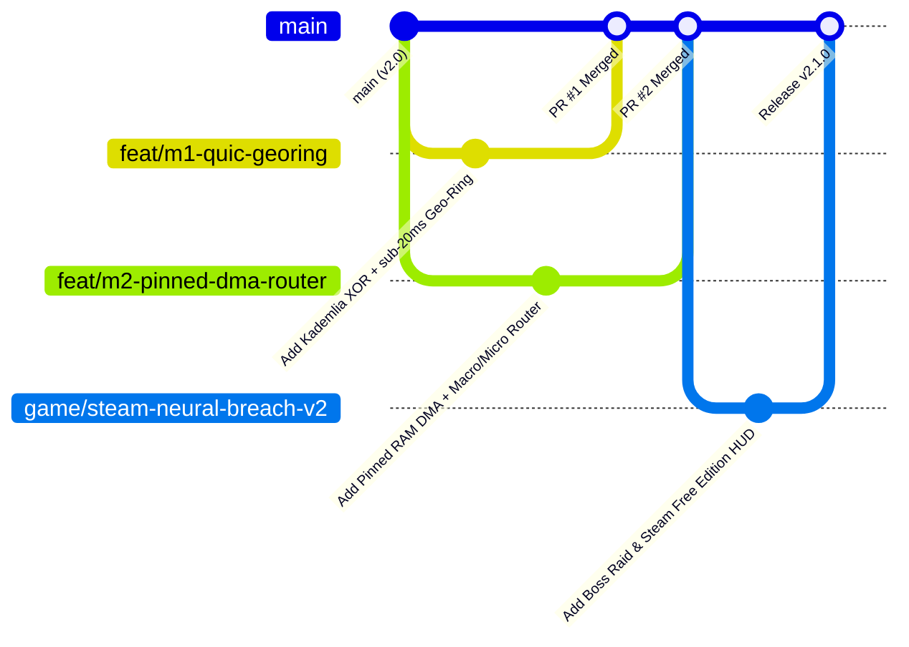

# Contributing to Project HiveMind 🧠⚡

> **Steam status:** The Hack-Miner and RTX Steam Tool package run locally from this repository. The default test App ID `3133700` belongs to another product on the public Steam Store; see [Steam integration status](docs/STEAM_STATUS.md).

Welcome to **Project HiveMind** — the open-source decentralized training and inference framework (think **SETI@home / Folding@home** meets **Petals** and **DiLoCo**) that aggregates idle consumer gaming GPUs (**8 GB–12 GB VRAM**) and local NVMe storage into a community-owned **Sparse Mixture-of-Experts (MoE)** cluster.

Whether you are a systems engineer optimizing **QUIC/Libp2p P2P rings**, a CUDA kernel hacker building **FP8 / asynchronous DMA pipelines**, an ML researcher training new **Hugging Face QLoRA domain experts**, or a game developer expanding **`HiveMind: Neural Breach`**, this guide explains how our peer development workflow operates.

---

## 🧭 Table of Contents

1. [Architecture Tracks for Contributors](#1-architecture-tracks-for-contributors)
2. [Branching Strategy & Naming Conventions](#2-branching-strategy--naming-conventions)
3. [Local Development Setup (8 GB GPU or CPU)](#3-local-development-setup-8-gb-gpu-or-cpu)
4. [Hard Engineering Invariants (The 4 Golden Rules)](#4-hard-engineering-invariants-the-4-golden-rules)
5. [Pull Request & Peer Review Lifecycle](#5-pull-request--peer-review-lifecycle)
6. [Adding a New Hugging Face Domain Expert & Bounty](#6-adding-a-new-hugging-face-domain-expert--bounty)
7. [`$HIVE` Contributor Bounties & Steam Leaderboard Recognition](#7-hive-contributor-bounties--steam-leaderboard-recognition)

---

## 1. Architecture Tracks for Contributors

Large-scale peer development is organized into **5 modular tracks** so contributors can work in parallel without merge conflicts:

| Track | Codebase Directory | Focus Area |
| :--- | :--- | :--- |
| **Core Pillars (1–3)** | `src/hivemind/core/` | Zero-copy 4-bit NF4 stream loading, DiLoCo-QLoRA inner loop, Top-$k$ + FP8 wire compression, Multi-Krum outer optimizer, Factored BTM Sparse MoE upcycling |
| **BOINC & OpenAI Gateway (M4)** | `src/hivemind/boinc/` | Deterministic Spot-Check Validator ($\epsilon \le 10^{-4}$), Workunit dispatcher, `/v1/chat/completions` OpenAI proxy, OPoI 5% activation audits |
| **Swarm Fabric (M1–M4)** | `src/hivemind/swarm/` | Kademlia XOR Geo-Rings (`<20ms` RTT), Pinned Host RAM async DMA (`cudaHostAlloc`), 2-Level Macro/Micro Router, Eagle/Medusa Token Tree Speculation ($\gamma=6$), `$HIVE` PoUW L1/L2 Ledger |
| **Zero-Intrusion Daemon** | `src/hivemind/client/` | Win32 `GetLastInputInfo` idle hook, GPU process scanner, `<1.5s` NVMe emergency checkpoint & VRAM yield, Steamworks `ISteamUser` / `ISteamLeaderboards` anti-Sybil bridge |
| **Steam Game (`AppID: 3133700`)** | `src/hivemind/game/` & `steam_dist/` | `HiveMind: Neural Breach // Hugging Face Hack-Miner`, Cyberpunk Web HUD (`:8090`), live HF shard recon, Boss Raid MoE fusion |

👉 See **[`docs/CONTRIBUTOR_TASKS_AND_BOUNTIES.md`](docs/CONTRIBUTOR_TASKS_AND_BOUNTIES.md)** for the full catalog of open engineering tasks and issue specs.

---

## 2. Branching Strategy & Naming Conventions

We use a structured **Topic-Branch + Pull Request** workflow against `main`:



### Branch Prefixes
Always branch off the latest `main` using one of these prefixes:

- `feat/m1-<slug>` — Milestone M1: Transport, Kademlia DHT, QUIC/Libp2p WebSockets, NAT traversal
- `feat/m2-<slug>` — Milestone M2: 3-Tier NVMe/Pinned-RAM/VRAM DMA streaming & Macro/Micro routing
- `feat/m3-<slug>` — Milestone M3: Eagle/Medusa token tree speculative decoding & FP8 wire kernels
- `feat/m4-<slug>` — Milestone M4: OpenAI `/v1/chat/completions` proxy, OPoI 5% audits & Layer-2 `$HIVE` state channels
- `expert/<domain>-<dataset>` — New Hugging Face QLoRA domain expert branch & bounty mission
- `game/<slug>` — `HiveMind: Neural Breach` Free Steam Edition (`AppID: 3133700`), Web HUD, or Steamworks SDK features
- `fix/<slug>` — Bug fixes, 8 GB VRAM OOM fixes, or CUDA determinism patches
- `docs/<slug>` — Documentation, benchmarks, tutorials, and community localization

---

## 3. Local Development Setup (8 GB GPU or CPU)

```bash
# 1. Fork & clone the repository
git clone https://github.com/<your-username>/HiveMind.git
cd HiveMind
git remote add upstream https://github.com/xaviercallens/HiveMind.git

# 2. Create your feature branch
git checkout -b feat/m2-double-buffered-dma

# 3. Run the 16-test verification suite (runs on 8 GB CUDA GPU or CPU fallback)
uv run --no-sync pytest tests/ -v

# 4. Run the end-to-end RTX PoC or the Gamified Hugging Face Hack-Miner
hivemind run-poc --model-id Qwen/Qwen2.5-0.5B --lora-rank 16 --inner-steps 10
hivemind play-hack-game --inner-steps 8
```

---

## 4. Hard Engineering Invariants (The 4 Golden Rules)

Every Pull Request is evaluated against four non-negotiable invariants:

1. **The 8 GB Consumer GPU VRAM Ceiling:**
   - Never materialize a full FP16/FP32 base model on CPU heap or GPU VRAM. Always use `stream_load_hf_causal_lm()` (meta-device initialization + streaming 4-bit NF4 double quantization) and factored `Linear + LoRA` / `FactoredLoRAExpertFFN` layers.
   - Peak allocated VRAM on `Qwen/Qwen2.5-0.5B` (96 MoE experts) must stay under **2.0 GB**, and `Qwen/Qwen2.5-7B` worker footprints must stay under **6.5 GB** on an 8 GB card.
2. **Bitwise / Bounded CUDA Determinism ($\epsilon \le 10^{-4}$):**
   - Training inner loops must remain compatible with `configure_deterministic_runtime()` (`CUBLAS_WORKSPACE_CONFIG=:4096:8`) so `DeterministicSpotCheckValidator` can replay any 50-step micro-segment within $\epsilon \le 10^{-4}$.
3. **Byzantine Resilience:**
   - Outer-loop aggregation and P2P inference changes must preserve **Multi-Krum $2\sigma$ filtering** (`src/hivemind/core/diloco_outer.py`) and **OPoI 5% activation cosine auditing** (`src/hivemind/swarm/swarm_fabric.py`).
4. **Zero-Intrusion Gamer Respect:**
   - Daemon background threads must never block or degrade foreground games; preemption to local NVMe must complete in **`< 1.5 seconds`**.

---

## 5. Pull Request & Peer Review Lifecycle

1. **Open an Issue or Claim a Bounty:** Comment on an existing issue in [Issues](https://github.com/xaviercallens/HiveMind/issues) or open one using our structured templates.
2. **Write Focused Commits:** Follow Conventional Commits (`feat(m2): ...`, `fix(validator): ...`, `game(hud): ...`, `docs(readme): ...`).
3. **Run the Test Suite:** Ensure `pytest tests/ -v` passes 100% of tests and add a new test covering your feature.
4. **Fill Out the PR Template:** Include your `measure_vram_footprint()` telemetry and deterministic spot-check results in `.github/PULL_REQUEST_TEMPLATE.md`.
5. **Merge Strategy:** PRs are merged via **Squash & Merge** (for single-feature branches) or **Merge Commit** (for multi-milestone release branches) after CI passes.

---

## 6. Adding a New Hugging Face Domain Expert & Bounty

Want to add a new domain expert (e.g., `Rust_Systems`, `Cybersecurity_Audit`, `Legal_Contracts`, `Multilingual_ES`) to the community MoE and the Steam Hack-Miner game?

1. Add a `HFMissionSpec` entry in [`DEFAULT_HACK_MISSIONS`](src/hivemind/game/hf_hack_miner.py) with:
   - `dataset_id`: A public Hugging Face dataset (streamed via `fetch_hf_domain_subset`).
   - `target_keywords`: High-signal domain tokens scored by `HFDataReconScanner`.
   - `bounty_prompt` & `bounty_reference_solution`: Held-out challenge used to measure Pre-LoRA vs. Post-LoRA perplexity drop.
2. Run `hivemind play-hack-game` to verify your new expert hot-plugs cleanly into the `BranchTrainMixMoE` (`E -> E+1`) and reduces held-out perplexity.
3. Submit a PR on branch `expert/<domain-name>`!

---

## 7. Non-Monetary Reciprocal Compute Points (`PTS` / `$HIVE`) & Opt-In Community GPU Testing

> [!IMPORTANT]
> **⚖️ Binding Non-Monetary Notice — No Financial Payment (`0.00 EUR / 0.00 USD`):**
> **Project HiveMind is a 100% voluntary, non-commercial open-source research project. No money, fiat currency, cryptocurrency, wage, or financial payment of any kind is or will ever be involved or paid.**
> All references to **"Points" (`PTS`)**, **`$HIVE`**, or **"Bounties"** represent **strictly non-monetary, symbolic compute-reciprocity accounting units** (like SETI@home or BOINC credits). They confer **exclusively computing processing benefits**—priority Sparse MoE inference tokens, speculative decoding bandwidth, and distributed QLoRA fine-tuning slots—**when the live production HiveMind Swarm is deployed, available, and actively used by a large community**.

Merged Pull Requests that advance **Swarm Fabric (M1–M4)**, **Season 7 (`Wave 6`) Tasks (`HM-S7-01`..`HM-S7-08` in [`ROADMAP.md`](ROADMAP.md))**, or add verified **Hugging Face Domain Experts** receive:
- **Genesis Contributor Compute-Points Allocation** recorded in the repository's non-monetary PoUW Contributor Registry.
- **Apex Architect Badge** in the `HiveMind: Neural Breach` Free Steam Edition (`AppID: 3133700`) Global Leaderboard.

### Opt-In Community GPU Testing (If Interested & Possible)
If you have a consumer GPU (`NVIDIA RTX 20/30/40/50`, `AMD Radeon RX 6000/7000 ROCm`, or `Apple Silicon MPS`) and want to help verify cross-vendor hardware performance (`< 1.5 GB` peak VRAM), run:

```bash
uv run python scripts/run_community_gpu_benchmark.py --contributor-handle <your-github-handle>
uv run pytest tests/test_community_gpu_benchmark.py -v
```

## 8. Co-Training Over the AMCP Bus (Federation v2) & Trainer Registration

You can contribute a GPU (or a CPU, for a smoke test) to co-training rounds that run over the project's AMCP bus on Kafka. A coordinator publishes signed task offers; your learner verifies each one **before running anything** (code pin, base-model hash, deadline), trains a LoRA delta on its own shard, and sends back only the delta. It needs only an **outbound** connection and never runs code from a message.

* How to join, step by step: `docs/FEDERATION_V2_AMCP_AGLETS.md` (section 8). Getting onto the overlay (a home machine behind NAT included): `docs/OVERLAY_OPEN_SOURCE_TUNNELS.md`.
* Learners work only 22:00-07:00 Paris with `--night-only`, never while the T4 governor reports inference in flight, and never below 4,300 MiB of free VRAM.
* **Never** put the shared signing key (`HIVEMIND_AMCP_HMAC_KEYS`) or a WireGuard private key in a commit, an issue, a chat or a log. Agents and coding assistants: `check_offer`, `check_result` and `RoundBook` in `src/hivemind/swarm/federation_agents.py` are the trust boundary; do not bypass them.
* No points are earned for these rounds yet: with fewer than five learners no Byzantine filter can verify a delta.
* A web "trainer" registration must respect the contract in `docs/FEDERATION_V2_AMCP_AGLETS.md` section 9.
