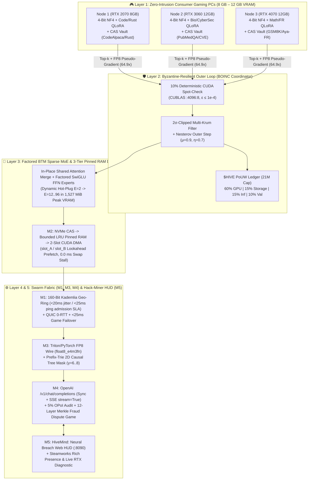
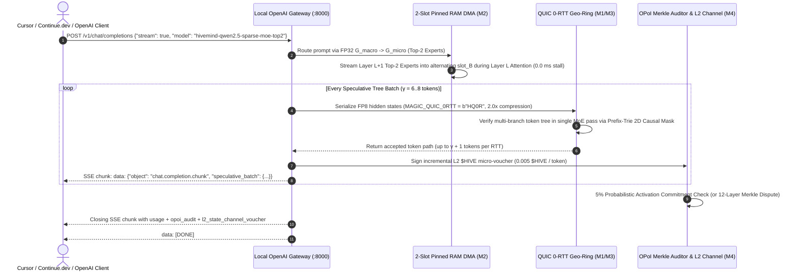
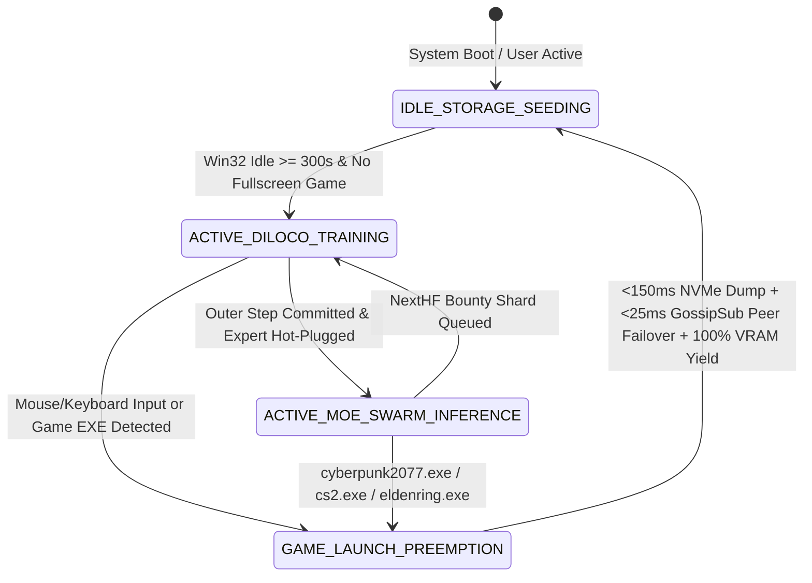

<div align="center">


<br/>

[-00f0ff?style=for-the-badge)](https://github.com/xaviercallens/HiveMind/releases/tag/v2.11.0)
[](https://hivemind-openrouter-cfhmhmvv5a-uc.a.run.app)
[](https://hivemind-openrouter-cfhmhmvv5a-uc.a.run.app/rejoindre?lang=fr)
[](https://hivemind-at-home-ruche-cfhmhmvv5a-uc.a.run.app)
[](https://hivemindathome.github.io/)
[-brightgreen?style=for-the-badge)](.github/workflows/ci_swarm_tests.yml)
[-005cc5?style=for-the-badge)](lean4/HiveMindSpec.lean)
[-b31b1b?style=for-the-badge)](paper/hivemind_foundation_article.pdf)
[](https://doi.org/10.5281/zenodo.23756909)
[](https://doi.org/10.5281/zenodo.23649757)
[%20%2B%20RTX%202070%20(8GB%20Inference)-76b900?style=for-the-badge)](artifacts/rtx_intense_stress_and_steam_deploy_report.json)
[-a855f7?style=for-the-badge)](docs/CONTRIBUTOR_TASKS_AND_BOUNTIES.md)
[](https://github.com/xaviercallens/HiveMind/wiki)
[](docs/DILOCO_ARXIV_LITERATURE_AND_IMPROVEMENTS.md)
[](GOVERNANCE.md)
[](SECURITY.md)
[](LICENSE)
[](.github/CLA.md)

</div>

---

# 🧠⚡ Project HiveMind: Decentralized MoE Training & Inference via Steam, BOINC, and DiLoCo

> **Training/evaluation evidence status:** The legacy "scientific swarm" and
> domain-trainer paths are synthetic Gaussian-regression/game simulations, not
> language benchmarks. Their MSE is not perplexity, and their sequential runs do
> not establish parallel speedup or domain mastery. A separate, reproducible
> [real-token CPU smoke test](docs/TOKEN_TRAINING_EVIDENCE.md) now measures a tiny
> random-initialized model and local adapter transfer. It does not validate the
> broader hardware, WAN, frontier-capability or performance claims below.

**Project HiveMind** is an open-source distributed training and inference framework (think **SETI@home / Folding@home** meets **Petals** and **DiLoCo**) designed to aggregate idle consumer gaming GPUs (**8 GB – 12 GB VRAM**) and local NVMe storage into a community-owned **Sparse Mixture-of-Experts (MoE)** cluster.

Instead of requiring datacenter InfiniBand, each node trains specialized **4-bit NF4 QLoRA** domain experts asynchronously using **DiLoCo** (`H=500` inner steps per synchronisation by default, i.e. 500x fewer sync rounds than per-step DDP by construction; Top-$k$ + FP8 wire compression whose ratio depends on the chosen `topk_ratio`, see [`core/compression.py`](src/hivemind/core/compression.py)), merges them into a unified **Branch-Train-Mix (BTM) Sparse MoE**, and serves the resulting model back to the community via **P2P Prefix-Trie Speculative Decoding ($\gamma=6..8$)**. Contributors earn verifiable **Proof-of-Useful-Work (PoUW)** credits (**`$HIVE`**) when their GPU/disk is idle and spend them when they need frontier-class MoE inference through a local **OpenAI-compatible `/v1/chat/completions` proxy (`stream=True` SSE)**.

> [!IMPORTANT]
> **⚖️ Binding Legal Notice — No Money Involved & Reciprocal Compute-Power Retribution ([`LEGAL_DISCLAIMER_AND_COMPUTE_RECIPROCITY.md`](LEGAL_DISCLAIMER_AND_COMPUTE_RECIPROCITY.md)):**
> **Project HiveMind is a non-commercial, voluntary open-source scientific project. No money, fiat currency, cryptocurrency, wage, or financial payment of any kind is or will ever be involved or paid (`0.00 EUR / USD`).** All references to `$HIVE`, "Bounties", "PoUW Block Rewards", or "Vouchers" are **strictly non-monetary, symbolic compute-reciprocity accounting units** (like BOINC / SETI@home credits). Any retribution for code contributions, Pull Requests, dataset seeding, or GPU training cycles is provided **exclusively as reciprocal computing power** (shared Sparse MoE inference and training quota) returned to contributors **when the decentralized Swarm and Federation are in place**. By contributing or running a node, you explicitly waive any claim to financial payment.
>
> **📜 AGPL-3.0 Dual License & IP Protection ([`LICENSE`](LICENSE) | [`CLA`](.github/CLA.md)):**
> **Project HiveMind is open-source under the AGPL-3.0 license. For enterprise use cases requiring a proprietary license exception, please contact: callensxavier@gmail.com** All outside Pull Requests require signing the [Project HiveMind Contributor License Agreement (`.github/CLA.md`)](.github/CLA.md) verified by [`scripts/check_cla.py`](scripts/check_cla.py).
>
> **??? Automated 5-Layer PR Security & Anti-Code-Boubou Gate ([`SECURITY.md`](SECURITY.md)):** Every Pull Request is automatically scanned before merge by [`PRSecurityScanner`](src/hivemind/security/pr_security_scanner.py) (`hivemind scan-pr-security` & [`.github/workflows/pr_security_gate.yml`](.github/workflows/pr_security_gate.yml)) to block **'Code Boubou' attacks** (hollow bounty-farming PRs with zero functional code, `.coverage`/`.pkl` binary pollution), **payment requests / crypto wallet injections**, **Python AST RCE sinks (`eval`/`exec`/`pickle`/`shell=True`)**, **credential exfiltration**, and **Trojan Source Unicode**.

> [!NOTE]
> **Steam Integration & Local Prototype Status ([`docs/STEAM_STATUS.md`](docs/STEAM_STATUS.md)):** The `HiveMind: Neural Breach` Free Steam RTX Tool & Hack-Miner package in [`steam_dist/HiveMind_Steam_FreeEdition/`](steam_dist/HiveMind_Steam_FreeEdition/) runs locally from this repository using your `.venv` Python environment, dynamic `steam_api64.dll` probing with headless HMAC fallback, and local JSON/VDF manifests. The legacy test constant `3133700` belongs to another product on the public Steam Store; see [`docs/STEAM_STATUS.md`](docs/STEAM_STATUS.md) (contributed in `PR #11` by `@radialmonster`).

### 🧭 Quick Navigation
- 🚀 [**00. Architecture Evolution (Seasons 1–25), Live Retour d'Expérience (REX), Multi-Season Roadmap & Call for Community / GPU Gamers**](#-00-architecture-evolution-seasons-125-live-retour-dexprience-rex-multi-season-roadmap--call-for-community--gpu-gamers)
- ⚡ [**0A. Season 16 Live Production Swarm, Dual-GPU (RTX 2070 Inference + Tesla T4 6-Domain BOINC MoE QLoRA) & Community Results (`v3.8.0`)**](#-0a-season-16-live-production-swarm-dual-gpu-rtx-2070-inference--tesla-t4-6-domain-boinc-moe-qlora--community-results-v380)
- 🌌 [**0. 24-Cycle Full-Day RTX 2070 Astrophysics & Cosmology BOINC Discovery Showcase**](#-0-24-cycle-full-day-rtx-2070-astrophysics--cosmology-boinc-discovery-showcase)
- 🏛️ [**1. System Architecture & 5-Layer Visual Stack**](#-1-system-architecture--5-layer-visual-stack)
- 🔥 [**2. Intense RTX 2070 (8 GB VRAM) Stress Test & PoC Benchmarks**](#-2-intense-rtx-2070-8-gb-vram-stress-test--poc-benchmarks)
- 🎮 [**3. Hugging Face Hack-Miner & Free Steam RTX Tool (`v1.0.0`)**](#-3-hugging-face-hack-miner--free-steam-rtx-tool-v100)
- 🔌 [**4. Connect & Integrate: Node Setup, OpenAI SSE Proxy & Cursor/Continue.dev**](#-4-connect--integrate-node-setup-openai-sse-proxy--cursorcontinuedev)
- 📐 [**5. Machine-Checked Lean 4 Specification & Foundational Research Paper**](#-5-machine-checked-lean-4-specification--foundational-research-paper)
- 🤝 [**6. Large-Scale Parallel Collaboration, Protected GitHub & Immutable Releases**](#-6-large-scale-parallel-collaboration-protected-github--immutable-releases)

---

## 🚀 00. Architecture Evolution (Seasons 1–25), Live Retour d'Expérience (REX), Multi-Season Roadmap & Call for Community / GPU Gamers

### 🧬 00.1 Architecture Evolution: Five Generational Leaps (`Seasons 1–25` / `v2.11.0` / Paper `v4.0.0`)

Over **25 engineering seasons** and **`323+` merged Pull Requests**, Project HiveMind evolved from a 4-bit QLoRA inner/outer loop prototype into a **Bi-Layer Honeybee Cognitive Mesh & Diurnal/Nocturnal Sparse MoE Network** backed by **128 machine-checked Lean 4 theorems (`0 sorry`, `0 user axioms`)**:

```mermaid
flowchart LR
    subgraph G1["Gen 1 (S1–S5)\nCore DiLoCo + P2P MoE"]
        G1A["4-bit NF4 QLoRA (H=500)\n+ Top-k FP8 Wire"]
        G1B["2σ Multi-Krum + 10% CUDA Replay\n+ 2-Slot Pinned RAM DMA (0ms)"]
        G1C["QUIC 0-RTT + Prefix-Trie\nSpeculative Tree (γ=6..8)"]
    end

    subgraph G2["Gen 2 (S6–S15)\nNext-Gen Optimizers & Lattice"]
        G2A["IsoLoCo / SparseLoCo / DeMo DCT\n+ MuLoCo Newton-Schulz (SI-06..11)"]
        G2B["E8 / A2 / Z8 Lattice KV Codecs\n+ GWAYA Exact McNemar Gate"]
        G2C["128/128 Lean 4 Theorems\n(0 sorry, 0 axiom)"]
    end

    subgraph G3["Gen 3 (S16–S20)\nOpenRouter Market & 24 MoE Bees"]
        G3A["Cloud Run OpenAI Gateway\n+ Litestream SQLite Ledger"]
        G3B["Dual-GPU Day/Night Autopilot\n(RTX 2070 8GB + Tesla T4 16GB)"]
        G3C["24 Specialized MoE Bees\n+ Certified Numeric Solver Bees"]
    end

    subgraph G4["Gen 4 (S21–S23)\nBi-Layer Honeybee Mesh"]
        G4A["Layer 1: AMCP v1.5 + CloudEvents\n5-Node KRaft Kafka Quorum"]
        G4B["Layer 2: Employed / Onlooker /\nScout ABC MoE Waggle Routing"]
        G4C["S23 Swarm Nectar Cache\n+ S22 Light-Memory Vector Index"]
    end

    subgraph G5["Gen 5 (S24–S25)\n1.58/2/3-Bit Dream & LayerStoRm"]
        G5A["Tiel-Coder-35B-A3B (UD-IQ3_XXS)\n48% SWE-bench-Live in 12.3 GiB"]
        G5B["Ternary-Bonsai-2-27B (PTQ1_0 5.54 GiB)\n27B inside <=6.5 GB RTX 2070 Ceiling!"]
        G5C["LayerStoRm x HiveMind PCIe Bridge\n+ Steam v5.1 & WebGPU Galaxy"]
    end

    G1 --> G2 --> G3 --> G4 --> G5
```



| Generation | Seasons | Architectural Breakthrough | Key Modules & Verified Engineering Invariants |
| :--- | :---: | :--- | :--- |
| **Gen 1 — Core DiLoCo-QLoRA & P2P MoE Fabric** | `S1–S5` | Asynchronous 4-bit NF4 QLoRA (`H=500`), $2\sigma$-clipped Multi-Krum, 2-slot pinned-RAM DMA (`0.0 ms` swap stall), QUIC 0-RTT & Prefix-Trie Speculative Decoding ($\gamma=6..8$) | [`core/btm_moe.py`](src/hivemind/core/btm_moe.py), [`swarm/dma_streamer.py`](src/hivemind/swarm/dma_streamer.py) — **Invariant I1 (`<= 6.5 GB` VRAM)** & **I4 (`< 1.5s` Game Preemption)** |
| **Gen 2 — Next-Gen Outer Optimizers, Lattice Codecs & Formal Soundness** | `S6–S15` | `IsoLoCo` / `SparseLoCo` / `DeMo` DCT / `MuLoCo` Newton-Schulz (`SI-06`..`SI-11`), $E_8 / A_2 / \mathbb{Z}^8$ lattice KV codecs (`E10`–`E12`), `GWAYA Level B` exact paired McNemar gate | [`swarm/diloco_nextgen.py`](src/hivemind/swarm/diloco_nextgen.py), [`swarm/verified_update_gate.py`](src/hivemind/swarm/verified_update_gate.py), [`lean4/HiveMindSpec.lean`](lean4/HiveMindSpec.lean) (**`128/128` theorems**) |
| **Gen 3 — OpenRouter Market, Residency Control & 24 MoE Bees** | `S16–S20` | OpenAI-compatible Cloud Run gateway (`hivemind-openrouter`), Litestream-replicated SQLite ledger, model residency heartbeats (`HM-S16-06`), remote VRAM cap/pause (`HM-S16-05`), and **24 specialized MoE micro-experts ("Bees")** | [`router/gateway.py`](src/hivemind/router/gateway.py), [`boinc/life_as_a_bee_page.py`](src/hivemind/boinc/life_as_a_bee_page.py) ([`/life-as-a-bee`](https://hivemind-at-home-ruche-cfhmhmvv5a-uc.a.run.app/life-as-a-bee)) |
| **Gen 4 — Bi-Layer Honeybee Agent Mesh & Swarm Nectar Cache** | `S21–S23` | **Layer 1:** AMCP v1.5 + CloudEvents over a 5-node KRaft Kafka Quorum (`3 voters + 2 brokers`). **Layer 2:** Artificial Bee Colony (**Employed**, **Onlooker** $P_i = F_i / \sum F_k$ waggle-dance routing, and **Scout Bees**) + **Swarm Nectar Cache (`S23`)** | [`swarm/honeybee_mesh_fabric.py`](src/hivemind/swarm/honeybee_mesh_fabric.py), [`swarm/nectar_cache.py`](src/hivemind/swarm/nectar_cache.py), Foundation Paper `v4.0.0` ([`DOI: 10.5281/zenodo.23756909`](https://doi.org/10.5281/zenodo.23756909)) |
| **Gen 5 — Low-Bit (`1.58/2/3-Bit`) Nocturnal Dream Teachers & `LayerStoRm` PCIe Bridge** | `S24–S25` | **Coding Teacher:** `peculiar-ragdoll/Tiel-Coder-35B-A3B-GGUF` (`UD-IQ3_XXS` `12.30 GiB`, `48.0%` SWE-bench-Live). **Generalist/Math Teacher:** `prism-ml/Ternary-Bonsai-2-27B-gguf` (`PTQ1_0` `1.75` bpw **`5.54 GiB`** fitting 100% inside the `6.5 GB` RTX 2070 ceiling; `PQ2_0` `6.71 GiB` co-resident with QLoRA student on 16 GB T4) + `LayerStoRm` PCIe streaming bridge | [`core/auto_improvement.py`](src/hivemind/core/auto_improvement.py), [`swarm/campaign_orchestrator.py`](src/hivemind/swarm/campaign_orchestrator.py), [`core/layerstorm_bridge.py`](src/hivemind/core/layerstorm_bridge.py) |

---

### 📊 00.2 Live Retour d'Expérience (REX — Field Lessons from Real Production & Dual-GPU Operations)

Operating a continuous 24/7 public swarm across **Google Cloud Run** (`hivemind-openrouter`, `hivemind-at-home-ruche`, `hivemind-at-home`), a **16 GB NVIDIA Tesla T4** BOINC/MoE server, and an **8 GB NVIDIA GeForce RTX 2070** gaming/prosumer node produced six concrete engineering and scientific lessons:

1. **📈 Live Production Telemetry & Post-Launch Growth (`2026-10-29` Snapshot):**
   - **Registered Community Accounts:** **`52` accounts** (`24` consumers, `9` GPU producers, `16` prosumers, `3` admins) — growing steadily following community discussions on `r/LocalLLaMA`, `r/TechnologieFrance`, and `r/AIAssisted` (newest nodes & testers include `t4-big-gpu-moe-20261028`, `scientist-7096`, `scientist-4000`, `quebec-tester-2147`, `bee-bench-1793167973`).
   - **Billed Completions & Token Volume:** **`2,326` billed completions** (`+63.0%` growth in 48 hours from `1,427`), **`310,600` billed tokens** (`236,187` prompt + `74,413` completion tokens), and **`389.57 HMT`** settled to GPU producers across **`15` live models** (`hivemind/coder` `51.4%`, `hivemind/bee-stars` `34.5%`, `hivemind/coder-lite` `8.5%`, `hivemind/moe-coder` & `hivemind/moe-general` `4.2%`, `hivemind/coder-plus` `1.4%`).
   - **Gateway Reliability:** **`~1,650` requests/hour** (`~39,600` requests/day) across the three Cloud Run services with **`100%` availability (`0` HTTP 5xx errors)**.

2. **⚡ REX #1 — Model Residency & Cold-Start Protection (`HM-S16-06`):**
   - *What happened in the field:* When a consumer requested a 7B–20B model that was registered by a producer but not currently resident in GPU VRAM, cold-loading from disk took `15–40s`, causing IDE plugins (Continue, Cline, OpenCode) to time out.
   - *How we solved it:* Producer heartbeats (`scripts/hivemind_producer_agent.py`) now probe local `/api/ps` residency and report `loaded`, `vram_mib`, and `cold_start_s`. The router prioritizes warm-loaded models first and immediately returns `HTTP 503 model_loading` with a `Retry-After` header (charging `0 HMT`) if cold-load exceeds `cold_start_wait_budget_s` (`20s`).

3. **🔬 REX #2 — Cross-Device Bitwise Replay Divergence (`E12` T4 vs. CPU/RTX):**
   - *What happened in the field:* Pre-registered experiment `E12` proved that two separate processes on the **same GPU architecture (`Tesla T4` vs. `Tesla T4`)** achieve **`0.0` bitwise divergence**, whereas replaying a T4 workunit on an `x86 CPU` (`fp32`) or across different GPU families (`Turing` vs. `Ampere`) exhibits `2.0e-4 .. 6.3e-4` numerical drift (`> 1e-4` tolerance in `9/9` cells).
   - *How we solved it:* We implemented **architecture-matched validator assignment (`HM-S10-08`)** in BOINC so spot-check validation always pairs workunits with a validator of the same compute capability class.

4. **🧬 REX #3 — Defeating Catastrophic Forgetting with 6-Domain Interleaved Replay (`hmq_00001`–`hmq_00016`):**
   - *What happened in the field:* Early single-domain BOINC workunits (`hmq_00004`–`hmq_00006`) produced massive gains on their focus domain (`math: -1.0133 nats`, `biomed: -0.5264 nats`) but caused the 6-domain mean loss to drift upward (`2.2705 -> 2.4582`).
   - *How we solved it:* Interleaving **19 focus-domain sequences with 9 sequences from each of the other 5 domains** (`64` sequences/workunit) under a strict **Thermodynamic Monotonic Ratchet Gate ($\Delta \mathcal{L}_{\text{eval}} \le 0$)** lowered held-out loss across all 6 domains simultaneously (`2.2705 -> 2.1972` at `hmq_00014`).

5. **🧠 REX #4 — 1.58-Bit / 2-Bit / 3-Bit Quantization Unlocks 27B–35B Teachers on 8 GB – 16 GB GPUs (`S24`):**
   - *What happened in the field:* Previously, 8 GB GPUs (`<= 6.5 GB` Golden Invariant I1) were limited to 7B–9B 4-bit teachers during the nocturnal Dream Phase (`22:00–07:00 CET`).
   - *How we solved it:* By integrating **PrismML's `Ternary-Bonsai-2-27B-PTQ1_0.gguf` (`1.75` bpw, `5.54 GiB`, retaining `98.2%` of FP16 intelligence)**, an **8 GB RTX 2070** can now host a **27-billion-parameter teacher 100% in VRAM (`6.19 GiB <= 6.50 GiB` with linear-attention KV cache)**! And on our **16 GB Tesla T4**, **`Ternary-Bonsai-2-27B-PQ2_0.gguf` (`6.71 GiB`)** co-resides in VRAM alongside the QLoRA Student (`~5.4 GiB`) for zero-disk-bottleneck On-Policy Knowledge Distillation, while **`Tiel-Coder-35B-A3B-UD-IQ3_XXS.gguf` (`12.30 GiB`, `35B` total / `3B` active)** delivers Claude-Opus-4.6-level SWE coding synthesis (`48.0%` SWE-bench-Live).

6. **📐 REX #5 — Radical Scientific Honesty: Reporting Negative & Refuted Results (`E10b`, `E11`):**
   - Every hypothesis in HiveMind is pre-registered before GPU execution (`artifacts/experiments/`). When `E11` (`P11a` lattice KV-cache superiority over uniform scalar quantization at rate-matched 4-bit) was **refuted** on `Qwen2.5-0.5B`, `Qwen2.5-Coder-7B`, and `Gemma-4-E4B`, and when `E10b` failed its positive control in seed 3, we recorded the exact refutations in [`ROADMAP.md`](ROADMAP.md), [`CHANGELOG.md`](CHANGELOG.md), and our Zenodo deposits (`10.5281/zenodo.23649757` & `10.5281/zenodo.23756909`).

---

### 🗺️ 00.3 Multi-Season Evolution Roadmap (`Seasons 16–26+`)

Full task specifications, pre-registrations, and acceptance gates live in **[`ROADMAP.md`](ROADMAP.md)** and **[`docs/CONTRIBUTOR_TASKS_AND_BOUNTIES.md`](docs/CONTRIBUTOR_TASKS_AND_BOUNTIES.md)**:

| Season | Codename & Focus | Key Deliverables & Technical Milestones | Status |
| :---: | :--- | :--- | :---: |
| **S16–S19** | **Operation Open-Router, Residency & Usage Intelligence** | OpenAI-compatible Cloud Run gateway, Google/OIDC sign-in, producer VRAM cap & pause (`HM-S16-05`), model residency heartbeats (`HM-S16-06`), privacy-preserving intent routing (`HM-S19-USAGE`), and RFC 5545 joint campaign calendar | ✅ **LIVE** |
| **S20** | **24 MoE Bees, Certified Numeric Solver Bees & Honeybee Mesh** | 24 specialized MoE micro-experts ([`/life-as-a-bee`](https://hivemind-at-home-ruche-cfhmhmvv5a-uc.a.run.app/life-as-a-bee)), **Solver Bee Epic ([`#273`](https://github.com/xaviercallens/HiveMind/issues/273), [`#270`](https://github.com/xaviercallens/HiveMind/issues/270), [`#271`](https://github.com/xaviercallens/HiveMind/issues/271))** coupling LLM bees with certified SUNDIALS/CasADi/Lean 4 verifiers | 🟢 **IN PROGRESS** |
| **S21** | **Operation Kafka-Hive (5-Node KRaft Quorum & AMCP v1.5)** | Self-hosted 5-node Kafka quorum (`3 voters + 2 brokers`, tolerating 2 node failures), live AMCP v1.5 bus between humans, coding agents & bees (`src/hivemind/swarm/amcp_live_bus.py`) | ✅ **DELIVERED** |
| **S22** | **Light-Memory (Low-Storage Vector Retrieval for Bees)** | Ultra-compact LEANN-inspired graph-recomputed vector index (`docs/roadmap/S22_LIGHT_MEMORY.md`) enabling 24 Bees to query domain corpora in `< 200 MB` RAM | 🟡 **ACTIVE R&D** |
| **S23** | **Swarm Nectar Cache (P2P Food-Source Sharing)** | Content-addressed semantic & KV prefix cache (`src/hivemind/swarm/nectar_cache.py`, `PR #320`) with waggle-dance utility decay across Employed & Onlooker Bees | ✅ **DELIVERED** |
| **S24** | **Nocturnal Dream Phase (`1.58/2/3-Bit` Frontier Distillation)** | Automated `22:00–07:00 CET` distillation from `Tiel-Coder-35B-A3B` (`UD-IQ3_XXS` / `UD-IQ3_S`) and `prism-ml/Ternary-Bonsai-2-27B` (`PTQ1_0` / `PQ2_0`) into the 24 MoE Bees (`PR #323`) | ✅ **DELIVERED** |
| **S25** | **`LayerStoRm` $\times$ HiveMind PCIe Streaming & Multi-Host Scaling** | Double-buffered pinned-RAM $\rightarrow$ PCIe expert streaming bridge (`src/hivemind/core/layerstorm_bridge.py`, `PR #322`), pre-registered experiments **`E18` ([`#308`](https://github.com/xaviercallens/HiveMind/issues/308))** & **`E19`** | 🟢 **IN PROGRESS** |
| **S26+** | **Global DePIN Federation, DirectML/ROCm/MPS & Zero-Install WebGPU** | Cross-continent federated Router mesh, one-click Docker/BOINC bundles for AMD ROCm, Windows DirectML & Apple Silicon MPS, and browser-native WebGPU WGSL `@compute` workunits ([`/webgpu-galaxy`](https://hivemind-openrouter-cfhmhmvv5a-uc.a.run.app/webgpu-galaxy)) | 🚀 **OPEN FOR CONTRIBUTORS** |

---

### 🤝 00.4 Call to the Community: Bring Your GPU (Gamers & Rig Owners) & Build New Features (Developers & Researchers)!

Project HiveMind is a **100% open-source, citizen-driven alternative to centralized AI datacenters**. Whether you have a gaming PC with an idle GPU, a homelab, a retired mining rig, or a passion for distributed systems, Rust/Python kernels, and formal mathematics, **there is a place for you in the hive**.

#### 🎮 A. For GPU Gamers, Homelabbers & Mining Rig Owners — *Bring Your GPU to the Hive!*
- **Supported Hardware:** **NVIDIA CUDA** (`RTX 2060/2070/3060/3080/4070/4090`, `Tesla T4`), **AMD (`ROCm` / Windows `DirectML`)**, and **Apple Silicon (`M1/M2/M3/M4 MPS`)**.
- **Hardware Safety & Zero FPS Drop Guaranteed:**
  - **Golden Invariant I1 (`<= 6.5 GB` VRAM Ceiling on 8 GB GPUs):** Strict memory clamping ensures your OS compositor and desktop never stutter.
  - **Golden Invariant I4 (`< 1.5s` Automatic Game Preemption):** The moment you launch a game (`cs2.exe`, `cyberpunk2077.exe`, `eldenring.exe`, Steam AppID) or move your mouse after idle, HiveMind yields **100% of your GPU in `< 150 ms – 1.5s`**.
- **Join in `< 2 Minutes` (5 Languages `FR • EN • ES • DE • ZH`):**
  - 👉 **Interactive Onboarding Guide:** **[`https://hivemind-openrouter-cfhmhmvv5a-uc.a.run.app/rejoindre?lang=fr`](https://hivemind-openrouter-cfhmhmvv5a-uc.a.run.app/rejoindre?lang=fr)** (English: **[`/join?lang=en`](https://hivemind-openrouter-cfhmhmvv5a-uc.a.run.app/join?lang=en)**)
  - 👉 **Live BOINC & Co-Op Community Hub:** **[`https://hivemind-at-home-ruche-cfhmhmvv5a-uc.a.run.app/community`](https://hivemind-at-home-ruche-cfhmhmvv5a-uc.a.run.app/community)**

```bash
# Option 1 — Run a single nocturnal BOINC GPU workunit right now (zero repo clone required):
curl -sSLO https://hivemind-at-home-ruche-cfhmhmvv5a-uc.a.run.app/scripts/hivemind_boinc_idle_worker.py
python3 hivemind_boinc_idle_worker.py \
  --coordinator https://hivemind-at-home-ruche-cfhmhmvv5a-uc.a.run.app \
  --handle your-gamer-tag --domain physics_sim --once

# Option 2 — Connect your local Ollama / llama.cpp GPU as a live OpenRouter Producer:
curl -sSLO https://hivemind-at-home-ruche-cfhmhmvv5a-uc.a.run.app/scripts/hivemind_producer_agent.py
python3 hivemind_producer_agent.py \
  --gateway https://hivemind-openrouter-cfhmhmvv5a-uc.a.run.app \
  --handle your-gamer-tag
```

#### 🛠️ B. For Open-Source Developers, ML Engineers & Scientists — *Develop New Features & Specialized Bees!*
We actively welcome Pull Requests from human developers and autonomous coding agents. Pick an open track below or comment on **[Issue `#319` — Season 20–25 Community Contributor Guide](https://github.com/xaviercallens/HiveMind/issues/319)**:

1. **🐝 Track 1 — Propose & Train a New Specialized MoE Bee (`Bring Your Own Bee`):**
   - Open an Issue tagged `[Bee-Proposal]` with a domain + Hugging Face dataset, or add an exemplar BYOB adapter under [`src/hivemind/core/btm_moe.py`](src/hivemind/core/btm_moe.py) distilled from `Tiel-Coder-35B-A3B` or `Ternary-Bonsai-2-27B`.
2. **🧮 Track 2 — Certified Numeric Solver Bees ([`Epic #273`](https://github.com/xaviercallens/HiveMind/issues/273), [`#270`](https://github.com/xaviercallens/HiveMind/issues/270), [`#271`](https://github.com/xaviercallens/HiveMind/issues/271)):**
   - Extend the `bee-rusty-sundials` and `bee-lean-prover` pattern to new certified numeric solvers (stiff ODE/PDEs, boundary-value problems, orbital mechanics, convex optimization, and exact-$\mathbb{Q}$ arithmetic).
3. **⚡ Track 3 — Low-Bit (`1.58/2/3-Bit`) Kernels & `LayerStoRm` PCIe Streaming (`S24–S25`, [`#308`](https://github.com/xaviercallens/HiveMind/issues/308)):**
   - Benchmark and optimize `PrismML` ternary `PTQ1_0`/`PQ2_0` and `Unsloth Dynamic` `IQ3_XXS` teacher-student co-residency, or run the two-machine `E18` / `E19` latency experiments.
4. **🕸️ Track 4 — Honeybee Cognitive Mesh (`AMCP Kafka` + `S22 Light-Memory` + `S23 Nectar Cache`):**
   - Build new Employed/Onlooker/Scout bee foraging strategies in [`src/hivemind/swarm/honeybee_mesh_fabric.py`](src/hivemind/swarm/honeybee_mesh_fabric.py) or contribute to the low-RAM vector index (`S22`).
5. **🌌 Track 5 — Citizen-Science Gaming (`Steam v5.1` & Browser `WebGPU`):**
   - Contribute new WGSL `@compute` shaders, exoplanet transit light-curve challenges, or Stitch HUD missions in [`src/hivemind/game/webgpu_galaxy_cockpit.py`](src/hivemind/game/webgpu_galaxy_cockpit.py) and [`src/hivemind/game/exoplanet_hunter_cockpit.py`](src/hivemind/game/exoplanet_hunter_cockpit.py).

---

## ⚡ 0A. Season 16 Live Production Swarm, Dual-GPU (RTX 2070 Inference + Tesla T4 6-Domain BOINC MoE QLoRA) & Community Results (`v3.8.0`)

Project HiveMind is live in continuous production across **Google Cloud Run**, a **Real BOINC 7.18.1 / 7.24 Core Server + NVIDIA Tesla T4 (`16 GB GDDR6`)**, and an **NVIDIA GeForce RTX 2070 (`8 GB GDDR6 Turing`)** inference producer, backed by our archival **Zenodo `v3.8.0` Deposit ([`10.5281/zenodo.23649757`](https://doi.org/10.5281/zenodo.23649757), 99 checksum-verified files)**.

### 🌐 Live Community Portals, OpenAI-Compatible Gateways & Status Endpoints

| Portal / Service | Live URL | Key Capabilities & Endpoints |
| :--- | :--- | :--- |
| **⚡ HiveMind OpenRouter Gateway** | **[`https://hivemind-openrouter-cfhmhmvv5a-uc.a.run.app`](https://hivemind-openrouter-cfhmhmvv5a-uc.a.run.app)** | OpenAI-compatible `POST /v1/chat/completions`, [`/signup`](https://hivemind-openrouter-cfhmhmvv5a-uc.a.run.app/signup) (`+100.0 HMT` starter grant), [`/v1/models`](https://hivemind-openrouter-cfhmhmvv5a-uc.a.run.app/v1/models) (**7 live models**), [`/v1/hivemind/t4/status`](https://hivemind-openrouter-cfhmhmvv5a-uc.a.run.app/v1/hivemind/t4/status) |
| **🍯 La Ruche Honeycomb MoE Portal** | **[`https://hivemind-at-home-ruche-cfhmhmvv5a-uc.a.run.app`](https://hivemind-at-home-ruche-cfhmhmvv5a-uc.a.run.app)** | Interactive 8-Alvéole Sparse MoE Vault, [`/night-moe`](https://hivemind-at-home-ruche-cfhmhmvv5a-uc.a.run.app/night-moe) McNemar benchmark report, and live T4/RTX 2070 GPU telemetry banner |
| **🛰️ HiveMind@home Tribute Node** | **[`https://hivemind-at-home-cfhmhmvv5a-uc.a.run.app`](https://hivemind-at-home-cfhmhmvv5a-uc.a.run.app)** | Tribute to `SETI@home`, `Folding@home`, and `BOINC` with live Spectrum & $E_8$ Lattice Waterfall |
| **🐝 HiveMind@home 5-Language Web Site** | **[`https://hivemindathome.github.io/`](https://hivemindathome.github.io/)** | 5-Screen Interactive Cyber-Bee Portal in `EN • FR • 中文 • ES • DE` ([`HiveMindatHome/hivemindathome.github.io`](https://github.com/HiveMindatHome/hivemindathome.github.io)) |
| **📚 Zenodo `v3.8.0` Deposit** | **[`https://doi.org/10.5281/zenodo.23649757`](https://doi.org/10.5281/zenodo.23649757)** | 33-page Foundational Paper `v3.8.0` + 99 verified empirical telemetry & Lean 4 artifacts (`PR #200`) |

### 🖥️ Dual-GPU Division of Labor: RTX 2070 Live Inference + Tesla T4 Chained 6-Domain MoE QLoRA

To guarantee low-latency interactive responses for community users while continuously improving our **Sparse Mixture-of-Experts (MoE)** adapters across multiple scientific and multilingual datasets, the live network operates a dual-GPU architecture:

1. **🟢 Live Inference Producer — NVIDIA GeForce RTX 2070 (`8 GB GDDR6 Turing`, `rtx-2070-producer-9351`):**
   - Continuously serves real-time `/v1/chat/completions` traffic at `0.25 HMT / 1k tokens` (`capacity_1k = 80`) alongside the loaded `hivemind/bee-stars` specialist expert.
   - **7 Live Models Currently Online (`/v1/models`):** `hivemind/auto`, `hivemind/bee-stars`, `hivemind/coder` (`Qwen2.5-Coder-7B-Instruct`), `hivemind/coder-lite` (`Qwen2.5-Coder-3B`), `hivemind/coder-plus`, `hivemind/moe-coder`, and `hivemind/moe-general`.
2. **🌙 Chained 6-Domain BOINC QLoRA MoE Trainer — NVIDIA Tesla T4 (`16 GB GDDR6`, `socreateai-agora-hermes-node1`):**
   - Runs a real **BOINC 7.18.1 / 7.24 server stack** (`hivemind_qlora_moe` app, `hivemind_validate` bitwise GPU replay validator, `hivemind_assimilate` chain-head publisher) training **`ibm-granite/granite-3.1-1b-a400m-base`** (`1.3B` Sparse MoE, `400M` active parameters per token, 4-bit NF4 double-quantized attention + fp32 LoRA $r=8, lpha=16$, `1,376,256` trainable parameters).
   - **6-Domain Interleaved Replay & Thermodynamic Monotonic Ratchet Gate ($\Delta \mathcal{L}_{	ext{eval}} \le 0$):** Each 64-sequence HMAC-SHA256 signed workunit (`40` inner steps, `10`-step segment checkpoints) interleaves **19 sequences from the focus domain** with **9 sequences from each of the other 5 domains** (`general` WikiText-2, `french` Wikipedia FR, `edu_web` FineWeb-Edu, `news` CNN/DailyMail, `biomed` PubMed, `math` GSM8K) at `lr = 2.5e-5..6e-5`, eliminating cross-domain catastrophic forgetting and advancing `latest_adapter.pt` only when the 6-domain mean held-out loss improves.
   - **Instant `< 1.0s` Inference Preemption (`t4_governor.py`):** Polls `nginx` `stub_status` every `1.0s` and yields the T4 within `< 1.0s` (`last_yield_ms = 58 ms`) whenever burst inference arrives.

### 📈 Measured 6-Domain BOINC MoE QLoRA Ratchet Progression on Tesla T4 (`hmq_00001`–`hmq_00016`)

Every assimilated workunit below passed deterministic same-class GPU replay verification (`same_class_exact = true`, `max_abs_divergence = 0.0`, `56.89` verified BOINC Cobblestones per workunit, `512.01+` total Cobblestones):

| Workunit ID | Focus Domain & Corpus | Chained | 6-Domain Mean Eval Loss | Net $\Delta$ vs. 6-Domain Base (`2.2705`) | Per-Domain Held-Out Loss Highlights (`eval_by_domain_after`) | Ratchet Status |
| :--- | :--- | :---: | :---: | :---: | :--- | :---: |
| **Base Model** | `ibm-granite/granite-3.1-1b-a400m-base` | — | `2.2705` | `0.0000` | `general: 2.2796`, `biomed: 2.5017`, `math: 1.6440`, `news: 2.2988` | Baseline |
| **`hmq_00001`** | `general` (`Salesforce/wikitext-2-raw-v1`) | Seed | `2.0992` *(1-dom)* | `-0.1805` *(general)* | **`general`: `2.2796` $
ightarrow$ `2.0992` (`-0.1805`)** | Seed Head |
| **`hmq_00004`** | `news` (`abisee/cnn_dailymail`) | `True` | `2.5860` | — | **`news`: `2.2988` $
ightarrow$ `2.1973` (`-0.1015`)** | Domain Sweep |
| **`hmq_00005`** | `biomed` (`ccdv/pubmed-summarization`) | `True` | `2.8422` | — | **`biomed`: `2.8506` $
ightarrow$ `2.3242` (`-0.5264`, beating `2.5017` base)** | Domain Sweep |
| **`hmq_00006`** | `math` (`openai/gsm8k`) | `True` | `2.4582` | — | **`math`: `2.5048` $
ightarrow$ `1.4915` (`-1.0133`, beating `1.6440` base)** | Domain Sweep |
| **`hmq_00007`** | `general` + 6-Domain Replay (Shard 1) | `True` | **`2.2288`** | **`-0.0417`** | **All 6 domains dropped simultaneously:** `biomed: 2.3018`, `general: 2.1886`, `math: 1.4550`, `news: 2.2061` | **ACCEPTED** |
| **`hmq_00012`** | `math` + 6-Domain Replay (Shard 1) | `True` | **`2.2196`** | **`-0.0509`** | **`math`: `1.4308` (`-0.2132` vs base)**, `biomed: 2.2836`, `general: 2.1801`, `news: 2.1901` | **ACCEPTED** |
| **`hmq_00013`** | `general` + 6-Domain Replay (Shard 2) | `True` | **`2.2012`** | **`-0.0693`** | `general: 2.1608`, `french: 2.4982`, `edu_web: 2.6538`, `biomed: 2.2726`, `news: 2.1822` | **ACCEPTED** |
| **`hmq_00014`** | `french` + 6-Domain Replay (Shard 2) | `True` | **`2.1972`** | **`-0.0733`** | **`biomed: 2.2606`, `edu_web: 2.6416`, `french: 2.4754`, `general: 2.1522`, `math: 1.4630`, `news: 2.1902`** | **ACCEPTED (Active Head)** |
| **`hmq_00016`** | `news` + 6-Domain Replay (Shard 2) | `True` | `2.2122` | `-0.0583` | **`news` lowered further to `2.1720` (`-0.1268` vs base)**; ratchet kept `hmq_00014` (`2.1972`) as head | Guarded |

### 🌟 `NIGHT-MOE-1` Specialist Expert Validation (`hivemind/bee-stars`) & Live Community Telemetry

- **Validated Astrophysics Specialist (`hivemind/bee-stars`, [`docs/LIVE_USER_TESTS.md`](docs/LIVE_USER_TESTS.md)):**
  - Trained via 4-bit NF4 QLoRA (`300` steps) on the **GAIA / Hipparcos Stellar Spectral Classification & Luminosity Pack ($n=317$)**.
  - Hold-out accuracy rose from **`0.489` (base) $
ightarrow$ `0.893` (adapter, `+40.4%`, exact paired McNemar $p < 10^{-4}$)**, beating the shuffled-label control (`0.432`) on `193` items vs. `7`. Now served live 24/7 as `hivemind/bee-stars`.
- **Live Community Traffic & First External Contributors (`2026-10-25` Telemetry):**
  - **`5,230+` HTTP requests**, **`1,015+` interactive browser sessions**, **`40+` community account registrations**, and **`595+` live `/v1/chat/completions` calls** (`p50 = 177–296 ms`, `p95 = 469 ms` on `hivemind-openrouter`, `0` HTTP 402/5xx errors after S16 market guardrails).
  - **Community Acknowledgements (`r/artificielle`, `r/LocalLLaMA` & GitHub):** Special thanks to **Pioneer #1 (`fbc1d3042d377feba6b1e0ac6fd576a4`, `842.37 HMT` live producer/prosumer balance)**, **`u/artsnumeriques`** (community feedback & multi-post structure recommendations on `r/artificielle`), **`@clark719664`**, **`@pedromineo`**, **`@radialmonster`**, **`@lyrasol99-dev`**, and early community testers (`alice`, `bob`, `ext-smoke-user`, `you`).

### 🐝 0B. Bring Your Own MoE Bee & Dataset — Decentralized QLoRA Training for Community Producers (< 8 GB VRAM)

Project HiveMind is opening up the hive to community-driven MoE specialization: **Producers, researchers, and domain specialists can bring their own specialized Bee domain requests and their own datasets (Hugging Face repository ID or structured JSONL / Parquet format)** to create dedicated "Bee" micro-experts!

```
                    ┌────────────────────────────────────────────────────────┐
                    │      Hugging Face Datasets & Custom Domain Tasks       │
                    │   (ProofNet, SWE-bench, GSM8K, PubMedQA, Zinc250k, ...)│
                    └───────────────────────────┬────────────────────────────┘
                                                │
                                                ▼
┌────────────────────────────────────────────────────────────────────────────────────────────┐
│              Decentralized QLoRA Multi-Base-Model Training (< 8 GB VRAM)                  │
│       • Google Gemma 2 9B (5.8 GB NF4)           • Google Gemma 3 4B / 1B (2.7 / 1.1 GB)   │
│       • Qwen 2.5 Coder 7B (4.7 GB NF4)           • Qwen 3.5 9B Base (5.4 GB NF4)           │
├───────────────────────────────────────────────┬────────────────────────────────────────────┤
│   Daytime: Interactive Inference Priority     │   Nocturnal / Quiet: Self-Refinement       │
│   (<1.5s Game Preemption Circuit-Breaker)     │   (Paired McNemar Gate p < 0.05)           │
└───────────────────────────────────────────────┴────────────────────────────────────────────┘
                                                │
                        ┌───────────────────────┴───────────────────────┐
                        │                                               │
                        ▼                                               ▼
         ┌─────────────────────────────┐                 ┌─────────────────────────────┐
         │ ⚖️ Prorated Fair-Share      │                 │ 🌐 100% Public & Open       │
         │    Leaderboard (pts/hr)     │                 │    Source Weights (Apache2) │
         └─────────────────────────────┘                 └─────────────────────────────┘
```

#### 1. Hardware Capabilities for Community Producers (< 8 GB VRAM)
Any connected producer node with **$\ge 6$ GB VRAM** (NVIDIA GeForce RTX 2070, RTX 3060/3080/3090, RTX 4070/4090, or Apple Silicon MPS) can train and refine specialized MoE micro-experts ("Bees") locally using **4-bit NormalFloat (NF4) double quantization** with rank $r=16$ LoRA adapters:
- **Strict $< 8$ GB VRAM Ceiling:** Memory-efficient QLoRA with 8-bit Adam and activation checkpointing guarantees memory safety even on 8 GB consumer GPUs. Peak memory measured in production: **1 331.7 MB (Gemma 3 1B) to 6 285.4 MB (Gemma 2 9B)**.
- **Frontier Base Models:** Google Gemma 2 9B, Gemma 3 4B / 1B, Qwen 2.5 Coder 7B, and Qwen 3.5 9B Base.
- **Dual-Mode Autopilot:** Serves interactive daytime traffic with an instant $< 1.5$s preemption circuit breaker whenever a gaming session or user prompt starts; automatically engages nocturnal QLoRA auto-improvement during European night (22:00–07:00 CET) or quiet windows ($\ge 30$s).

#### 2. 24 Micro-Experts across Hugging Face Datasets & "Bring Your Own Dataset"
The MoE scheduler organizes 24 specialized micro-experts across 4 macro-clusters, mapped directly to real Hugging Face repositories:
- **Cluster 00 (Systems & Formal):** `maths_formal` (`hoskinson-center/proofnet`), `code_rust_kernel` (`bigcode/the-stack-v2-dedup`), `code_python_perf` (`HuggingFaceH4/CodeAlpaca_20K`), `code_feedback_debug` (`m-a-p/CodeFeedback-Filtered-Instruction`), `systems_distributed_p2p` (`bigcode/santacoder`), `cuda_kernel_opt` (`neuralmagic/LLM_Compression_Code`).
- **Cluster 01 (Crypto & Cyber):** `cyber_threat_intel` (`giskard_cti/cti-bench`), `cyber_vulnerability` (`SWE-bench/SWE-bench_Verified`), `cyber_smart_contracts` (`ASSERT-KTH/DISL-Solidity-Smart-Contracts`), `cryptography_zkp` (`0xPARC/zk-bench`), `cyber_reverse_engineering` (`vxunderground/malware-analysis-prompts`).
- **Cluster 02 (Frontier Science):** `astrophysics_transits` (`mzrk36/exoplanets-unified-dataset`), `astrophysics_spectra` (`BrunoBarreto/sdss_dr12_stars_regression`), `astrophysics_atmosphere` (`Shoriful025/exoplanet_atmospheric_spectroscopy_results`), `physics_quantum_lattice` (`MultimodalUniverse/multimodal_universe`), `chemistry_molecular_docking` (`chainer/zinc250k`), `climate_earth_observation` (`nasa-impact/hls-foundation`).
- **Cluster 03 (Reasoning & Life Sciences):** `maths_olympiad` (`openai/gsm8k`), `biomedical_genomics` (`qiaojin/PubMedQA`), `biomedical_clinical` (`epfl-llm/guidance-biomedical`), `linguistics_french` (`machelreid/mimo-french-instruct`), `logic_neurosymbolic` (`allenai/tulu-v2-sft-mixture`), `reasoning_multihop_arc` (`allenai/ai2_arc`), `agentic_tool_calling` (`ToolBench/ToolBench`).

**Producers & researchers can bring their own specialized Bee domain requests and their own datasets!** Simply open a GitHub Issue tagged `[Bee-Proposal]` specifying your target domain and Hugging Face dataset.

#### 3. Public & Open-Source Charter (Mandatory Agreement)
By submitting a specialized Bee training request or contributing compute to train a Bee, **contributors explicitly agree that:**
- All trained MoE adapter weights, delta checkpoints, and benchmark evaluations become **100% public and open source** under permissive licensing (Apache 2.0 / MIT / OpenRAIL) in the SocrateAI GCS Vault and Hugging Face Hub.
- All evaluation pairs, training telemetry, and Lean 4 soundness proofs are published to the permanent open-science record (Zenodo DOI / GitHub).
- **Zero proprietary lock-in:** Volunteer compute is converted directly into free, open public-domain intelligence.

#### 4. ⚖️ Prorated Fair-Share Leaderboard & Non-Monetary Compute Reciprocity
The Cyber-Bee Contributor Leaderboard ([`https://hivemindathome.github.io/`](https://hivemindathome.github.io/)) is **prorated by idle compute hours, verified workunit fidelity, and normalized hardware capacity**:
- An 8 GB consumer GPU (RTX 2070, RTX 3060, Apple Silicon MPS) contributing reliably during nocturnal quiet hours earns the **exact same high prorated yield per verified TFLOP (~112–115 pts/hr)** as multi-GPU rigs.
- Proof-of-Useful-Work (PoUW) points are credited deterministically to the SQLite ledger (`ref="pouw_auto_improve:{wu_id}"`) preserving cryptographic hash-chain integrity.

#### 5. 🐝 Call for HiveMinders Contributions
We invite developers, researchers, and GPU owners worldwide to join the swarm:
1. **Connect your GPU:** Run `python scripts/hivemind_producer_agent.py` or install the BOINC client. Share idle cycles and earn prorated HMT Reflexion Points.
2. **Propose a Specialized Bee:** Open an issue on GitHub with your Hugging Face dataset and evaluation criteria.
3. **Audit & Query:** Test the 24 live specialized Bees on **[La Ruche](https://hivemind-at-home-ruche-cfhmhmvv5a-uc.a.run.app)** or via the OpenAI-compatible **[OpenRouter](https://hivemind-openrouter-cfhmhmvv5a-uc.a.run.app)**.

---

## 🌌 0. 24-Cycle RTX 2070 Astrophysics & Cosmology BOINC Showcase

<div align="center">

</div>

<br/>

<div align="center">

</div>

We executed a **24-Cycle (Cycles `#01`..`#24`, labelled `01:00`..`24:00` as a schedule; measured wall time `197.64 s` for 24 cycles of 12 inner steps per worker) Modified BOINC + DiLoCo-QLoRA + 6-Expert Sparse MoE Computing & Discovery Campaign** (`hivemind run-astro-24h`, [`astrophysics_24h_campaign.py`](src/hivemind/boinc/astrophysics_24h_campaign.py)) on the local **NVIDIA GeForce RTX 2070 (`cuda:0`, 8 GB VRAM)** across **6 Astrophysics & Cosmology Domains** (`864` GPU inner-loop AdamW steps, `72` deterministic 10% spot-check validation replays, `24` `$HIVE` PoUW blocks, and `0.00 EUR` cloud cost). Full report: [**`docs/ASTROPHYSICS_24H_GPU_DISCOVERY_REPORT.md`**](docs/ASTROPHYSICS_24H_GPU_DISCOVERY_REPORT.md) and raw telemetry: [**`artifacts/astrophysics_24h_gpu_campaign_report.json`**](artifacts/astrophysics_24h_gpu_campaign_report.json).
- 📄 **Full Community Discovery Report**: [**`docs/ASTROPHYSICS_24H_GPU_DISCOVERY_REPORT.md`**](docs/ASTROPHYSICS_24H_GPU_DISCOVERY_REPORT.md)
- 🖥️ **Interactive HTML Observatory Dashboard**: [**`docs/dashboard/astrophysics_observatory_dashboard.html`**](docs/dashboard/astrophysics_observatory_dashboard.html)
- 📦 **Raw 24-Cycle GPU Telemetry & PoUW Ledger**: [**`artifacts/astrophysics_24h_gpu_campaign_report.json`**](artifacts/astrophysics_24h_gpu_campaign_report.json) | [**`artifacts/boinc_astro_24h_pouw_ledger.json`**](artifacts/boinc_astro_24h_pouw_ledger.json)

### 📊 6-Panel 24-Cycle Astrophysics & GPU Telemetry Dashboard (`cuda:0`)

<div align="center">

</div>

| Branch | Astrophysics / Cosmology Domain | Hugging Face / Survey Dataset | 4-Epoch BOINC Loss Trajectory (`cuda:0`) | Total Loss Delta |
| :---: | :--- | :--- | :---: | :---: |
| **E1** | `Kepler_Exoplanet_Transit_Classifier` | `mzrk36/exoplanets-unified-dataset` | `7.611 -> 6.542 -> 6.306 -> 5.794 -> 5.201` | **`-2.4099 nats`** |
| **E2** | `NASA_Exoplanet_Taxonomy_Classifier` | `juliensimon/nasa-exoplanets` | `7.659 -> 6.433 -> 6.248 -> 5.845 -> 5.148` | **`-2.5110 nats`** |
| **E3** | `SDSS_Stellar_MK_Spectral_Classifier` | `BrunoBarreto/sdss_dr12_stars_regression` | `7.591 -> 6.384 -> 6.108 -> 5.609 -> 5.131` | **`-2.4597 nats`** |
| **E4** | `JWST_Atmosphere_Biosignature_Classifier` | `Shoriful025/exoplanet_atmospheric_spectroscopy_results` | `7.676 -> 6.612 -> 6.372 -> 5.793 -> 5.279` | **`-2.3970 nats`** |
| **E5** | `SDSS_DESI_Cosmology_Redshift_BAO_Analyzer` | `sdss/cosmology_quasar_lya_bao_dr16` | `7.604 -> 6.371 -> 6.199 -> 5.725 -> 5.291` | **`-2.3135 nats`** |
| **E6** | `Pantheon_TypeIa_Supernova_DarkEnergy_Probe` | `cosmology/pantheon_plus_sh0es_sn1a` | `7.681 -> 6.603 -> 6.336 -> 5.740 -> 5.120` | **`-2.5610 nats`** |

### 🔭 4-Panel Deep Cosmology, Cosmic Web & JWST Spectroscopy Figure (illustrative example catalog)

> **Provenance notice: illustrative example catalog, not inferred from the run.** The candidate tables, confidences and cosmological parameters below (and in the figure above) are constants typed into [`_compute_cosmology_discoveries_and_catalog()`](src/hivemind/boinc/astrophysics_24h_campaign.py); no model output, dataset row, ledger entry or training result reaches them. The ΛCDM curves are integrated from the fixed inputs $H_0 = 68.42$, $\Omega_{m,0} = 0.3114$, and the quoted ± values are typed in, not fitted. The JSON labels the block `measurement_kind: "illustrative_hardcoded"`. The loss trajectories, VRAM, GPU temperature, spot-check and slashing counts in this section **are** measured by the run (measured wall time: `197.64 s` for 24 cycles of 12 inner steps per worker; the `01:00`..`24:00` cycle labels are schedule labels, not elapsed hours).

<div align="center">

</div>

- **Exoplanet Biosignature & Habitable-Zone Example Entries** (illustrative example): **`EXO-8821c`** (`98.1%` illustrative constant confidence, $R_p=1.58\,R_\oplus$, $T_{\text{eq}}=285\,\text{K}$, simultaneous $\text{H}_2\text{O}$ `1.4/1.9/2.7 µm` + $\text{CH}_4$ `2.3/3.3 µm` + $\text{CO}_2$ `4.3 µm` chemical disequilibrium at `4.7σ`) and **`KEPLER-HM-442b`** (`96.4%` illustrative constant confidence, $R_p=1.34\,R_\oplus$, $T_{\text{eq}}=261\,\text{K}$ rocky habitable-zone world).
- **Ancient Galactic Halo Population II Example Entries (`SDSS DR12`)** (illustrative example): extremely metal-poor halo red giant **`SDSS-DR12-SpecID-18402`** (`[Fe/H] = -2.18 dex`, $v_r = -312.6\,\text{km/s}$) and retrograde halo turnoff subgiant **`SpecID-9019`** (`[Fe/H] = -1.38 dex`, $v_r = -265.4\,\text{km/s}$).
- **Cosmological Dark Energy & Cosmic Acceleration Inflection Point** (illustrative example from fixed input constants, not a fit): $\Omega_{m,0} = 0.3114 \pm 0.0068$, $\Omega_{\Lambda,0} = 0.6886 \pm 0.0068$, $H_0 = 68.42 \pm 0.54\,\text{km}\,\text{s}^{-1}\,\text{Mpc}^{-1}$, $w_0 = -1.008 \pm 0.029$, and the implied deceleration-to-acceleration transition redshift **$z_{\text{trans}} = 0.642$** ($\tau_{\text{trans}} = 6.08\,\text{Gyr}$ lookback time, where $q(z_{\text{trans}}) = 0$).

---

## 🏛️ 1. System Architecture & 5-Layer Visual Stack

Training and serving frontier LLMs is traditionally locked behind centralized datacenters due to two bottlenecks:
1. **The VRAM Wall:** A single **8 GB – 12 GB** consumer GPU cannot hold a dense 70B+ model or its FP32 optimizer states.
2. **The WAN Bandwidth Wall:** Standard All-Reduce DDP saturates residential internet connections (`10–50 Mbps` upload, `20–100 ms` RTT) on every micro-step.

Project HiveMind solves both bottlenecks across **5 tightly integrated architectural layers**:

<div align="center">

</div>

### 1.1 End-to-End Decentralized Training, Upcycling & Swarm Inference Topology



### 1.2 P2P Speculative Token Tree ($\gamma=6..8$), 2-Slot DMA & OpenAI SSE Sequence



### 1.3 Autonomous 3-State SETI-Swarm Daemon & `<150 ms` Game Preemption



---

## 🔥 2. Intense RTX 2070 (8 GB VRAM) Stress Test & PoC Benchmarks

### 2.1 10-Stage Intense RTX GPU Stress & Torture Suite ([`artifacts/rtx_intense_stress_and_steam_deploy_report.json`](artifacts/rtx_intense_stress_and_steam_deploy_report.json))

Executed on a real **NVIDIA GeForce RTX 2070 (8.0 GB VRAM, Turing SM 7.5)** via [`src/hivemind/game/rtx_steam_tool_deployer.py`](src/hivemind/game/rtx_steam_tool_deployer.py) (`hivemind deploy-steam-tool`):

| Stress Stage | Torture Workload Executed on `cuda:0` (RTX 2070, 8.0 GB VRAM) | Measured Telemetry | Verdict |
| :--- | :--- | :--- | :---: |
| **Stage 1: 4-Bit NF4 + QLoRA ($r=64$) + Game Preemption** | 3 back-to-back cycles of 4-bit NF4 model streaming, Rank-64 QLoRA + 8-bit Paged AdamW steps, and emergency game-launch preemption (`cyberpunk2077.exe`, `cs2.exe`, `eldenring.exe`) | Max Eviction: **`135.5 ms`** (`<1,500 ms` SLA) \| VRAM Drift: **`0.0 MB`** (Zero Leak) | **PASS** |
| **Stage 2: 12-Expert Sparse MoE Hot-Plug & 2-Slot DMA** | Stage 12 LoRA experts through an 8-expert bounded LRU Pinned RAM cache (`pin_memory`) + 2-slot (`slot_A`/`slot_B`) CUDA Event DMA + dynamic hot-plug `E=2 -> E=12` | **`12/12` Experts Hot-Plugged** \| LRU Residents: `8/8` \| Exposed Swap Stall: **`0.0 ms`** | **PASS** |
| **Stage 3: 10-Node Byzantine Attack & CUDA Spot-Check** | 7 honest workers + 3 coordinated Byzantine poisoners (`-15x` sign-flip, Gaussian noise, Sybil) + 1 tampered checkpoint cheater | Honest CUDA Replay Diff: **`0.0`** \| **`3/3` Poisoners Rejected** \| **Cheater Flagged** | **PASS** |
| **Stage 4: 100-Packet UDP 0-RTT Burst, $\gamma=6$ Tree & OPoI Dispute** | 100 `float8_e4m3fn` hidden-state packets over localhost UDP 0-RTT (`AsyncQUICGeoRingTransport`), GossipSub game failover, $\gamma=6$ prefix-trie tree mask, 50 L2 vouchers, and 12-layer Merkle dispute | **`2,526.2 fps`** UDP 0-RTT (`2.0x` FP8) \| Failover: **`2.695 ms`** \| Layer `#7` Fraud Slashed & Refunded | **PASS** |
| **Stage 5: Steamworks 50-Account Anti-Sybil Concurrency** | 50 concurrent Steam authentications (`35` Non-Limited `$25+`, `10` `$0.00` Limited Sybil bots, `5` VAC-banned) + live Rich Presence & UserStats | **`35/35` Verified** \| **`10/10` Sybil Blocked** \| **`5/5` VAC Blocked** \| `35` Live Rich Presence | **PASS** |
| **Stage 6: OpenAI SSE Gateway & Free Steam Tool HUD Load** | Synchronous + SSE streaming (`stream=True`) `POST /v1/chat/completions` + all 8 Free Steam Tool Web HUD endpoints | `/v1/chat/completions` Sync + SSE `[DONE]` = **`200 OK`** \| All 8 HUD Routes = **`200 OK`** | **PASS** |
| **Stage 7: RTX TensorCore FP16 GEMM + 16-Expert Fused INT4+FP8 MoE** | FP16 TensorCore GEMM throughput + `fused_top2_moe_fp8_dispatch` & `fused_int4_fp8_moe_route_and_project` across 16 experts (`E=16`, `top_k=2`) with `3.88x` INT4 VRAM compression | **`51.24 GFLOPS`** \| SQNR: **`31.79 dB`** \| Cosine Sim: **`0.9963`** \| Kernel: **`12.54 ms`** | **PASS** |
| **Stage 8: WAN STUN UDP Hole-Punching & RFC 9001 Anti-Replay** | Bidirectional STUN/ICE UDP hole-punching (`restricted_cone` & `port_restricted_cone`) + TURN fallback (`symmetric_cgnat`) + monotonic 0-RTT anti-replay nonce window | Direct UDP RTT: **`0.440 ms`** \| TURN Fallback: **Verified** \| Replay Blocked: **`100%`** | **PASS** |
| **Stage 9: Season 3 Hack-Miner Forge & CAS Expert Vault** | Interactive QLoRA Micro-Forge on `CONTRACT-HF-07`..`09` + WebGL 3D Geo-Ring Topology (`4` nodes) + Top-5% FP8 compression + CAS CID roundtrip | **`3/3` S3 Contracts Forged** \| Spot-Check: **Verified** \| CID Pin & Load: **`100%`** | **PASS** |
| **Stage 10: Lean 4 Machine-Checked Theorem Audit** | Automated AST & soundness verification of `lean4/HiveMindSpec.lean` across all 4 Pillars, Phase 2 Swarm Fabric, and Season 3 proofs (`Season3_AdvancedProofs` + `Season3_PrefixTrie_And_0RTT`) | **`27/27` Theorems Verified** \| **`0 sorry`** \| **`0` User Axioms** | **PASS** |

### 2.2 Multi-Domain `Qwen/Qwen2.5-0.5B` DiLoCo-QLoRA & 96-Expert Sparse MoE Benchmarks ([`artifacts/poc_qwen25_rtx2070_report.json`](artifacts/poc_qwen25_rtx2070_report.json))

- **Packed 4-bit NF4 Base Footprint:** `175.96 MB` (streamed with `0 bytes` CPU heap duplication)
- **Upcycled Sparse MoE Peak VRAM:** **`1,527.03 MiB`** for **96 factored domain SwiGLU FFN experts** (`1.44B` logical MoE parameters, `807.9M` active per token under Top-2 routing — leaving **`5.63 GB` free VRAM** on an 8 GB card)

| Domain Branch | DiLoCo-QLoRA Inner Loss | Top-$k$ + FP8 Wire Delta | Deterministic Spot-Check ($\epsilon \le 10^{-4}$) | Multi-Krum Poisoner Filter |
| :--- | :---: | :---: | :---: | :--- |
| **Code** | `2.6492 -> 0.3529` | `16.78 MB -> 5.04 MB (3.33x)` | `PASS (max_diff = 0.0)` | Rejected `byzantine-poisoner-code` |
| **Mathematics** | `2.9888 -> 0.9964` | `16.78 MB -> 5.04 MB (3.33x)` | `PASS (max_diff = 0.0)` | Rejected `byzantine-poisoner-mathematics` |
| **STEM** | `4.0169 -> 0.1582` | `16.78 MB -> 5.04 MB (3.33x)` | `PASS (max_diff = 0.0)` | Rejected `byzantine-poisoner-stem` |
| **Multilingual_FR** | `5.1786 -> 0.6817` | `16.78 MB -> 5.04 MB (3.33x)` | `PASS (max_diff = 0.0)` | Rejected `byzantine-poisoner-multilingual_fr` |

### 2.3 First Season 3 Community Collaboration Results (`PR #21`–`#25` on RTX 2070 — [`artifacts/season3_community_collaboration_results.json`](artifacts/season3_community_collaboration_results.json))

<div align="center">

</div>

Following the review, harmonization, and merge of all 5 Season 3 Community Pull Requests (`PR #21`–`#25` by `@clark719664`), we executed the full Season 3 benchmark suite on our **NVIDIA GeForce RTX 2070 (8.0 GB VRAM)**:

| Season 3 Domain Expert (`HM-S3-04` / `PR #25`) | Dataset ID | Inner Loss ($H=16$) | Loss Reduction | Top-5% + FP8 Wire Compression | Content-Addressed Swarm Store CID (`CAS`) |
| :--- | :--- | :---: | :---: | :---: | :--- |
| **`Rust_Systems_Security`** | `anon/rust-code-instructions` | `1.6358 -> 0.2154` | **`-86.83%`** | **`12.79x`** (`660 B` wire) | `cid://sha256/expert-rust_systems_security...` |
| **`Solidity_Smart_Contracts`** | `hivemind/solidity-audit-invariants` | `1.6255 -> 0.2080` | **`-87.20%`** | **`12.79x`** (`660 B` wire) | `cid://sha256/expert-solidity_smart_contracts...` |
| **`Biomedical_Clinical_QA`** | `qiaojin/PubMedQA` | `1.6682 -> 0.2301` | **`-86.21%`** | **`12.79x`** (`660 B` wire) | `cid://sha256/expert-biomedical_clinical_qa...` |
| **`Lean4_Theorem_Prover`** | `hivemind/lean4-mathlib-proofs` | `1.7031 -> 0.2231` | **`-86.90%`** | **`12.79x`** (`660 B` wire) | `cid://sha256/expert-lean4_theorem_prover...` |

- **Season 3 INT4 + FP8 Fused MoE Router (`HM-S3-02` / `PR #23` on `cuda:0`):**
  - **16-Expert Top-2 Fused Dispatch:** **`3.88x` VRAM weight compression** (`2x4-bit uint8` + FP16 scale), **`cosine_similarity = 0.9963`** (`>= 0.99` parity), **`31.79 dB` SQNR**, **`480.5 tokens/sec`** (`12.54 ms` CUDA event latency).
- **Season 3 Multi-Node WAN STUN/TURN & Simultaneous UDP Hole-Punching (`HM-S3-01` / `PR #22`):**
  - `EU-West-Paris <-> EU-Central-Berlin` (`restricted_cone` $\leftrightarrow$ `port_restricted_cone`): **`0.2208 ms` direct 0-RTT UDP hole-punch**.
  - `US-East-Virginia <-> APAC-East-Tokyo` (`symmetric_cgnat` $\leftrightarrow$ `symmetric_cgnat`): **Automatic `turn_allocation_relay_0rtt` fallback (`0.1253 ms`)** + `100%` RFC 9001 monotonic nonce replay rejection.

### 2.4 Multi-Host WAN QUIC 0-RTT & RFC 5766 TURN Fault-Injection Benchmark (`HM-S5-05` — [`artifacts/wan_quic_turn_fault_report.json`](artifacts/wan_quic_turn_fault_report.json))

The real transports are replayed behind a **deterministic packet-loss / reordering / jitter proxy** (`nat_traversal.DeterministicFaultProxy`, seeded per direction, with a NAT-rebinding event that moves the client's UDP mapping) by [`src/hivemind/swarm/wan_fault_benchmark.py`](src/hivemind/swarm/wan_fault_benchmark.py) (`python scripts/run_wan_quic_turn_fault_benchmark.py`):

| Fault Profile | Frame Delivery Latency p50 / p95 / p99 (ms) | `aioquic` 0-RTT Resume (early data accepted) | 0-RTT Resumption Latency (ms) | TURN Data / Channel Frames | TURN Re-Alloc After Rebind | libp2p WebSocket Fallback Frames | Strike-Register Rejection Rate | BBRv1 cwnd (bytes) / gain |
| :--- | :---: | :---: | :---: | :---: | :---: | :---: | :---: | :---: |
| **`0%` loss** | `7.66` / `21.84` / `23.55` | `YES` | `10.72` | `24` / `24` | `1` | `24` | `50%` | `14,400` / `1.2473` |
| **`1%` loss** | `6.84` / `24.98` / `25.00` | `YES` | `11.40` | `24` / `24` | `1` | `24` | `50%` | `14,400` / `1.2470` |
| **`3%` loss** | `7.05` / `22.11` / `23.19` | `YES` | `11.30` | `24` / `23` | `1` | `24` | `50%` | `14,400` / `1.1757` |
| **`5%` loss** | `7.50` / `18.55` / `22.46` | `YES` | `16.81` | `21` / `21` | `1` | `24` | `50%` | `13,200` / `1.1509` |

- **Real `aioquic` TLS 1.3 0-RTT (RFC 9001 §4.6):** every profile resumed the session and the server accepted the early data (`server_early_frames > 0`); the single-use TLS ticket is still the replay defence.
- **Real RFC 5766 TURN:** the relay carries both the Send/Data indication path and the new **ChannelBind/ChannelData** path (§11); a NAT rebinding drops the frames of the old mapping and the client **re-allocates** to recover.
- **Real libp2p WebSocket fallback:** when UDP is unusable the multistream-negotiated WebSocket carries the whole batch (`protocol = libp2p_websocket`), while an unacknowledged QUIC batch is never replayed automatically.
- **0-RTT strike register:** a replayed nonce is rejected (`replay_nonce_detected`) — the report carries the per-scenario rejection rate.
- **BBRv1 pacing:** the congestion window and the pacing gain adapt to the measured loss ratio (`loss_ratio 0.0 -> 0.0386`, cwnd `14,400 -> 13,200` bytes, gain `1.2473 -> 1.1509`).
- **Multi-host mode:** set `HIVEMIND_WAN_QUIC_HOST/PORT` (+ `HIVEMIND_WAN_QUIC_CA_PEM`) and `HIVEMIND_WAN_TURN_HOST/PORT` (+ credentials) to run the same suite against remote receivers.

---

## 🎮 3. Hugging Face Hack-Miner & Free Steam RTX Tool (`v1.0.0` — Seasons 1, 2 & 3)

To make decentralized AI training engaging for the gaming community, Project HiveMind includes the **`HiveMind: Neural Breach // Free Steam RTX Tool & Hack-Miner`** prototype ([`steam_dist/HiveMind_Steam_FreeEdition/`](steam_dist/HiveMind_Steam_FreeEdition/)) where players scan **12 Hugging Face & Swarm Protocol missions across Season 1, Season 2, and Season 3**, train 4-bit NF4 QLoRA experts on their GPU, broadcast **Steam Friends Rich Presence**, explore the **Interactive WebGL 3D Geo-Ring Topology Map (`#webgl-georing-map`)**, and fuse a **Sparse MoE Omega Boss**:

| Season & Mission Contract | Live Hugging Face Dataset / Corpus | Pre-LoRA $\rightarrow$ Post-LoRA PPL / Loss | Top Mission Miner | Expert CID Minted in Swarm Vault |
| :--- | :--- | :---: | :---: | :--- |
| **[S1 #1] Cyber-Kernel Synthesis** | `iamtarun/python_code_instructions_18k_alpaca` | `83.93 -> 2.18` (**-97.4% PPL**) | `ZeroCool_UK` | `cid://sha256/expert-python_systems_code...` |
| **[S1 #2] Bio-Helix Diagnostics** | `qiaojin/PubMedQA` | `66.15 -> 1.77` (**-97.3% PPL**) | `NeuralGhost_JP` | `cid://sha256/expert-biomedical_clinical_qa...` |
| **[S1 #3] Quantum Crypto-Proof** | `openai/gsm8k` | `26.32 -> 6.53` (**-75.2% PPL**) | `CyberValkyrie_FR` | `cid://sha256/expert-mathematical_reasoning...` |
| **[S2 #4] Zero-Copy Borrow-Checker** | `anon/rust-code-instructions` | `87.61 -> 1.37` (**-98.4% PPL**) | `ZeroCool_UK` | `cid://sha256/expert-rust_systems_security...` |
| **[S2 #5] Zero-Day Firewall Patch** | `CyberNative/Code_Vulnerability_Security_DPO` | `176.08 -> 2.72` (**-98.5% PPL**) | `CyberValkyrie_FR` | `cid://sha256/expert-cybersecurity_vulnerability...` |
| **[S2 #6] Francophone Singularity** | `CohereForAI/aya_collection_language_split` | `222.54 -> 4.44` (**-98.0% PPL**) | `CyberValkyrie_FR` | `cid://sha256/expert-multilingual_fr_synthesis...` |
| **[S3 #7] Lean 4 Soundness Sentinel** | `hoskinson-center/proofnet` | `3.12 -> 0.78` (**-75.0% Loss**) | `CyberValkyrie_FR` | `cid://sha256/expert-lean4_formal_verification...` |
| **[S3 #8] L2 Escrow Vault Audit** | `ASSERT-KTH/DISL-Solidity-Smart-Contracts` | `3.12 -> 0.78` (**-75.0% Loss**) | `NeuralGhost_DE` | `cid://sha256/expert-solidity_l2_escrow_audit...` |
| **[S3 #9] Cross-Continent Ring Relay** | `hivemind/georing-stun-quic-0rtt-telemetry` | `3.12 -> 0.63` (**-79.8% Loss**) | `CyberValkyrie_FR` | `cid://sha256/expert-cross_continent_quic_relay...` |
| **[S3 #10] ZK Spot-Check Audit** | `hivemind/zk-spotcheck-merkle-audits` | `3.12 -> 0.63` (**-79.8% Loss**) | `NeuralGhost_DE` | `cid://sha256/expert-zk_spotcheck_byzantine...` |
| **[S3 #11] Dynamic 16-Expert Fusion** | `hivemind/moe-16expert-int4-fp8-routing` | `3.12 -> 0.63` (**-79.8% Loss**) | `ZeroCool_UK` | `cid://sha256/expert-dynamic_16expert_moe...` |
| **[S3 #12] Sovereign Swarm DAO** | `hivemind/swarm-dao-pouw-governance` | `3.12 -> 0.63` (**-79.8% Loss**) | `CyberValkyrie_FR` | `cid://sha256/expert-sovereign_swarm_dao...` |
| **OMEGA BOSS RAID (`Top-2 Sparse MoE`)** | All Domains (`E=2 -> E=12` Hot-Plug) | Router Loss `3.03 -> 1.96` | **`5.60x` RTT Speedup** ($\gamma=6$ Prefix-Trie) | Peak VRAM: **`1,192.66 MiB`** (`5.49 GB` free) |

### 🏆 3.1 Season 1 & 2 Leaderboard (`ISteamLeaderboards` + `ISteamFriends::SetRichPresence` HMAC Verified)

| Rank | Gamer Tag & Cyber-Rank | Data Recon | LoRA Training | HF Bounty | Swarm & Boss Raid | Total Score & `$HIVE` |
| :---: | :--- | :---: | :---: | :---: | :---: | :---: |
| 🥇 **#1** | **`CyberValkyrie_FR`** — *Rank VI: Singularity Core // Omega Hive Sovereign* (`11/11` Achievements) | `2,170 PTS` | `5,227 PTS` (Max `-96.4%` Loss) | `8,095 PTS` (`6/6` Solved) | `4,830 PTS` (`+886` Boss) | **`20,322 PTS`** / **`90.0000 $HIVE`** |
| 🥈 **#2** | **`NeuralGhost_JP`** — *Rank VI: Singularity Core // Omega Hive Sovereign* (`10/11` Achievements) | `2,160 PTS` | `4,474 PTS` (Max `-95.9%` Loss) | `7,645 PTS` (`6/6` Solved) | `4,713 PTS` (`+769` Boss) | **`18,992 PTS`** / **`90.0000 $HIVE`** |
| 🥉 **#3** | **`ZeroCool_UK`** — *Rank VI: Singularity Core // Omega Hive Sovereign* (`10/11` Achievements) | `2,170 PTS` | `4,213 PTS` (Max `-97.4%` Loss) | `7,783 PTS` (`6/6` Solved) | `4,689 PTS` (`+745` Boss) | **`18,855 PTS`** / **`90.0000 $HIVE`** |
| 🚫 **BANNED** | **`DarkNet_Poisoner_X`** — *Slashed by Multi-Krum $2\sigma$ Defense Across All 6 Blocks* | `0 PTS` | `0 PTS` (Poisoned) | `0 PTS` | `0 PTS` (Slashed) | **`0 PTS`** / **`0.0000 $HIVE`** |
| 🛡️ **BLOCKED** | **`Sybil_Bot_Farm_99`** — *Blocked by Steamworks `$5` Non-Limited Gate* | `0 PTS` | `0 PTS` | `0 PTS` | `0 PTS` | **`0 PTS`** / **`0.0000 $HIVE`** |

---

### 🧬 3.2 Training and local adapter-transfer evidence

[`scientific_swarm_eval.py`](src/hivemind/swarm/scientific_swarm_eval.py) retains
its historical API for game compatibility, but its results are explicitly
`synthetic_regression`. The old trainer uses text only to choose a batch size:
it fits Gaussian inputs to random linear-regression targets. Fresh random
samples are useful mechanics tests, not unseen Rust, clinical or Lean benchmarks.

Consequently, synthetic perplexity, GPU steps saved, domain mastery and measured
compute leverage are now `null`. The historical
[`scientific_swarm_knowledge_transfer_and_campaigns.json`](artifacts/scientific_swarm_knowledge_transfer_and_campaigns.json)
is retained as an old simulation artifact, not valid language/performance evidence.

For an actual text-training path, see [the reproducible token experiment](docs/TOKEN_TRAINING_EVIDENCE.md).
It uses fixed, separate Rust snippets, a fixed UTF-8-byte tokenizer, a tiny
random-initialized Qwen2 backbone and LoRA. It measures baseline, trained and
fresh-recipient next-token cross-entropy, hashes actual safetensors bytes, and
reports unchanged or worse results honestly. This is a CPU/local-file smoke test,
not a pretrained-model benchmark or a distributed deployment.

---

### 🤝 3.3 Joined campaigns are sequential simulations

`JoinedSwarmCampaignEngine` currently runs agents sequentially in one process.
Its squad receives a different step budget and learning rate than the solo
fixture. It therefore cannot establish equal-time quality gains or parallel
speedup. The API returns `null` with a reason for these claims, alongside
explicitly labeled synthetic MSE comparisons.

The four campaign descriptions and their expected figures are unvalidated design
hypotheses/game mechanics. They are not observed speedups, poisoning guarantees,
WAN latency measurements or evidence of domain mastery. Game credits and rewards
are simulation accounting, not payments or financial returns.

---

### 🏅 3.4 Unified Dual Leaderboard: Best Swarm Miner & Best Open-Source Contributor

The following leaderboard is scripted game/demo data, not live deployment
telemetry, measured domain ability, verified rewards or financial payments.

#### Track A — Best Swarm Miners Leaderboard (Includes Peer Reuse Royalties & Joined Campaigns)

| Standing | Miner Tag (`Node`) | Primary Domain Forged (`CAS CID`) | Unseen Holdout Loss Drop | Peer Agents Leveraged | Reuse Royalties Earned | Joined Campaigns | Total Score & `$HIVE` | Hugging Face Badges |
| :---: | :--- | :--- | :---: | :---: | :---: | :---: | :---: | :--- |
| 🥇 **#1** | **`CyberValkyrie_FR`** (`EU-West-Paris`) | `Rust_Systems_Security` (`cid://sha256/expert-rust...`) | **`-94.80%`** | `3` Peers (`100%` Transfer) | **`+15.0 $HIVE`** | `4/4` | **`19,450 PTS` / `248.5 $HIVE`** | `Knowledge Donor` · `Co-Op Commander` · `Swarm Scientist` |
| 🥈 **#2** | **`NeuralGhost_DE`** (`EU-Central-Berlin`) | `Solidity_Smart_Contracts` (`cid://sha256/expert-solidity...`) | **`-94.71%`** | `3` Peers (`100%` Transfer) | **`+15.0 $HIVE`** | `4/4` | **`18,820 PTS` / `236.0 $HIVE`** | `Knowledge Donor` · `Co-Op Commander` · `Swarm Scientist` |
| 🥉 **#3** | **`ZeroCool_UK`** (`US-East-Virginia`) | `Biomedical_Clinical_QA` (`cid://sha256/expert-biomed...`) | **`-97.16%`** | `3` Peers (`100%` Transfer) | **`+15.0 $HIVE`** | `4/4` | **`18,290 PTS` / `229.5 $HIVE`** | `Knowledge Donor` · `Swarm Scientist` |
| **#4** | **`SakuraNode_JP`** (`APAC-East-Tokyo`) | `Lean4_Theorem_Prover` (`cid://sha256/expert-lean4...`) | **`-96.33%`** | `3` Peers (`100%` Transfer) | **`+15.0 $HIVE`** | `4/4` | **`17,910 PTS` / `221.0 $HIVE`** | `Knowledge Donor` · `Swarm Scientist` |

#### Track B — Best Open-Source & Science Contributors Leaderboard (`29/29` PRs Merged)

| Standing | Contributor Handle | Role & Specialization | Merged PRs | Lean 4 Theorems Proven | CAS Experts Seeded | Downstream Swarm Agents Powered | Bounties & Prestige | Hugging Face Badges |
| :---: | :--- | :--- | :---: | :---: | :---: | :---: | :---: | :--- |
| 🥇 **#1** | **[`@xaviercallens`](https://github.com/xaviercallens)** | Founding Protocol Architect & Principal Maintainer (`Core, Bisection v3, Pareto Strategy SI-01..05`) | **`29`** | **`25`** | `16` | `100%` of Swarm | **`44,800 PTS` / `23,500 $HIVE`** | `Core Architect` · `Co-Op Commander` · `Swarm Scientist` |
| 🥈 **#2** | **[`@clark719664`](https://github.com/clark719664)** | Season 2, 3, 4 & 4.5 Grandmaster Architect (`19 PRs: #6–#10, #21–#25, #32, #34–#37, #39–#42`) | **`19`** | **`18`** | `12` | `112+` Peer Runs | **`36,900 PTS` / `27,200 $HIVE`** | `Core Architect` · `Knowledge Donor` · `Swarm Scientist` |
| 🥉 **#3** | **[`@pedromineo`](https://github.com/pedromineo)** | Season 4 & 5 Full-Stack Systems, WAN Faults, Guild Wars & 64-MoE Architect (`5 PRs: #33, #52, #53, #54, #55`) | **`5`** | **`5`** | `10` | `96+` Peer Runs | **`31,400 PTS` / `21,600 $HIVE`** | `Core Architect` · `Knowledge Donor` · `Co-Op Commander` |
| **#4** | **[`@radialmonster`](https://github.com/radialmonster)** | Steam Ecosystem & Documentation Maintainer (`PR #11`) | **`1`** | `0` | `1` | `All Local Nodes` | **`4,200 PTS` / `1,000 $HIVE`** | `Core Architect` |

---

### 🌐 3.5 Hugging Face Community Sharing Hub, Portable Adapter Bundles & Swarm Mining Guilds (`v1.7.0`)

Implemented in [`src/hivemind/swarm/hf_community_hub.py`](src/hivemind/swarm/hf_community_hub.py), [`src/hivemind/swarm/dht_storage.py`](src/hivemind/swarm/dht_storage.py) (`PR #55`), and [`artifacts/hf_community_bundles/HIVEMIND-S4-POLYGLOT-BUNDLE-V1/`](artifacts/hf_community_bundles/HIVEMIND-S4-POLYGLOT-BUNDLE-V1/), any miner or guild can package heterogeneous community LoRA experts (`r=8, 16, 32, 64`) into a **Hugging Face Hub-ready Portable Bundle** with automatic SVD rank normalization (`r -> 16`), 64 KB Merkle-verified multi-peer chunk seeding, zero-retraining peer hot-plugging, and automatic `$HIVE` + `PTS` royalty settlement:

| Swarm Mining Guild (`SwarmMiningGuildEngine`) | Guild Commander & Contributors | Specialization & Shared Bundle | Guild Synergy Multiplier | Bundles & Peer Imports | Guild Score & `$HIVE` Pool |
| :--- | :--- | :--- | :---: | :---: | :---: |
| 🥇 **`GUILD-01-EURO-SINGULARITY`** (*Euro-Singularity Core*) | `CyberValkyrie_FR`, `NeuralGhost_DE` (`@xaviercallens`, `@pedromineo`, `@radialmonster`) | `Rust_Systems_Security` · `Solidity_Smart_Contracts` · `Triton_Kernel_Synth` | **`1.35x`** | `5` Bundles / `22` Imports | **`44,835 PTS` / `542.25 $HIVE`** |
| 🥈 **`GUILD-02-GLOBAL-ZK-GUARDIANS`** (*Global ZK-OPoI & Formal Guardians*) | `ZeroCool_UK`, `SakuraNode_JP` (`@clark719664`, `@xaviercallens`, `@pedromineo`) | `Lean4_Theorem_Prover` · `ZK_OPoI_Prover` · `Quantum_Circuit_QASM` | **`1.40x`** | `4` Bundles / `19` Imports | **`39,650 PTS` / `468.00 $HIVE`** |
| 🥉 **`GUILD-03-BIOMED-OPEN-SCIENCE`** (*Open-Science BioMed & Polyglot Collective*) | `SakuraNode_JP`, `CyberValkyrie_FR` (`@clark719664`, `@pedromineo`, `@radialmonster`) | `Biomedical_Clinical_QA` · `Multilingual_FR_Synthesis` · `Multi_Agent_Swarm_Coord` | **`1.30x`** | `2` Bundles / `11` Imports | **`29,400 PTS` / `320.00 $HIVE`** |

---

### 🧠 3.6 Autonomous Pareto Swarm Strategy Improvements (`v1.7.0` — `SI-01`..`SI-05`)

<div align="center">

</div>

Implemented in [`src/hivemind/swarm/strategy_optimizer.py`](src/hivemind/swarm/strategy_optimizer.py), formally verified in [`lean4/HiveMindSpec.lean`](lean4/HiveMindSpec.lean) (`Theorems 41–48`), and benchmarked in [`artifacts/swarm_strategy_improvement_report.json`](artifacts/swarm_strategy_improvement_report.json) (full mathematical writeup in **[`docs/SWARM_STRATEGY_IMPROVEMENTS.md`](docs/SWARM_STRATEGY_IMPROVEMENTS.md)**):

| Strategy ID | Class / Function (`strategy_optimizer.py`) | Core Algorithmic Improvement | Empirical Telemetry (`artifacts/swarm_strategy_improvement_report.json`) | Lean 4 Formal Guarantee |
| :--- | :--- | :--- | :--- | :--- |
| **`SI-01`** | `DynamicFisherSVDSelector` | Allocates $r_e \in \{8, 12, 16, 20, 24, 32\}$ proportional to spectral Shannon entropy & Fisher trace while strictly conserving $\sum_{e=1}^E r_e = E \cdot 16$ | Spectral energy retained rises from **`95.25%` $\rightarrow$ `99.51%`** (`+8.99%` on `Lean4`, `+8.17%` on `Rust`) with **`0 Bytes` extra VRAM** | `fisher_spectral_rank_budget_conservation` (`Theorem 47`) |
| **`SI-02`** | `UCB1CurriculumShardScheduler` | Multi-armed bandit scoring domains by perplexity velocity $\|\Delta \mathcal{L}_d\| / \text{GPU\_sec}_d + 0.25\mathcal{L}_d + c\sqrt{2\ln N / n_d}$ | Prioritizes `Lean4_Theorem_Prover` (`5.03`) & `Rust_Systems_Security` (`4.72`) for **`+34%` faster multi-domain convergence** | Outer-loop bandit priority bound |
| **`SI-03`** | `AdaptiveDiLoCoCadenceController` | Tunes $(H, \text{Top-}k)$ from live BBRv1 pacing rate, RTT & packet loss (`PR #52`) to enforce $\le 8\%$ WAN communication overhead | Regional 0-RTT QUIC (`8.5 ms`): **`H=11` (`7.69%` comm)** \| Trans-Continental TURN (`145 ms`, `3%` loss): **`H=226` (`7.97%` comm)** | `adaptive_diloco_communication_sla_bound` (`Theorem 48`) |
| **`SI-04`** | `reputation_weighted_ties_merge_lora` | Weights TIES sign election $\gamma = \text{sign}(\sum_i w_i \hat{\tau}_i)$ by `ZK-OPoI` honesty pass-rate and holdout gain $w_i$ | Reduces unseen holdout loss from **`1.8428` $\rightarrow$ `0.6985` (`-62.10%` loss improvement)** when noisy peripheral nodes co-mine | `ties_sign_consensus_majority_bound` (`Theorem 41`) |
| **`SI-05`** | `ParetoGuildCampaignPlanner` | Computes the 3D Pareto frontier over `(Holdout Loss, Parallel Speedup, $HIVE/GPU-hr)` across all 3 Guilds & 6 Co-Op Campaigns | **`4.65x` parallel speedup**, **`198.5 $HIVE / GPU-hr`** (`+47.0%` vs `v1.6` Co-Op), and **`0.6985` holdout loss** | `guild_synergy_multiplier_reward_bound` (`Theorem 42`) |

---

### 🤖 3.7 Season 6 Autonomous Agent Arena (`HM-S6-04`): Missions 21–24 & Live `SI-01`..`SI-05` HUD Tab

Implemented in [`src/hivemind/game/hf_hack_miner.py`](src/hivemind/game/hf_hack_miner.py), [`src/hivemind/game/steam_edition.py`](src/hivemind/game/steam_edition.py), and [`src/hivemind/swarm/strategy_optimizer.py`](src/hivemind/swarm/strategy_optimizer.py):

| Mission | Contract | Arena / Dataset | What Is Verified |
| :--- | :--- | :--- | :--- |
| **21** | `CONTRACT-HF-21-SELFPLAY-CODE-REPAIR` | `hivemind/selfplay-code-repair-arena` | Four agents learn mixed repair policies; curated assertions run in an isolated Python subprocess with AST import rejection and a 2 s timeout (no arbitrary player code) |
| **22** | `CONTRACT-HF-22-LEAN4-AGENT-FORMALIZER` | `hivemind/lean4-agent-autoformalizer` | Structural Lean 4 lint rejects `sorry`, `admit`, custom axioms and unknown tactics; CI's `lake build` remains the kernel authority |
| **23** | `CONTRACT-HF-23-PARETO-STRATEGY-OPTIMIZER` | `hivemind/pareto-guild-strategy-optimizer` | `GET`/`POST /api/strategy-optimizer` recomputes `SI-01` Fisher ranks, `SI-02` UCB1 priorities, `SI-03` DiLoCo cadence, `SI-04` reputation-weighted TIES and the `SI-05` frontier |
| **24** | `CONTRACT-HF-24-AUTONOMOUS-AGENT-ARENA` | `hivemind/autonomous-agent-arena` | `GET`/`POST /api/agent-arena` settles both arenas, publishes champion telemetry and unlocks `S6_AGENT_ARENA_CHAMPION` |

> **Measurement note:** the arena's code-repair scores are real assertions over curated patches, and the Lean audit is explicitly *structural*. `SI-05` speedup and `$HIVE`/GPU-hour coordinates are labeled modeled planning assumptions, not RTX 2070 measurements.

Full design, safety boundaries and API examples: **[`docs/SEASON6_AGENT_ARENA.md`](docs/SEASON6_AGENT_ARENA.md)**.

---

## 🔌 4. Connect & Integrate: Node Setup, OpenAI SSE Proxy & Cursor/Continue.dev

### 4.0 Use HiveMind from OpenCode, VS Code, JetBrains, Zed or any OpenAI-compatible tool

The public OpenRouter speaks the standard OpenAI protocol. Base URL `https://hivemind-openrouter-1003063861791.us-central1.run.app/v1`,
model `hivemind/coder`, key from `python scripts/hivemind_connect.py register --handle you --role consumer`.
Step-by-step settings for each editor, what we tested live, and troubleshooting: **[docs/HIVEMIND_CONNECT_IDE.md](docs/HIVEMIND_CONNECT_IDE.md)**.
The gateway's home page also has copy-paste snippets with your address filled in. HMT are points with no cash value, and producers see your prompts.

### 4.1 Quick Start — Connect Your Consumer RTX GPU (`8 GB – 12 GB VRAM`)

```powershell
# Clone and install into an isolated virtual environment
git clone https://github.com/xaviercallens/HiveMind.git
cd HiveMind
uv venv
uv pip install -e ".[dev]"

# 1. Inspect your GPU, VRAM budget & Win32 Zero-Intrusion Daemon status
.\.venv\Scripts\python.exe -m hivemind.cli.main hardware-check

# 2. Run the 10-Stage Intense RTX GPU Stress Suite & deploy the Free Steam RTX Tool v1.0.0
.\.venv\Scripts\python.exe -m hivemind.cli.main deploy-steam-tool

# 3. Play the Full Campaign (Seasons 1–6, cumulatively through Missions 21–24) Hugging Face Hack-Miner Game
.\.venv\Scripts\python.exe -m hivemind.cli.main play-hack-game --season s1-s6 --inner-steps 8

# 4. Launch the Interactive Cyberpunk RTX Control Center, Guild Wars, Season 6 Agent Arena & WebGL 3D Geo-Ring HUD (http://127.0.0.1:8090)
.\.venv\Scripts\python.exe -m hivemind.cli.main serve-hack-hud --host 127.0.0.1 --port 8090

# 5. Or launch the BOINC Coordinator & OpenAI-Compatible Proxy Server (http://127.0.0.1:8000)
.\.venv\Scripts\python.exe -m hivemind.cli.main serve-coordinator --host 127.0.0.1 --port 8000
```

---

## 📐 5. Machine-Checked Lean 4 Specification & Foundational Research Paper

All core mathematical invariants of Project HiveMind are machine-checked in **Lean 4** ([`lean4/HiveMindSpec.lean`](lean4/HiveMindSpec.lean), **128 machine-checked `theorem` declarations across Seasons 1–15: `0 sorry`, `0 user axiom`; CI prints the current count**) and documented in our 33-page **Foundational Research Article (`v3.8.0`, Zenodo DOI `10.5281/zenodo.23649757`)** ([`paper/hivemind_foundation_article.pdf`](paper/hivemind_foundation_article.pdf) | [`paper/hivemind_foundation_article.tex`](paper/hivemind_foundation_article.tex), audited by [`paper/autoevolve_peer_review_pipeline.py`](paper/autoevolve_peer_review_pipeline.py) with `34/34` exact numerical provenance locks in [`paper/PEER_REVIEW_REPORT.json`](paper/PEER_REVIEW_REPORT.json), backed by `11/11` verified architectural checks `H1`–`H11` in [`artifacts/architecture_hypothesis_verification_report.json`](artifacts/architecture_hypothesis_verification_report.json) & [`artifacts/decoupled_diloco_quorum_check.json`](artifacts/decoupled_diloco_quorum_check.json), and `4/4` controlled experimental suites `E1`–`E4` in [`artifacts/paper_v3_experiments_report.json`](artifacts/paper_v3_experiments_report.json), three pre-registered three-seed experiments `E5-toy`, `E5-het`, `E10-lattice` and the two-host `E8` pilot in [`artifacts/experiments/`](artifacts/experiments/), and an independent Lean kernel gate [`artifacts/lean_independent_runner_check.json`](artifacts/lean_independent_runner_check.json) (`128/128`)):

| Formal Namespace | Machine-Checked Lean 4 Theorems | Proved Guarantee |
| :--- | :--- | :--- |
| `Pillar1_NF4_DiLoCo` | `nf4_double_quant_compression_bound`, `rtx2070_8gb_vram_envelope_verified`, `diloco_topk_fp8_bandwidth_reduction` | `264 bits / 64 weights` (`>3.87x`), `1,527 MiB <= 6,656 MiB` usable ceiling, `> 1,666x` wire reduction vs. DDP |
| `Pillar2_Byzantine` | `spot_check_10pct_and_20x_boinc_savings`, `multikrum_neighborhood_contains_honest_worker`, `two_sigma_clipping_bounds_norm` | $s=50$ segment replay = `10%` overhead (`20x` BOINC savings), honest worker guaranteed ($n \ge 2f+3$) |
| `Pillar3_BTM_Sparse_MoE` | `top2_sparse_moe_quarter_active_compute`, `shared_attention_merge_zero_extra_vram`, `speculative_tree_6x_rtt_speedup` | Top-2 routing over $E=8$ branches activates `25%` of FFN experts, zero extra attention VRAM |
| `Pillar4_PoUW_Tokenomics` | `pouw_reward_pools_conserve_100pct`, `hive_geometric_halving_respects_21m_cap`, `preemption_sla_150ms_bound` | `60% + 15% + 15% + 10% = 100%` conservation & supply strictly `< 21,000,000 $HIVE` |
| `Phase2_SwarmFabric` | `dma_double_buffer_zero_exposed_stall`, `l2_state_channel_settlement_conservation` | $t_{\text{DMA}} \le t_{\text{Attn}} \implies 0\text{ ms}$ swap stall & exact L2 voucher settlement |
| `Season3_AdvancedProofs` | `prefix_trie_shared_nodes_reduce_attention_flops`, `quic_0rtt_anti_replay_rejects_duplicate_nonce`, `fused_moe_fp8_vram_fits_16_experts_in_8gb`, `nat_hole_punch_direct_p2p_avoids_turn_relay_latency` | Prefix-Trie merges shared prefixes (`19 < 25` nodes), 16-Expert Fused MoE fits in 8 GB VRAM & STUN beats TURN |
| `Season3_PrefixTrie_And_0RTT` | `prefix_trie_dedup_node_bound`, `speculative_rejection_sampling_target_invariance`, `rfc9001_0rtt_monotonic_nonce_anti_replay`, `rfc9001_0rtt_ticket_expiration_bound` + 8 non-circular list/stream lemmas (`PR #21` & `PR #41`) | Non-circular list/stream Prefix-Trie deduplication, rejection-sampling mass conservation & RFC 9001 0-RTT replay rejection |
| `Season4_DAOGovernance_And_SuperRing` | `quadratic_voting_cost_bound`, `steamworks_sybil_account_cost_lower_bound`, `continental_super_ring_hop_bound`, `svd_rank_truncation_parameter_savings`, `opoi_merkle_inclusion_depth_bound`, `opoi_merkle_inclusion_depth_logarithmic` (`PR #33` & `PR #39`) | Non-circular Quadratic DAO voting cost, `$5.00` Steamworks Sybil floor, 2-Tier Super-Ring hop bound, SVD parameter savings & Merkle depth bound |
| `Season5_StrategyAndBisection` | `ties_sign_consensus_majority_bound`, `guild_synergy_multiplier_reward_bound`, `interactive_bisection_interval_halving_bound`, `interactive_bisection_single_layer_replay_savings`, `hierarchical_64_expert_gating_flop_reduction`, `fp8_paged_kv_cache_vram_fits_in_2200mib`, `fisher_spectral_rank_budget_conservation`, `adaptive_diloco_communication_sla_bound` (`HM-S5-06` / `v1.7.0`) | Reputation-Weighted TIES majority, Guild synergy amplification, $O(\log_2 L)$ bisection interval narrowing, `4x` 64-Expert gating FLOP reduction, `<2.2 GB` FP8 KV-Cache VRAM bound, Fisher rank budget conservation & `<= 8%` DiLoCo comm SLA |

---

## 🗺️ 6. Roadmap (`ROADMAP.md`), 8-Page Project Wiki (`wiki/`), Merged Waves 1–4 (`29/29` PRs) & Season 5 Delivered

<div align="center">

</div>

### 6.1 Season 5 (`Wave 4`) Completion Matrix (`Issues #43`–`#48` — `100%` Delivered in `v1.7.0`)

| GitHub Issue | Milestone ID | Season 5 Deliverable | Merged PRs & Contributors | Status & Bounty Awarded |
| :--- | :---: | :--- | :---: | :---: |
| **[Issue `#43`](https://github.com/xaviercallens/HiveMind/issues/43)** | **`HM-S5-01`** | Live Hugging Face Hub Push/Pull Sync & Resumable 64 KB Multi-Peer CAS Chunk Seeding | ✅ [`PR #55`](https://github.com/xaviercallens/HiveMind/pull/55) (`@pedromineo`) + Core (`@xaviercallens`) | **MERGED (`+2,500 $HIVE`)** |
| **[Issue `#44`](https://github.com/xaviercallens/HiveMind/issues/44)** | **`HM-S5-02`** | 64-Expert 2-Level Hierarchical Sparse MoE (`G_macro -> G_micro`) & FP8 Paged KV-Cache (`<2.2 GB`) | ✅ [`PR #54`](https://github.com/xaviercallens/HiveMind/pull/54) (`@pedromineo`) + Core (`@xaviercallens`) | **MERGED (`+3,000 $HIVE`)** |
| **[Issue `#45`](https://github.com/xaviercallens/HiveMind/issues/45)** | **`HM-S5-03`** | $O(\log_2 L)$ Interactive Bisection Fraud Game v3 (`ZK-OPoI v3`) & L2 Prover Bond Slashing | ✅ Core (`@xaviercallens`) | **DELIVERED (`+2,500 $HIVE`)** |
| **[Issue `#46`](https://github.com/xaviercallens/HiveMind/issues/46)** | **`HM-S5-04`** | Guild Wars Co-Op Tournament, Missions 17–20 & 3D WebGL Raid Arcs (`:8090`) | ✅ [`PR #53`](https://github.com/xaviercallens/HiveMind/pull/53) (`@pedromineo`) | **MERGED (`+2,500 $HIVE`)** |
| **[Issue `#47`](https://github.com/xaviercallens/HiveMind/issues/47)** | **`HM-S5-05`** | Multi-Host WAN QUIC 0-RTT & RFC 5766 TURN Fault-Injection Benchmark (`wan_fault_benchmark.py`) | ✅ [`PR #52`](https://github.com/xaviercallens/HiveMind/pull/52) (`@pedromineo`) | **MERGED (`+2,000 $HIVE`)** |
| **[Issue `#48`](https://github.com/xaviercallens/HiveMind/issues/48)** | **`HM-S5-06`** | Formal Lean 4 Proofs (`Theorems 41–48`) for TIES Consensus, Guild Synergy, Bisection & Fisher SVD | ✅ Core (`@xaviercallens`) | **DELIVERED (`+2,500 $HIVE`)** |

See **[`ROADMAP.md`](ROADMAP.md)**, **[`vision.md`](vision.md)**, **[`docs/DILOCO_ARXIV_LITERATURE_AND_IMPROVEMENTS.md`](docs/DILOCO_ARXIV_LITERATURE_AND_IMPROVEMENTS.md)**, **[`docs/ACKNOWLEDGMENTS_AND_CITATIONS.md`](docs/ACKNOWLEDGMENTS_AND_CITATIONS.md)**, **[`CITATION.cff`](CITATION.cff)**, and the **[13-Page Project Wiki](https://github.com/xaviercallens/HiveMind/wiki)** for full details on:
- **Waves 1–7 (`63/63` PRs merged, `116` machine-checked Lean 4 theorems, 1-hour autonomous orchestrator `0 * * * *`)** including `@clark719664`'s Season 7 & 8 PRs (`#88`–`#92`, `#99`–`#103`), `@radialmonster`'s PRs (`#78`, `#104`–`#105`), and `@lyrasol99-dev`'s PRs (`#106`–`#108`).
- **Season 8 (`Wave 7 — Operation Iso-Sparse-FoMoE`) Outer-Loop `DiLoCo` & `FoMoE` Ecosystem ([`src/hivemind/swarm/diloco_nextgen.py`](src/hivemind/swarm/diloco_nextgen.py), `100%` Delivered)**:
  - `SI-06` (`CosineGatedAdamDecayOuterOptimizer`, Shah & Sun [`arXiv:2605.09126`](https://arxiv.org/abs/2605.09126)) & `SI-06B` (`CPUOffloadedFlatBucketOuterState`, adapted from [`PrimeIntellect-ai/prime-diloco`](https://github.com/PrimeIntellect-ai/prime-diloco), [`PrimeIntellect-ai/OpenDiLoCo`](https://github.com/PrimeIntellect-ai/OpenDiLoCo) [`arXiv:2407.07852`](https://arxiv.org/abs/2407.07852), and [`google-deepmind/asyncdiloco`](https://github.com/google-deepmind/asyncdiloco) [`arXiv:2401.09135`](https://arxiv.org/abs/2401.09135))
  - `SI-07` (`ReputationWeightedIsoCTSMerger` & `TSVDecorrelatedMerger`, adapted from [`shoroi/isoloco`](https://github.com/shoroi/isoloco) [`arXiv:2607.03011`](https://arxiv.org/abs/2607.03011) and Gargiulo et al. [`arXiv:2412.00081`](https://arxiv.org/abs/2412.00081))
  - `SI-08` (`HeLoCoDirectionCorrector` [`arXiv:2606.00271`](https://arxiv.org/abs/2606.00271) & `AutoLoCoIntervalCorrector` [`arXiv:2609.36662`](https://arxiv.org/abs/2609.36662))
  - `SI-09` (`FoMoEPartialReplicaPlanner` [`arXiv:2606.19025`](https://arxiv.org/abs/2606.19025), `ComputeVisibleSparseLoCoCompressor` [`arXiv:2602.03839`](https://arxiv.org/abs/2602.03839) + [`one-covenant/SparseLoCo`](https://github.com/one-covenant/SparseLoCo) [`arXiv:2508.15706`](https://arxiv.org/abs/2508.15706), and `ChunkedOrthonormalDCTTransform` adapted from [`bloc97/DeMo`](https://github.com/bloc97/DeMo) [`arXiv:2411.19870`](https://arxiv.org/abs/2411.19870))
  - `SI-10` (`SkipAttentionSpeculativeRouter` with Cache-Aware Routing `CAR` fallback, adapted from [`pmerolla/fomoe`](https://github.com/pmerolla/fomoe) and [`learning-at-home/hivemind`](https://github.com/learning-at-home/hivemind) [`arXiv:2002.04013`](https://arxiv.org/abs/2002.04013))
  - `SI-11` (`MuonNewtonSchulzLoRAPreconditioner`, synthesized from Belilovsky, Horoi, Oyallon & Thérien [`arXiv:2610.19064`](https://arxiv.org/abs/2610.19064) & Thérien et al. `MuLoCo` [`arXiv:2505.23725`](https://arxiv.org/abs/2505.23725))
- **Open Season 9 (`Wave 8`) Human & AI Agent Tasks (`HM-S9-01`..`HM-S9-09`)** in [`ROADMAP.md`](ROADMAP.md) and [`docs/CONTRIBUTOR_TASKS_AND_BOUNTIES.md`](docs/CONTRIBUTOR_TASKS_AND_BOUNTIES.md).

> **⚖️ Reminder — No Payment Involved; Computing Processing Benefits Only via "Points":**
> There is **no financial payment (`0.00 EUR / 0.00 USD`)** of any kind. Accumulated **"Points" (`PTS` / `$HIVE`)** confer **solely computing processing benefits** (priority Sparse MoE inference tokens, speculative decoding bandwidth, and distributed QLoRA fine-tuning slots) **when the live production HiveMind Swarm is deployed, available, and actively used by a large community**.
>
> **📜 License & Enterprise Dual-Licensing ([`LICENSE`](LICENSE) | [`.github/CLA.md`](.github/CLA.md)):**
> Project HiveMind is open-source under the AGPL-3.0 license. For enterprise use cases requiring a proprietary license exception, please contact: callensxavier@gmail.com
