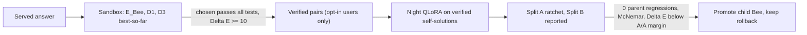

# Operation Autopoietic Energy-Bees (`Season 18` / `Wave 17`)
## Leveraging Measured `AutoevolveAI` (ANSE) Results to Add a Physical Energy Model & Self-Evolving Loop to HiveMind Bees

- **Date:** 2026-10-26
- **Source Repositories:** [`xaviercallens/AutoevolveAI`](https://github.com/xaviercallens/AutoevolveAI) (ANSE Phases 1–5) $\times$ [`xaviercallens/HiveMind`](https://github.com/xaviercallens/HiveMind) (La Ruche, BOINC Core Node & OpenRouter Gateway)
- **Target Roadmap Section:** `ROADMAP.md` Section `3.16` (`Season 18` — `HM-S18-AE-01..05`)

> [!IMPORTANT]
> **Reviewed 2026-10-26 (same day as the draft).** The task table, gates and order of record are in [`ROADMAP.md` §3.16](../ROADMAP.md), which lists six review findings (R1–R6) and their fixes. This document keeps the motivation, the evidence audit and the energy definition; where it differs from §3.16, §3.16 wins. All gates are drafts until the scientific lead pre-registers them.

---

## 1. Motivation: Two Measured Bottlenecks in HiveMind Live Operations

Recent real-life production runs on the HiveMind fleet (`socreateai-agora-hermes-node1` Tesla T4 16 GB + GeForce RTX 2070 8 GB) exposed two concrete limitations of purely token-loss-driven training and unverified routing:

1. **The 30-Round BOINC Token-NLL Plateau (`scripts/t4_training_report.py`, 25–26 Oct 2026):**
   - Across `98` chained BOINC QLoRA-MoE rounds (`hmq_00001..hmq_00098`, `5,632.11` Cobblestones), 6-domain held-out cross-entropy NLL improved from `2.2705 -> 2.1380` (`-5.8%`, with `math -15.1%`, `biomed -11.7%`, `general -8.8%`).
   - However, **held-out NLL plateaued after ~30 rounds**: later blocks of 10 rounds improved by only `0.0005–0.005` (`std = 0.0055` over the last 20 rounds), and in rounds `69–98` a round no longer improved even the domain it trained on (`+0.0006`).
   - Furthermore, choosing chain head `hmq_00092` (`20` accepted / `78` held) on the same fixed `8 x 128`-token evaluation sets introduces **best-of-97 selection bias**, and token NLL alone does not measure downstream executable correctness.

2. **Token NLL $\neq$ Physical Execution Correctness (`NIGHT-MOE-1` & `HM-S16-04`):**
   - On Day 1 of Go-Live (`HM-S16-04`), the first real coding query was served with low latency (`198 ms` p50) but returned code that failed execution.
   - In `NIGHT-MOE-1`, fine-tuning small specialist adapters on terse static reference answers caused format interference on `maths` and `code`, whereas `hivemind/bee-stars` succeeded (`0.489 -> 0.893`, `+40.4%`, exact paired McNemar $p < 10^{-4}$) when evaluated against an explicit, discrete verification gate with a shuffled-label control.

---

## 2. Evidence Audit from `AutoevolveAI` (What Worked vs. What Was Refuted)

To avoid importing complexity that does not work, we filter [`AutoevolveAI`](https://github.com/xaviercallens/AutoevolveAI)'s experimental record (`docs/EVOLUTION_LAB.md`, `results/phase{1,2,3}_evolution/results.json`, `results/semantic_backprop_and_the_wall.json`, `results/rung2_gate_cost.json`) into **proven mechanisms to adopt** and **refuted mechanisms to exclude**:

### 2.1 Proven Mechanisms to Adopt in HiveMind Bees
| `AutoevolveAI` Component | Measured Evidence in `AutoevolveAI` | Application to HiveMind Specialist Bees |
|---|---|---|
| **1. Phase 1 Reality Engine & Graded Physical Energy $E(y)$** (`anse/symbolic/sandbox.py`) | Exposed **36% false convergence** (`4/11` self-graded successes failed hidden tests). Plain retry with hidden-test graded energy lifted verified `pass@1 = 42.5% -> pass@3 = 52.5%` on `qwen2.5-coder:1.5b`; `0` crashes or memory poisonings across `8` hostile scenarios (`UC5 PASS`). | Replace self-graded / token-NLL checks with an out-of-process **Bee Physical Energy Function $E_{\text{Bee}}(x, y)$** combining hidden test failure rate, execution latency (ms), peak RSS memory (MB), and domain conservation laws ($E = 10^6$ on crash/timeout/stub). |
| **2. Phase 3 Autopoietic Hot-Swapping & Banach Registry** (`anse/autopoiesis/hypervisor.py`) | **5/5 Gates Passed:** Promoted better children (`5/5`, median `75x` speedup), rejected fast-but-wrong children (`5/5` vs `0/5` legacy), `0/15` false promotions on A/A noise (vs `5/15` legacy), `5/5` instant rollbacks, and `2/2` valid LLM-proposed children promoted (`0` invalid). | Gate every La Ruche / OpenRouter Bee adapter promotion (`theta_parent -> theta_child`) on an out-of-process equivalence check + interleaved noise-margin thermodynamic condition $\Delta E = E_{\text{child}} - E_{\text{parent}} < -\epsilon_{\text{noise}}$. |
| **3. Phase 4 Low-Tier Hardness Directives `D1, D3, D6`** (`docs/EVOLUTION_LAB.md`) | Designed for $\le 3\text{B}$–$7\text{B}$ models: `D1` compresses failing code/stderr to `<200` chars; `D3` enforces energy-monotonic early stop ($E_2 > E_1$) and returns **best-so-far** ($\arg\min_t E_t$); `D6` exports verified preference pairs when $\Delta E \ge 10$. | Prevent token waste on 1B–7B Bees (`coder-lite`, `crowd-v1`, `bee-stars`, `coder`), guarantee non-increasing energy across retries, and harvest live `(chosen_low_E, rejected_high_E)` pairs for Night-MoE QLoRA self-evolution. |
| **4. Rung-2 Formal Gate & Warm Verifier Amortization** (`results/rung2_gate_cost.json`, `rung2_gate_controls.json`) | Proved `4/4` positive/negative obligation controls (`0` `sorry` or wrong-coefficient leaks) and showed that **Mathlib import (`17.61 s` median)** is ~100% of single-shot Lean verification cost (`spec + candidate` add `~0 s`). | Run a **persistent warm verifier daemon** (Lean 4 REPL / persistent Python worker pool) on the T4 / BOINC validator node so candidate Bee outputs are checked in milliseconds without paying the per-process import floor. |
| ~~**5. System-1 Fast Soundness Pre-Ranker**~~ (`results/retrained_models_use_cases_report.json`) | `laya_system_one` 10/10 on 10 hand-picked cases; the MCTS "speed-ups" compare predicted energies, not executions. | **Dropped in review (R6):** too little evidence; Phase 2 showed a learned probe must first beat a linear baseline on our own traces. |

### 2.2 Refuted Mechanisms Explicitly Excluded
1. **No Unverified JEPA Latent Skipping (`Phase 2 UC1/UC4 FAIL`):** In `AutoevolveAI` Phase 2, the standalone JEPA energy predictor scored `40.0%` vs `44.3%` random on candidate selection (`UC4 FAIL`). **Rule:** Latent predictors may only *order* candidates; **every** promoted Bee or verified response must pass the real sandbox (`E_Bee`).
2. **No Full-Solution Lesson Injection or Multi-Turn Adaptive Retry on $\le 3\text{B}$ Bees (`Phase 1 UC2/UC4 FAIL`):** Injecting full reference solutions into small models caused `3` regressions vs `1` gain (`50%` off vs `40%` on), and verbose adaptive retries raised mean energy (`22.5 -> 24.0 -> 29.0`). **Rule:** Use plain retry with `<200`-char compressed error traces (`D1`) and keep the best-so-far candidate (`D3`).
3. **No Complex Genetic Crossover Operators Without Curriculum Split (`semantic_backprop_and_the_wall.json`):** Eight tested GP/semantic variation operators all collapsed at the exact same complexity cliff (`L3 -> L4`), proving the bottleneck is **task decomposition and representation**, not the mutation operator.

---

## 3. Mathematical Formulation of the HiveMind Bee Energy Model

For any prompt $x$ in domain $d \in \{\text{code}, \text{math/lean4}, \text{astro/physics}, \text{biomed}, \text{general}\}$ and candidate response $y \sim \pi_{\theta_d}(\cdot \mid x)$ from Specialist Bee $\theta_d$, the **Physical Energy Function** $E_{\text{Bee}}(x, y; d)$ is evaluated out-of-process:

$$E_{\text{Bee}}(x, y; d) = \begin{cases} 10^6 & \text{if syntax error, AST stub, timeout, crash, or } \texttt{sorry} \\ w_{\text{fail}} \cdot \frac{N_{\text{fail}}}{N_{\text{tests}}} + w_{\text{inv}} \cdot \mathcal{R}_{\text{phys}} + 0.99 \cdot \frac{w_{\text{fail}}}{N_{\text{tests}}} \cdot \frac{w_{\text{lat}} \frac{\tau}{\tau + \tau_0} + w_{\text{mem}} \frac{M}{M + M_0}}{w_{\text{lat}} + w_{\text{mem}}} & \text{otherwise} \end{cases}$$

where:
- $N_{\text{fail}}(x, y) / N_{\text{tests}}(x) \in [0, 1]$ is the fraction of hidden unit tests or exact paired evaluation items failed ($w_{\text{fail}} = 100.0$),
- $\mathcal{R}_{\text{phys}}(x, y) \ge 0$ is the domain conservation/epistemic residual (e.g., $|\Delta H / H_0|$ for symplectic astrophysics, `defeq` obligation mismatch for Lean 4, or format/constraint violation for factual packs; $w_{\text{inv}} = 50.0$),
- $\tau$ and $M$ are measured execution time and peak resident memory inside the `rlimit` sandbox ($\tau_0 = 100$ ms, $M_0 = 64$ MB, $w_{\text{lat}} = 1.0$, $w_{\text{mem}} = 0.5$). The cost term is **bounded below the weight of one failed test**, so cost only orders answers of equal correctness (review R2: the first draft's linear cost ranked a correct 6 s answer below a half-wrong 5 ms one).

### Thermodynamic Condition for Bee Self-Evolution
A child Bee adapter $\theta_d^{(t+1)}$ trained during the European Night BOINC window (`22:00–07:00 CET`) replaces the parent Bee $\theta_d^{(t)}$ in La Ruche and on the OpenRouter gateway **if and only if** the following hold (no regression on the parent's verified items, exact McNemar as the primary rule, $\epsilon_{\text{noise}}$ measured from at least 3 A/A runs; review R4) on an **independent held-out oracle split $\mathcal{D}_{\text{oracle}}$** (never used during inner training or per-round ratchet selection):

$$\Delta E_d = \operatorname{median}_{(x_i) \in \mathcal{D}_{\text{oracle}}} \Big( E_{\text{Bee}}(x_i, \theta_d^{(t+1)}) - E_{\text{Bee}}(x_i, \theta_d^{(t)}) \Big) < -\epsilon_{\text{noise}}, \quad p_{\text{McNemar}}(\theta_d^{(t+1)} > \theta_d^{(t)}) < 0.05, \quad \text{and} \quad \text{Control}_{\text{shuffled}} = \text{NS}.$$

---

## 4. Tasks

See [`ROADMAP.md` §3.16](../ROADMAP.md): `HM-S18-AE-01` energy function (unblocks #191), `AE-02` two-split ratchet and plateau rule, `AE-03` energy-gap pairs (unblocks #166), `AE-04` promotion gate (unblocks #165/#170), `AE-05` warm verifier (unblocks #173). Epic: [#208](https://github.com/xaviercallens/HiveMind/issues/208).

Plateau rule, replayed on the real ledger (97 six-domain rounds `hmq_00002..00098`, default thresholds): first fires at round 47 (`hmq_00048`); at round 40 the 10-round gain is still 0.0096. The thresholds were chosen after seeing this chain, so this is descriptive; the rule must be validated on a new chain.
