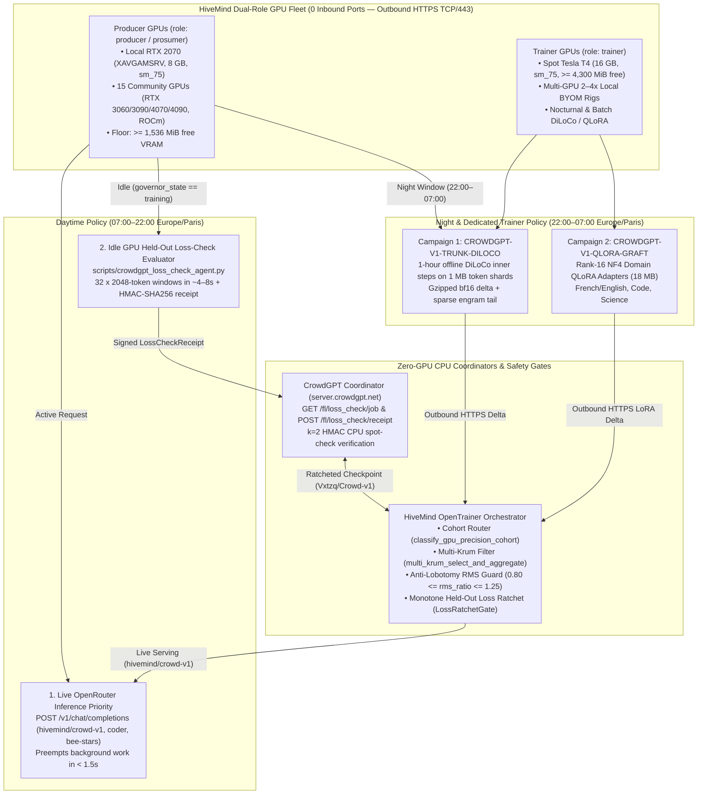

# CrowdGPT (`Vxtzq/Crowd-v1`) × HiveMind Co-Training Plan: Trainer & Producer GPUs

- **Plan ID:** `CROWDGPT-HIVEMIND-CO-TRAIN-V1`
- **Partner Projects:** **CrowdGPT** ([@Vxtzq](https://github.com/Vxtzq) — `Vxtzq/CrowdGPT`, `Vxtzq/Crowd-v1`, `server.crowdgpt.net`) × **HiveMind / La Ruche** ([@xaviercallens](https://github.com/xaviercallens) — `xaviercallens/HiveMind`)
- **Live API Endpoint:** `GET /v1/hivemind/opentrainer/crowdgpt-plan` (`/v1/opentrainer/status`, `/v1/hivemind/contributive-hub`)
- **Official Discord Coordination Hub:** **https://discord.gg/ZeFtZpKHf**
- **GitHub Discussions Hub:** [Discussion #866](https://github.com/xaviercallens/HiveMind/discussions/866) | [Issue #867](https://github.com/xaviercallens/HiveMind/issues/867) | [Issue #367](https://github.com/xaviercallens/HiveMind/issues/367)

---

## 1. Executive Summary ("Le Tronc Commun + Les Greffons")

**CrowdGPT (`Vxtzq/Crowd-v1`)** trains a 657.8M-parameter (`151,669` Qwen3 vocabulary, MIT license) dense generalist foundation model via 1-hour offline client training rounds on 1 MB `uint16`/`uint32` token shards (`window=2048`), coordinated by a lightweight CPU backend (`server.crowdgpt.net`, 2 vCPU, 15 GB RAM).

**HiveMind (`La Ruche` + `OpenTrainer`)** operates a dual-role fleet of **Producer GPUs** (serving live daytime OpenRouter inference with `< 1.5s` game/inference preemption) and **Trainer GPUs** (running nocturnal and Spot DiLoCo + NF4 QLoRA rounds), backed by a permanent `$3.65/mo` CPU orchestrator (`hm-opentrainer-1`).

This plan unites **Trainer GPUs** and **Producer GPUs** into a single zero-bottleneck pipeline that:
1. **Offloads CrowdGPT's Held-Out Loss Check to Idle Producer GPUs** (`scripts/crowdgpt_loss_check_agent.py`), cutting per-round validation from `~187 s` on the 2-core CPU backend to `~4–8 s` on GPU while leaving the CPU backend only a fast `k = 2` HMAC-selected spot check.
2. **Co-Trains the `Vxtzq/Crowd-v1` Generalist Trunk (`CROWDGPT-V1-TRUNK-DILOCO`)** across nocturnal Producer GPUs (`22:00–07:00 Europe/Paris`) and dedicated/Spot Trainer GPUs using hardware-stratified precision cohorts (`sm_75` `fp32` vs `sm_80+` `bf16`).
3. **Trains 18 MB Domain QLoRA Grafts (`CROWDGPT-V1-QLORA-GRAFT`)** on top of the ratcheted `Crowd-v1` trunk and serves `hivemind/crowd-v1` live on the HiveMind OpenRouter gateway (`/v1/chat/completions`).

---

## 2. Architecture: Dual-Role Producer + Trainer GPU Pipeline



---

## 3. GPU Role Partitioning & Hardware Precision Cohorts

### 3.1 Producer GPUs vs. Trainer GPUs

| Fleet Role | Account Roles | Hardware Examples | Free VRAM Safety Floor | Daytime (`07:00–22:00 Paris`) | Night (`22:00–07:00 Paris`) |
| :--- | :--- | :--- | :--- | :--- | :--- |
| **Producer GPUs** | `producer`, `prosumer` | Local RTX 2070 (`XAVGAMSRV`, 8 GB), Community RTX 3060/3090/4070/4090, AMD ROCm | **`>= 1,536 MiB`** (8 GB GPUs) | **1st Priority:** Live OpenRouter inference (`/v1/chat/completions`).<br>**When Idle (`governor_state="training"`):** Fast GPU Held-Out Loss Check (`CROWDGPT-V1-LOSS-CHECK`) & micro-rounds (`< 1.5s` preemption). | Automatically switches to full **Trainer Mode** (`CROWDGPT-V1-TRUNK-DILOCO` & `CROWDGPT-V1-QLORA-GRAFT`). |
| **Trainer GPUs** | `trainer` | GCP Spot Tesla T4 (`16 GB`), 2–4x Multi-GPU Homelab Rigs | **`>= 4,300 MiB`** (Tesla T4 Rule 1) | Scheduled Spot batch training & held-out loss calibration (`hivemind-t4`). | Full nocturnal DiLoCo outer/inner trunk rounds + rank-16 NF4 QLoRA grafts. |
| **CPU Coordinators** | `coordinator` | `hm-opentrainer-1` (`$3.65/mo` Spot `e2-small`), `server.crowdgpt.net` (`2 vCPU`) | `0 MiB` (`requires_t4_gpu=False`) | 24/7 task dispatch, Multi-Krum aggregation, Weight RMS guard, and `k = 2` CPU spot-check verification. | 24/7 outer DiLoCo momentum step and atomic checkpoint persistence. |

### 3.2 Hardware-Stratified Numerical Cohorts (`classify_gpu_precision_cohort`)

To prevent numerical drift between pre-Ampere (`sm < 80`) and Ampere+ (`sm >= 80`) GPUs (`Vxtzq/CrowdGPT#44`, `#51`), [`src/hivemind/swarm/crowdgpt_bridge.py`](../src/hivemind/swarm/crowdgpt_bridge.py) assigns every GPU to a homogeneous precision cohort:

1. **`nvidia:sm75_pre_ampere:fp32:adamw_8bit`** *(RTX 2070 8 GB, Tesla T4 16 GB)*:
   - Enforces `fp32` master weights / NF4 QLoRA (`pre_ampere_fp32_enforced=True`) because Turing (`sm_75`) lacks native `bf16` tensor cores.
2. **`nvidia:sm80_plus_ampere:bf16:adamw_8bit`** *(RTX 3060 / 3090 / 4070 / 4090, L4)*:
   - Uses native `bfloat16` tensor cores and uploads gzipped `bf16` deltas + sparse engrams (`pack_crowdgpt_delta_stream`).
3. **`amd_rocm:rocm:fp32:adamw_8bit` & `apple_mps:mps:fp32:adamw_8bit`**:
   - Dedicated ROCm and Apple Silicon cohorts protected by `resolve_forming_pool_starvation(..., forming_timeout_s=180.0)` (`SOLO_LOSS_RATCHET_FALLBACK`) so minority hardware pools never stall at `1/3` or `2/3`.

---

## 4. Four-Gate Byzantine & Anti-Lobotomy Verification Pipeline

Every candidate outer step must pass all four cryptographic and numerical gates implemented in [`src/hivemind/swarm/crowdgpt_bridge.py`](../src/hivemind/swarm/crowdgpt_bridge.py) and [`src/hivemind/swarm/crowdgpt_loss_check_service.py`](../src/hivemind/swarm/crowdgpt_loss_check_service.py):

1. **Gate 1 — Wire Integrity & `safetensors`-Only Framing (`unpack_crowdgpt_delta_stream`)**:
   - Verifies SHA-256 digest, JSON header bounds, `bf16` base delta alignment, and sparse engram indices (`uint32`) + values (`uint16`). Zero `pickle` or arbitrary `torch.load` execution.
2. **Gate 2 — Token-Clamped Chunked Multi-Krum (`multi_krum_select_and_aggregate`)**:
   - Clamps self-reported `tokensProcessed` weights at `1.25x` the cohort median (`MAX_TOKEN_WEIGHT_MEDIAN_MULTIPLE = 1.25`) and computes $N \times N$ pairwise squared $L_2$ distances in `1,048,576`-element chunks to reject Byzantine outliers.
3. **Gate 3 — Anti-Lobotomy Weight RMS Collapse Guard (`check_weight_rms_collapse_guard`)**:
   - Explicitly detects and blocks the Step-282 zero-participant weight-halving bug (`Vxtzq/CrowdGPT#48`, where averaging a zeroed tensor scaled trunk weights by `0.5x` and reset loss to `~12.6`), requiring `0.80 <= rms_new / rms_old <= 1.25`.
4. **Gate 4 — GPU Held-Out Loss Check + CPU `k = 2` Spot Check (`LossCheckCoordinator` + `LossRatchetGate`)**:
   - Idle Producer/Trainer GPUs evaluate `N = 32` windows of `2048` held-out tokens and sign an HMAC-SHA256 `LossCheckReceipt`.
   - For unknown community GPUs, `required_receipts = 2` independent evaluators must agree within `agreement_tol = 2e-3`.
   - The CPU coordinator recomputes `k = 2` windows chosen unpredictably via `HMAC(server_secret, receipt_digest)` and promotes the checkpoint **if and only if** `loss_after - loss_before <= max_regression_tolerance`.

---

## 5. Four-Phase Execution Roadmap (Days 1–14)

| Phase | Timeline | Target | Concrete Actions & Verification |
| :--- | :--- | :--- | :--- |
| **Phase 1: GPU Loss-Check Offload & Calibration** | **Days 1–2** | `CROWDGPT-V1-LOSS-CHECK` | 1. Run `python scripts/crowdgpt_loss_check.py calibrate` between `XAVGAMSRV` (RTX 2070) / `hivemind-t4` (GPU) and `server.crowdgpt.net` (CPU) on `Vxtzq/Crowd-v1` to measure exact GPU-vs-CPU `tol` (`<= 2e-3`).<br>2. Enable `scripts/crowdgpt_loss_check_agent.py` on idle Producer GPUs governed by `artifacts/governor_state.json`. |
| **Phase 2: Dual-Fleet Trunk Co-Training** | **Days 3–5** | `CROWDGPT-V1-TRUNK-DILOCO` | 1. Register Producer & Trainer GPUs on `/v1/hivemind/opentrainer/heartbeat` with campaign `CROWDGPT-V1-TRUNK-DILOCO`.<br>2. Run nocturnal 1-hour DiLoCo inner loops on `sm75` (`fp32`) and `sm80+` (`bf16`) cohorts with Multi-Krum + RMS Guard + Loss Ratchet active. |
| **Phase 3: Night-Hive QLoRA Grafts & Live Serving** | **Days 6–10** | `CROWDGPT-V1-QLORA-GRAFT` | 1. Train 18 MB rank-16 NF4 QLoRA specialist adapters (`CROWDGPT-V1-QLORA-GRAFT`) on top of the ratcheted `Crowd-v1` trunk.<br>2. Serve `hivemind/crowd-v1` live on `/v1/chat/completions` and display the **HiveMind** flair on the CrowdGPT leaderboard. |
| **Phase 4: 72-Hour Joint Federated Benchmark** | **Days 11–14** | Public Receipt Report | 1. Run a 72-hour federated campaign combining CrowdGPT contributors and HiveMind Producer/Trainer GPUs.<br>2. Publish SHA-256 verification receipts on GitHub Discussions, Discord (`https://discord.gg/ZeFtZpKHf`), and `/telemetry`. |

---

## 6. Quick-Start CLI Commands for Contributors

### A. Producer GPU — Run Idle Held-Out Loss-Check Evaluator (Daytime & Nighttime)
```bash
python scripts/crowdgpt_loss_check_agent.py \
  --server https://server.crowdgpt.net \
  --evaluator-id hivemind-rtx2070 \
  --key-file ~/.config/hivemind/crowdgpt_evaluator_key \
  --governor-state artifacts/governor_state.json \
  --dtype float32 \
  --once
```

### B. Producer / Trainer GPU — Join `CROWDGPT-V1-TRUNK-DILOCO` (0 Inbound Ports, Outbound HTTPS)
```bash
python scripts/hivemind_opentrainer_agent.py \
  --gateway https://hivemind-openrouter-1003063861791.us-central1.run.app \
  --campaign-id CROWDGPT-V1-TRUNK-DILOCO \
  --network-mode outbound-https-relay \
  --check-firewall \
  --submit-delta \
  --once
```

### C. Multi-GPU Trainer Rig (2 to 4 Local GPUs) — Co-Train `CROWDGPT-V1-QLORA-GRAFT`
```bash
for gpu in 0 1 2 3; do
  CUDA_VISIBLE_DEVICES=$gpu python scripts/hivemind_opentrainer_agent.py \
    --gateway https://hivemind-openrouter-1003063861791.us-central1.run.app \
    --host-label RIG-GPU$gpu \
    --learner-index $gpu \
    --campaign-id CROWDGPT-V1-QLORA-GRAFT \
    --network-mode outbound-https-relay \
    --submit-delta \
    --once &
done
wait
```

### D. Verify Live CrowdGPT Co-Training Plan & Telemetry on the Gateway
```bash
curl -sS https://hivemind-openrouter-1003063861791.us-central1.run.app/v1/hivemind/opentrainer/crowdgpt-plan | python -m json.tool
```
