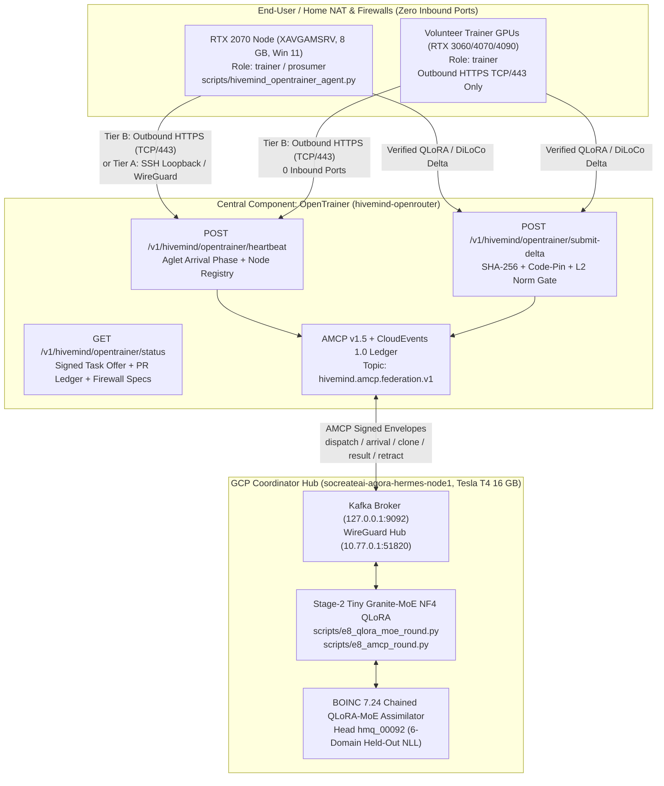

# OpenTrainer (`opentrainer`): Central Coordinator for Intense GPU Co-Training Across BOINC, AMCP v1.5, Kafka & Signed Task Agents (IBM Aglet Life Cycle)

**Component:** `OpenTrainer` ([`src/hivemind/router/opentrainer.py`](../src/hivemind/router/opentrainer.py))  
**Portal Category / Account Role:** `"trainer"` (supported alongside `"prosumer"`, `"producer"`, `"consumer"`, `"admin"`)  
**CLI Agent:** [`scripts/hivemind_opentrainer_agent.py`](../scripts/hivemind_opentrainer_agent.py)  
**Federation Topic:** `hivemind.amcp.federation.v1`  
**Gateway Endpoints:**
- `GET /v1/hivemind/opentrainer/status` (alias: `GET /v1/opentrainer/status`)
- `POST /v1/hivemind/opentrainer/heartbeat` (alias: `POST /v1/opentrainer/heartbeat`)
- `POST /v1/hivemind/opentrainer/submit-delta` (alias: `POST /v1/opentrainer/submit-delta`)

---

## 1. Why `OpenTrainer` and the `trainer` Portal Category?

Until Season 36, HiveMind separated participants into three public roles:
- **`consumer`** — uses models via `/v1/chat/completions` in their IDE or Playground.
- **`producer`** — serves daytime inference via Ollama and `hivemind_producer_agent.py`.
- **`prosumer`** — both uses models and shares their GPU.

With the real two-host federated training cell built between the **NVIDIA GeForce RTX 2070 (`XAVGAMSRV`, 8 GB VRAM, Windows 11)** and the **GCP NVIDIA Tesla T4 (`socreateai-agora-hermes-node1`, 16 GB VRAM, Linux)** across PRs **`#366`**, **`#399`**, **`#401`**, **`#407`**, **`#408`**, **`#409`**, and **`#410`**, we now have a fourth first-class participant role:
- **`trainer`** — provides a GPU specifically for **intense distributed training**:
  1. **Stage-2 Tiny Granite-MoE (`ibm-granite/granite-3.1-1b-a400m-base`) NF4 QLoRA** (`rank=8`, `alpha=16`, `q_proj`/`v_proj`, peak VRAM `~1,840 MiB`, fits comfortably inside 8 GB RTX 2070 and 16 GB Tesla T4).
  2. **DiLoCo Outer-Step Synchronization (`E8` cell)** with 2D-DCT spectral quantization (`int8` + `zlib`) and Nesterov outer momentum (`lr=0.7`, `momentum=0.9`).
  3. **Signed Task Agents over AMCP v1.5 & Apache Kafka (`hivemind.amcp.federation.v1`)** implementing IBM's **Aglet life cycle** (`dispatch` -> `arrival` -> `clone` -> `result` -> `retract`) **without mobile code** (`weights_only=True`, CRLF-normalized `code_pin`).
  4. **BOINC Nocturnal Workunits (`22:00–07:00` local time)** with automatic `< 1.15s` game preemption.

Crucially, PR `#410` ([`docs/FEDERATION_AGENTS_AMCP.md`](FEDERATION_AGENTS_AMCP.md)) identified that **Tier B** (firewalled end-user trainers who cannot open inbound ports or UDP `51820`) was *"designed, not built"*. **`OpenTrainer`** builds and deploys **Tier B Outbound HTTPS Relay (`outbound-https-relay`)** directly on `hivemind-openrouter` while unifying Tier A (`amcp-kafka-aglet` / `wireguard-t4-hub` / `ssh-loopback-tunnel`) and Tier C (`boinc-night-workunit`).

---

## 2. Architecture: RTX 2070 (`XAVGAMSRV`) ↔ OpenTrainer ↔ Tesla T4 (`socreateai-agora-hermes-node1`)



---

## 3. Easy Network Integration Despite Firewalls (Three Transport Tiers)

End-user trainers on residential ISPs, carrier-grade NAT (CGNAT), university networks, or Windows Defender Firewall cannot expose inbound TCP/UDP ports, and HiveMind strictly forbids binding `0.0.0.0` (PR `#401`). `OpenTrainer` solves this with three complementary firewall-traversal tiers:

| Tier | `network_mode` | Transport & Ports | Inbound Ports on Trainer | `0.0.0.0` Listeners | Target Environment |
| :--- | :--- | :--- | :---: | :---: | :--- |
| **Tier B (Default)** | `outbound-https-relay` | Outbound HTTPS (`TCP/443`) to `/v1/hivemind/opentrainer/*` | **`0`** | **`0`** | Any home PC / laptop behind NAT, CGNAT, or corporate/Windows firewall |
| **Tier A (Aglet Bus)** | `amcp-kafka-aglet` / `wireguard-t4-hub` / `ssh-loopback-tunnel` | Loopback SSH forward (`127.0.0.1:18766 -> 127.0.0.1:8765`) or WireGuard (`10.77.0.0/24` to T4 hub `UDP/51820`) | **`0`** | **`0`** | Dedicated `RTX 2070` (`XAVGAMSRV`) ↔ `Tesla T4` (`socreateai-agora-hermes-node1`) federation cell |
| **Tier C (Nocturnal)** | `boinc-night-workunit` | Outbound HTTPS (`TCP/443`) poll to BOINC scheduler (`22:00–07:00`) | **`0`** | **`0`** | Overnight volunteer GPUs & idle gaming rigs (`< 1.15s` yield) |

---

## 4. IBM Aglet Life Cycle Over AMCP & Kafka (Without Mobile Code)

Following [`src/hivemind/swarm/federation_agents.py`](../src/hivemind/swarm/federation_agents.py) (PR `#410`), `OpenTrainer` coordinates rounds using IBM's 1996 **Aglet** life-cycle vocabulary while **never shipping executable mobile code** (`pickle` / `marshal` / dynamic imports are structurally absent):

1. **`dispatch` (`io.hivemind.amcp.fed.task_offer`)**:
   - The coordinator publishes a signed `TaskOffer` manifest specifying `round_id`, `base_model` (`ibm-granite/granite-3.1-1b-a400m-base`), `code_pin` (SHA-256 of the training script with CRLF normalized to LF so Windows 11 `XAVGAMSRV` and Linux `T4` produce the exact same hash), `lora_rank=8`, `lora_alpha=16`, and `inner_steps=8`.
2. **`arrival` (`check_offer` & `/v1/hivemind/opentrainer/heartbeat`)**:
   - The trainer node receives the `active_task_offer` in its heartbeat response, verifies its local `code_pin`, and checks free VRAM (`>= 1,840 MiB`).
3. **`clone` (`io.hivemind.amcp.fed.task_claim`)**:
   - Up to `K` trainers claim learner slots (`learner_index = 0` on Tesla T4, `learner_index = 1` on RTX 2070, `learner_index = 2..K-1` on community `trainer` nodes) and run deterministic inner steps on their shard.
4. **`result` (`io.hivemind.amcp.fed.task_result` & `/v1/hivemind/opentrainer/submit-delta`)**:
   - Each trainer submits its L2 norm, `loss_before`, `loss_after`, `delta_sha256`, and `code_pin`. `OpenTrainer` validates:
     - `0 < delta_norm <= 50.0` (Multi-Krum & norm clipping envelope)
     - 64-hex `delta_sha256`
     - `code_pin` match against the active round offer
   - Accepted deltas are persisted in `opentrainer_rounds` and emitted as `io.hivemind.amcp.fed.task_result` events on `hivemind.amcp.federation.v1`.
5. **`retract` (`io.hivemind.amcp.fed.task_abort`)**:
   - If a trainer preempts for a game (`< 1.15s` yield) or misses the round deadline, the coordinator retracts or advances on quorum (`min_quorum = ceil(K / 2)`).

---

## 5. Ledger of Real RTX 2070 ↔ Tesla T4 PRs Integrated by `OpenTrainer`

| PR | Branch | Summary & Measured Evidence |
| :--- | :--- | :--- |
| **`#410`** | `feat/e8-stage2-tiny-moe-qlora` | **Signed Task Agents over AMCP & Kafka + Stage-2 Tiny Granite-MoE NF4 QLoRA:** `src/hivemind/swarm/federation_agents.py`, `scripts/e8_amcp_round.py`, `scripts/e8_qlora_moe_round.py`. Loss `4.1721 -> 1.7772` (`0.0` diff vs baseline); 70-round Kafka churn soak with `SIGKILL` recovery (`62` complete, `8` quorum, `0` rejections, loss `4.171 -> 1.448`). |
| **`#409`** | `docs/t4-24h-training-report` | **24h T4 + BOINC Chained QLoRA-MoE Report (`hmq_00001..hmq_00098`):** `100` assimilated workunits, `5,632.11` Cobblestones, `0.0` replay drift, 6-domain held-out NLL `2.2705 -> 2.1380 (-5.8%)`, math `-15.1%`, biomed `-11.7%`, head `hmq_00092`. |
| **`#408`** | `feat/s35-t4-live-visibility-and-portal-banner` | **Live T4 GPU & QLoRA MoE Visibility (`/v1/hivemind/t4/status`):** Real-time VRAM (`6,796 / 15,360 MiB`), temperature (`56°C`), and BOINC workunit head telemetry on the portal. |
| **`#407`** | `artifacts/e8-two-host-wan-results` | **Real Two-Host WAN E8 Run (`Tesla T4` ↔ `RTX 2070 XAVGAMSRV`):** 12 outer rounds, 400 inner steps across Linux T4 (learner 0) and Windows 11 RTX 2070 (learner 1) over SSH port-forward (`127.0.0.1:18766 -> 127.0.0.1:8765`). Seeds 1–3 paired loss diff `+4.8e-07 +/- 8.3e-07`, round latency `p50=1.20s`, `p95=3.79s`. |
| **`#401`** | `docs/e8-two-host-real-test` | **Loopback-Only E8 Syncer Hardening:** Refuses `0.0.0.0` binds unless explicitly overridden; documents SSH port-forward (`127.0.0.1:18766`) and CRLF-safe script verification. |
| **`#399`** | `feat/s31-t4-reconnect-and-hiveminder-fleet` | **HiveMinder Fleet Reconnection & Multi-GPU Scale Status:** `/v1/hivemind/producers/scale-100-status` and `/v1/hivemind/producers/fleet` with distinct physical GPU tracking. |
| **`#366`** | `feat/s19-amcp-kafka-joint-campaigns-and-bee-trading` | **AMCP v1.5 + CloudEvents 1.0 Kafka Bus:** Topics `hivemind.amcp.campaigns.v1`, `hivemind.amcp.human_agent.v1`, `hivemind.amcp.bee_coord.v1`, and `hivemind.amcp.bee_trading.v1`. |

---

## 6. Quick Start for Trainers

### Step 1 — Register a `trainer` Account
Either select **"Provide my GPU for intense training via OpenTrainer — BOINC, AMCP, Kafka & Aglets (Trainer)"** on [`/signup`](https://hivemind-openrouter-1003063861791.us-central1.run.app/signup), or register via the API:
```bash
curl -s https://hivemind-openrouter-1003063861791.us-central1.run.app/v1/hivemind/register \
  -H "Content-Type: application/json" \
  -d '{"handle":"my-rtx-trainer","role":"trainer"}'
```

### Step 2 — Verify Firewall Traversal & Run `hivemind_opentrainer_agent.py`
```bash
export HIVEMIND_API_KEY=hm-YOUR_TRAINER_KEY
python scripts/hivemind_opentrainer_agent.py \
  --gateway https://hivemind-openrouter-1003063861791.us-central1.run.app \
  --network-mode outbound-https-relay \
  --check-firewall \
  --submit-delta \
  --once
```
Remove `--once` to keep your GPU heartbeating and participating in `OpenTrainer` rounds continuously.
