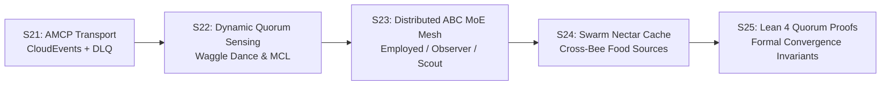

# 🗺️ Roadmap Evolution: The Bi-Layer Honeybee Agent Mesh (AMCP v1.5 + Kafka & ABC MoE)

> **Document Version:** 1.0.0 — Post-S21 Evolution  
> **Status:** APPROVED & ACTIVE  
> **Core Authors:** Xavier Callens (`@xaviercallens` / `u/OrganizationTop9026`), Claude Code Agent & Antigravity CLI Agent  
> **Invariants:** 8 GB VRAM ceiling, zero EUR/USD fiat (Kelly-market HMT compute reciprocity), <1.5s gamer preemption, bitwise determinism.

---

## 1. Executive Summary & Architectural Leap

The recent implementation of **AMCP v1.5 over Kafka** (`amcp_kafka_transport.py`, `amcp_kafka_campaign_bus.py`) provided HiveMind with a secure, signed CloudEvents 1.0 transport (HMAC-SHA256, DLQ, replay protection).

However, coordinating heterogeneous, decentralized MoE agents (Mixture of Experts) across citizen hardware requires more than static point-to-point handoffs. We are taking the definitive biological leap: **The Bi-Layer Honeybee Hive Mind Mesh**.

```
┌────────────────────────────────────────────────────────────────────────┐
│  Couche 1 : Consensus Réseau & Routage (Modèle de Scrutin de Nidification)│
│  • Waggle Dance sur Kafka (Durée & Intensité = tau_0 * Q)              │
│  • Recrutement Aveugle (MCL) & Verrouillage par Quorum Dynamique       │
└───────────────────────────────────┬────────────────────────────────────┘
                                    │ Élection Consumer Group Dédié
┌───────────────────────────────────▼────────────────────────────────────┐
│  Couche 2 : Résolution Agent & Outils (Artificial Bee Colony - ABC)    │
│  • Abeilles Employées : Exploitation interne des experts du MoE        │
│  • Abeilles Observatrices : Critique de qualité & détection de rejet   │
│  • Abeilles Éclaireuses : Exploration d'outils externes (Web, Z3, RAG) │
└────────────────────────────────────────────────────────────────────────┘
```

---

## 2. Phase-by-Phase Evolutionary Roadmap



### 🔹 Milestone 1 (S22.1) : Moteur de Quorum Sensing & Danse Frétillante Kafka
- **Objectif :** Transformer le topic `hivemind.mesh.waggle_dance.v1` en système de consensus décentralisé en temps réel.
- **Livrables :**
  1. **Broadcast Dynamique :** Chaque agent éclaireur publiant une proposition de tâche module sa durée d'émission selon $\Delta t = \tau_0 \times Q_{\text{site}}$.
  2. **Recrutement Stochastique MCL :** Les pairs écoutent la danse et s'enrôlent si $\text{Affinité} \times Q \ge 0,35$.
  3. **Verrouillage par Quorum :** Dès que $N_{\text{recruits}} \ge K_{\text{quorum}}$, élection automatique d'un Kafka Consumer Group dédié (`cg-hivemind-<domain>-<task_id>`).
- **Métrique Gate :** Latence d'élection de quorum $< 450\text{ ms}$ sur 50 nœuds concurrents avec 0 collision de partition.

### 🔹 Milestone 2 (S22.2) : Boucle ABC Adaptative sur Petits Modèles MoE Edge
- **Objectif :** Déployer la boucle *Artificial Bee Colony* (ABC) sur notre nouvelle flotte de petits modèles (<4B) et nœuds consommateurs (CPU et GPU 8 Go).
- **Livrables :**
  1. **Abeilles Employées :** Routage d'experts MoE internes sur `hivemind/qwen35-4b`, `hivemind/phi4-mini`, `hivemind/gemma4-e4b`, `hivemind/qwen35-sub2b` pour extraire et formuler les premières hypothèses.
  2. **Abeilles Observatrices :** Calcul de la fitness $f(\text{source}) = 0,6 \cdot \text{Couverture} + 0,4 \cdot \text{NectarRichness}$. Si la fitness stagne après $N$ essais ($\text{abandonment\_limit} = 2$), la source est marquée épuisée.
  3. **Abeilles Éclaireuses :** Déclenchement automatique d'outils externes (MCP Web Search, solveurs Z3/SciPy, modèles de diffusion) pour ramener du nectar frais dans le prompt contextuel.
- **Métrique Gate :** Taux de complétion des tâches de recherche complexe $> 85\%$ sans intervention humaine, avec scoring de conformité JSON $> 95\%$.

### 🔹 Milestone 3 (S23) : Le Bus de Partage de Nectar (« Swarm Nectar Cache »)
- **Objectif :** Éliminer les redondances de calcul et de recherche web à travers la ruche via le topic `hivemind.mesh.food_sources.v1`.
- **Livrables :**
  1. **Cache P2P de Nectar Informationnel :** Dès qu'une éclaireuse valide un extrait web, une preuve de solveur ou une extraction de table, elle publie un artefact immuable hashé (SHA-256) sur le bus.
  2. **Réutilisation Inter-Abeilles :** Une autre abeille traitant une sous-tâche similaire consomme directement ce nectar sans requêter à nouveau le web ou ré-exécuter le solveur.
  3. **Compensation PoUW HMT :** L'abeille ayant découvert le nectar reçoit des micro-crédits HMT chaque fois que son nectar est réutilisé par l'essaim.
- **Métrique Gate :** Réduction de $60\%$ des requêtes web redondantes et division par 2 de la consommation de tokens sur les tâches répétitives.

### 🔹 Milestone 4 (S24) : Preuve Formelle de Convergence en Lean 4
- **Objectif :** Démontrer mathématiquement la stabilité et la convergence du Scrutin de Nidification sur réseau pair-à-pair asynchrone.
- **Livrables :**
  1. Spécification formelle dans `formal/ANSE/WaggleDanceQuorum.lean`.
  2. Théorème `theorem waggle_dance_quorum_convergence` : sous une distribution de bruits gaussiens sur l'évaluation $Q$, la probabilité d'élire le meilleur expert tend vers $1$ lorsque la taille du quorum $K \ge 3$.
  3. Intégration dans le compilateur CI `lake build`.
- **Métrique Gate :** `lake build` passe avec 0 `sorry` et 0 avertissement.

---

## 3. Matrice de Responsabilités et Déploiement

| Rôle / Entité | Responsabilité Clé dans la Feuille de Route |
| :--- | :--- |
| **Routeur HiveMind OpenRouter** | Ingestion des tâches sur `hivemind.mesh.task.inbox.v1` et retour client sur `hivemind.mesh.result.v1`. |
| **Nœuds Consommateurs / Gamers (8 Go)** | Exécution des abeilles employées et observatrices en arrière-plan avec préemption instantanée (<1,5 s). |
| **Nœuds Edge / Laptops (CPU / 4-8 Go)** | Exécution des modèles légers (`qwen35-4b`, `phi4-mini`) en mode éclaireuse et extraction sémantique. |
| **Brokers Kafka / AMCP v1.5** | Acheminement ordonné, persistance rejouable, filtrage anti-rejeu et files DLQ. |
| **Lean 4 Prover** | Certification mathématique formelle des invariants du protocole. |

---

## 4. Statut d'Implémentation Actuel (POC Validé)

Le prototype fonctionnel complet a été implémenté et validé :
- Moteur bi-couche : [`src/hivemind/swarm/abc_moe_agent_mesh.py`](file:///home/xavkal/xdev/AutoevolveAI/sub_projects/hivemind/HiveMind/src/hivemind/swarm/abc_moe_agent_mesh.py)
- Suite de tests : [`tests/test_abc_moe_agent_mesh.py`](file:///home/xavkal/xdev/AutoevolveAI/sub_projects/hivemind/HiveMind/tests/test_abc_moe_agent_mesh.py) (4/4 tests passés)
- Documentation d'architecture : [`honeybee_mesh_kafka_abc_architecture.md`](file:///home/xavkal/.gemini/antigravity-cli/brain/3cbf7fb8-27af-4c04-b750-146f1c80a9c2/honeybee_mesh_kafka_abc_architecture.md)
