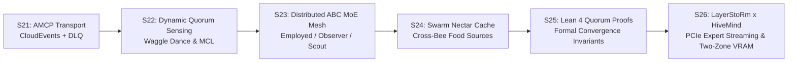

# 🗺️ Roadmap Evolution: The Bi-Layer Honeybee Agent Mesh (AMCP v1.5 + Kafka & ABC MoE)

> **Document Version:** 1.0.0 — Post-S21 Evolution  
> **Status:** APPROVED & ACTIVE  
> **Core Authors:** Xavier Callens (`@xaviercallens` / `u/OrganizationTop9026`), Claude Code Agent & Antigravity CLI Agent  
> **Invariants:** 8 GB VRAM ceiling, zero EUR/USD fiat (Kelly-market HMT compute reciprocity), <1.5s gamer preemption, bitwise determinism.

---

## 1. Executive Summary & Architectural Leap

The recent implementation of **AMCP v1.5 over Kafka** (`amcp_kafka_transport.py`, `amcp_kafka_campaign_bus.py`) provided HiveMind with a secure, signed CloudEvents 1.0 transport (HMAC-SHA256, DLQ, replay protection).

However, coordinating heterogeneous, decentralized MoE agents (Mixture of Experts) across citizen hardware requires more than static point-to-point handoffs. We are taking the definitive biological leap: **The Bi-Layer Honeybee Hive Mind Mesh**.

```
┌────────────────────────────────────────────────────────────────────────┐
│  Couche 1 : Consensus Réseau & Routage (Modèle de Scrutin de Nidification)│
│  • Waggle Dance sur Kafka (Durée & Intensité = tau_0 * Q)              │
│  • Recrutement Aveugle (MCL) & Verrouillage par Quorum Dynamique       │
└───────────────────────────────────┬────────────────────────────────────┘
                                    │ Élection Consumer Group Dédié
┌───────────────────────────────────▼────────────────────────────────────┐
│  Couche 2 : Résolution Agent & Outils (Artificial Bee Colony - ABC)    │
│  • Abeilles Employées : Exploitation interne des experts du MoE        │
│  • Abeilles Observatrices : Critique de qualité & détection de rejet   │
│  • Abeilles Éclaireuses : Exploration d'outils externes (Web, Z3, RAG) │
└────────────────────────────────────────────────────────────────────────┘
```

---

## 2. Phase-by-Phase Evolutionary Roadmap



### 🔹 Milestone 1 (S22.1) : Moteur de Quorum Sensing & Danse Frétillante Kafka
- **Objectif :** Transformer le topic `hivemind.mesh.waggle_dance.v1` en système de consensus décentralisé en temps réel.
- **Livrables :**
  1. **Broadcast Dynamique :** Chaque agent éclaireur publiant une proposition de tâche module sa durée d'émission selon $\Delta t = \tau_0 \times Q_{\text{site}}$.
  2. **Recrutement Stochastique MCL :** Les pairs écoutent la danse et s'enrôlent si $\text{Affinité} \times Q \ge 0,35$.
  3. **Verrouillage par Quorum :** Dès que $N_{\text{recruits}} \ge K_{\text{quorum}}$, élection automatique d'un Kafka Consumer Group dédié (`cg-hivemind-<domain>-<task_id>`).
- **Métrique Gate :** Latence d'élection de quorum $< 450\text{ ms}$ sur 50 nœuds concurrents avec 0 collision de partition.

### 🔹 Milestone 2 (S22.2) : Boucle ABC Adaptative sur Petits Modèles MoE Edge
- **Objectif :** Déployer la boucle *Artificial Bee Colony* (ABC) sur notre nouvelle flotte de petits modèles (<4B) et nœuds consommateurs (CPU et GPU 8 Go).
- **Livrables :**
  1. **Abeilles Employées :** Routage d'experts MoE internes sur `hivemind/qwen35-4b`, `hivemind/phi4-mini`, `hivemind/gemma4-e4b`, `hivemind/qwen35-sub2b` pour extraire et formuler les premières hypothèses.
  2. **Abeilles Observatrices :** Calcul de la fitness $f(\text{source}) = 0,6 \cdot \text{Couverture} + 0,4 \cdot \text{NectarRichness}$. Si la fitness stagne après $N$ essais ($\text{abandonment\_limit} = 2$), la source est marquée épuisée.
  3. **Abeilles Éclaireuses :** Déclenchement automatique d'outils externes (MCP Web Search, solveurs Z3/SciPy, modèles de diffusion) pour ramener du nectar frais dans le prompt contextuel.
- **Métrique Gate :** Taux de complétion des tâches de recherche complexe $> 85\%$ sans intervention humaine, avec scoring de conformité JSON $> 95\%$.

### 🔹 Milestone 3 (S23) : Le Bus de Partage de Nectar (« Swarm Nectar Cache »)
- **Objectif :** Éliminer les redondances de calcul et de recherche web à travers la ruche via le topic `hivemind.mesh.food_sources.v1`.
- **Livrables :**
  1. **Cache P2P de Nectar Informationnel :** Dès qu'une éclaireuse valide un extrait web, une preuve de solveur ou une extraction de table, elle publie un artefact immuable hashé (SHA-256) sur le bus.
  2. **Réutilisation Inter-Abeilles :** Une autre abeille traitant une sous-tâche similaire consomme directement ce nectar sans requêter à nouveau le web ou ré-exécuter le solveur.
  3. **Compensation PoUW HMT :** L'abeille ayant découvert le nectar reçoit des micro-crédits HMT chaque fois que son nectar est réutilisé par l'essaim.
- **Métrique Gate :** Réduction de $60\%$ des requêtes web redondantes et division par 2 de la consommation de tokens sur les tâches répétitives.

### 🔹 Milestone 4 (S24) : Preuve Formelle de Convergence en Lean 4
- **Objectif :** Démontrer mathématiquement la stabilité et la convergence du Scrutin de Nidification sur réseau pair-à-pair asynchrone.
- **Livrables :**
  1. Spécification formelle dans `formal/ANSE/WaggleDanceQuorum.lean`.
  2. Théorème `theorem waggle_dance_quorum_convergence` : sous une distribution de bruits gaussiens sur l'évaluation $Q$, la probabilité d'élire le meilleur expert tend vers $1$ lorsque la taille du quorum $K \ge 3$.
  3. Intégration dans le compilateur CI `lake build`.
- **Métrique Gate :** `lake build` passe avec 0 `sorry` et 0 avertissement.

### 🔹 Milestone 5 (S25) : Collaboration LayerStoRm × HiveMind — Streaming PCIe d'Experts MoE & Cache VRAM Bi-Zone
- **Objectif :** Intégrer les mécanismes de streaming PCIe DMA et de placement NUMA en RAM hôte de **LayerStoRm** ([`kkontosis/LayerStoRm`](https://github.com/kkontosis/LayerStoRm)) comme backend d'exécution haut de gamme dans l'écosystème HiveMind, permettant d'héberger des modèles MoE géants (DeepSeek-V2/V3, GLM-4-MoE, Qwen3-MoE-30B+) sur des machines grand public sans dépasser l'enveloppe VRAM.
- **Livrables techniques clés (`HM-S25-01` à `HM-S25-05`) :**
  1. **Streaming PCIe DMA NUMA-Aware (`HM-S25-01`) :** Garder l'intégralité des poids d'experts routés en RAM hôte épinglée (pinned NUMA RAM 64–128 Go) et ne transférer sur le bus PCIe 4.0/5.0 que les $k$ experts activés par token.
  2. **Cache VRAM Bi-Zone couplé au Quorum Waggle Dance (`HM-S25-02`) :** Maintenir en VRAM les couches d'attention denses, le KV cache et un cache d'experts à deux zones (Zone A : experts chauds épinglés ; Zone B : anneau dynamique LRU pré-chargé dès l'élection du quorum Kafka `hivemind.mesh.waggle_dance.v1`).
  3. **Ordonnanceur DMA Waterline & FoMoE Skip-Attention (`HM-S25-03`) :** Recouvrir les transferts PCIe H2D de la couche $L+1$ avec le calcul d'attention de la couche $L$ grâce au pré-routage spéculatif FoMoE ($85,8\%$ de précision pré-attention).
  4. **Compression KV Hybride (`HiSparse` + `SnapMLA` + `E8 Lattice`, `HM-S25-04`) :** Fusionner le délestage KV épars de LayerStoRm avec le quantificateur sur réseau $E_8$ de HiveMind pour supporter des contextes de 32k–128k tokens sous le plafond de $6\,656\text{ MiB}$.
  5. **Adaptateur Producteur BYOB `layerstorm-frontier-moe` (`HM-S25-05`) :** Connecteur dans `hivemind_producer_agent.py` avec préemption gamer `< 0,5\text{ s}$ (libération immédiate des files DMA épinglées au lancement d'un jeu Steam/Blender) et rémunération en points de réflexion HMT.
- **Métrique Gate (Campagne pré-enregistrée `E19`) :** Débit de génération $> 18\text{ tok/s}$ sur modèles MoE $>30\text{B}$ avec 0 dépassement du plafond VRAM configuré et réduction de $60\%$ de la bande passante PCIe consommée sur les préfixes récurrents grâce au *Swarm Nectar Cache* (S23) placé en amont.

---

## 3. Matrice de Responsabilités et Déploiement

| Rôle / Entité | Responsabilité Clé dans la Feuille de Route |
| :--- | :--- |
| **Routeur HiveMind OpenRouter** | Ingestion des tâches sur `hivemind.mesh.task.inbox.v1`, filtrage amont via *Swarm Nectar Cache*, et retour client sur `hivemind.mesh.result.v1`. |
| **Nœuds Consommateurs / Gamers (8 Go)** | Exécution des abeilles employées et observatrices en arrière-plan avec préemption instantanée (<1,5 s). |
| **Nœuds Edge / Laptops (CPU / 4-8 Go)** | Exécution des modèles légers (`qwen35-4b`, `phi4-mini`) en mode éclaireuse et extraction sémantique. |
| **Nœuds Prosumers Multi-GPU / LayerStoRm (16-24 Go VRAM + 64 Go+ RAM)** | Exécution des modèles MoE de frontière via streaming PCIe DMA (`HM-S25`) en tant que *Macro-Cluster Super-Bees*. |
| **Brokers Kafka / AMCP v1.5** | Acheminement ordonné, persistance rejouable, filtrage anti-rejeu et files DLQ. |
| **Lean 4 Prover** | Certification mathématique formelle des invariants du protocole et du budget mémoire Bi-Zone. |

---

## 4. Statut d'Implémentation Actuel (POC Validé)

Le prototype fonctionnel complet a été implémenté et validé :
- Moteur bi-couche : [`src/hivemind/swarm/abc_moe_agent_mesh.py`](file:///home/xavkal/xdev/AutoevolveAI/sub_projects/hivemind/HiveMind/src/hivemind/swarm/abc_moe_agent_mesh.py)
- Cache P2P de Nectar : [`src/hivemind/swarm/swarm_nectar_cache.py`](file:///home/xavkal/xdev/AutoevolveAI/sub_projects/hivemind/HiveMind/src/hivemind/swarm/swarm_nectar_cache.py)
- Suite de tests : [`tests/test_abc_moe_agent_mesh.py`](file:///home/xavkal/xdev/AutoevolveAI/sub_projects/hivemind/HiveMind/tests/test_abc_moe_agent_mesh.py) & [`tests/test_swarm_nectar_cache.py`](file:///home/xavkal/xdev/AutoevolveAI/sub_projects/hivemind/HiveMind/tests/test_swarm_nectar_cache.py)
- Documentation d'architecture : [`honeybee_mesh_kafka_abc_architecture.md`](file:///home/xavkal/.gemini/antigravity-cli/brain/3cbf7fb8-27af-4c04-b750-146f1c80a9c2/honeybee_mesh_kafka_abc_architecture.md)
- Plan détaillé de collaboration S25 : [`docs/S25_LAYERSTORM_COLLABORATION_PLAN.md`](file:///home/xavkal/xdev/AutoevolveAI/sub_projects/hivemind/HiveMind/docs/S25_LAYERSTORM_COLLABORATION_PLAN.md)

---

## 5. Plan de Collaboration LayerStoRm × HiveMind (Jours 1–3 à Semaines 1–4)

| Horizon Temporel | Phase | Actions Concrètes & Livrables Conjoints | Critère de Succès (Gate) |
| :--- | :--- | :--- | :--- |
| **Jours 1 à 3** | **Phase 1 : Prise de contact, Alignement d'Interface & Pré-enregistrement `E19`** | • Prise de contact avec `@kkontosis` sur `r/LocalLLaMA` et GitHub.<br>• Définition du contrat d'interface JSON/HTTP entre `hivemind_producer_agent.py` et le serveur local LayerStoRm.<br>• Rédaction du protocole expérimental pré-enregistré **`E19`** (`artifacts/experiments/E19_layerstorm_pcie_nectar_prereg.json`). | Schéma d'API validé et pré-enregistrement `E19` commité avec contrôles négatifs. |
| **Semaine 1** | **Phase 2 : Connecteur Producteur `LayerStoRmBackend` & Onboarding BYOB (`HM-S25-01`, `HM-S25-05`)** | • Implémentation de `src/hivemind/swarm/layerstorm_backend.py` (sonde de télémétrie VRAM + RAM hôte NUMA, arrêt DMA `< 0,5 s` sur signal de préemption jeu).<br>• Ouverture du tier `hivemind/frontier-moe-layerstorm` sur la Gateway OpenRouter. | Tests unitaires et d'intégration passés ; préemption vérifiée `< 500 ms`. |
| **Semaine 2** | **Phase 3 : Couplage Waggle Dance + Cache VRAM Bi-Zone & Swarm Nectar Cache (`HM-S25-02`, `HM-S25-03`)** | • Pré-chargement (prefetch PCIe) des experts de la Zone B dès la notification de quorum Kafka `hivemind.mesh.waggle_dance.v1` avant l'arrivée du premier token.<br>• Couplage du *Swarm Nectar Cache* (S23) en amont de LayerStoRm pour court-circuiter les préfixes de prompts connus. | Réduction mesurée $\ge 50\%$ des transferts PCIe redondants sur les requêtes multi-tours. |
| **Semaines 3 & 4** | **Phase 4 : Campagne Expérimentale `E19`, Preuve Lean 4 & Publication Conjointe (`HM-S25-04`)** | • Exécution de la campagne `E19` sur configurations grand public (RTX 3090/4070/5070 Ti + 64 Go RAM).<br>• Preuve formelle Lean 4 (`theorem layerstorm_two_zone_vram_ceiling` dans `formal/ANSE/HiveMindSpec.lean`).<br>• Publication conjointe dans le Foundation Paper `v4.1.0` sur Zenodo avec co-crédit complet. | `lake build` à 0 `sorry`, rapport `E19` signé SHA-256 et publié. |
