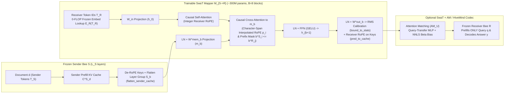
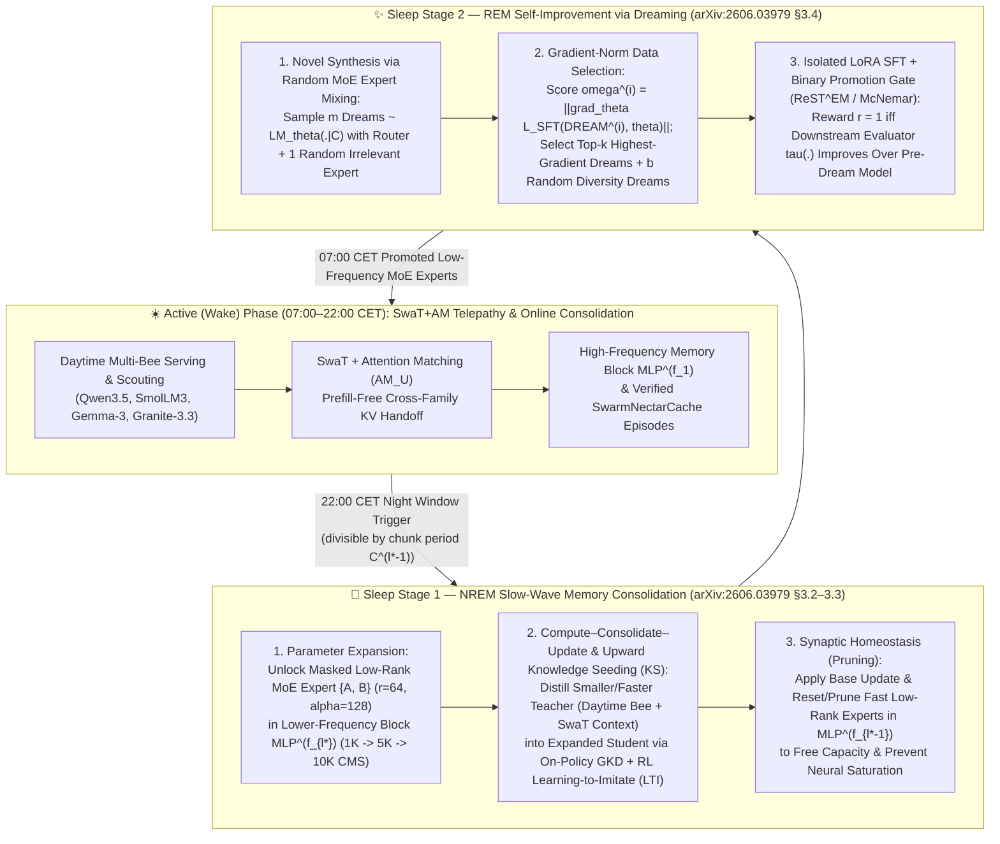

# 🧠 Season 34 (`Wave 32` — "Operation Swarm-Telepathy & Nocturnal Sleep Consolidation"): Prefill-Free Cross-Family KV-Cache Transfer (`SwaT`) + Two-Stage LLM Sleep (`Knowledge Seeding` & `Dreaming`)

> **Document Version:** 1.1.0 — 2026-10-31  
> **Status:** ROADMAP SPECIFICATION & PRE-REGISTERED EXPERIMENT PLAN (`HM-S34-01` .. `HM-S34-10`, strengthening `HM-S21-03`, `HM-S32-01` & `HM-S33-05`)  
> **Primary Wake-Phase Source (`SwaT`):** Abdulrahman Alabdulkareem, Irene Tenison, Yang Zhang, Yada Zhu, Boris Katz & Dan Gutfreund (MIT CSAIL & MIT-IBM Computing Research Lab), *"Swarm Telepathy: Prefill-Free KV-Cache Transfer Across Families"*, [`arXiv:2610.15095v1`](https://arxiv.org/abs/2610.15095) (10 Oct 2026). Cloned locally at [`third_party/SwaT/`](../third_party/SwaT) (commit `ae2de2285caf82f4d500526bf6e6992747b98eea`).  
> **Primary Sleep-Phase Source (`Sleep` / `Hope`):** Ali Behrouz, Farnoosh Hashemi, Adel Javanmard & Vahab Mirrokni (Google Research & Cornell University), *"Language Models Need Sleep: Learning to Self-Modify and Consolidate Memories"*, [`arXiv:2606.03979v2`](https://arxiv.org/abs/2606.03979) (10 Jul 2026).  
> **Compaction & Self-Adaptation Companions:** Adam Zweiger, Xinghong Fu, Han Guo & Yoon Kim, *"Fast KV Compaction via Attention Matching"*, [`arXiv:2602.16284`](https://arxiv.org/abs/2602.16284) (2026); Adam Zweiger, Jyothish Pari, Han Guo, Ekin Akyürek, Yoon Kim & Pulkit Agrawal, *"Self-Adapting Language Models (SEAL)"*, [`arXiv:2506.10943`](https://arxiv.org/abs/2506.10943) (2025).  
> **Golden Invariants:** `< 6,656 MiB` 8 GB consumer WDDM VRAM ceiling (`RTX 2070`), `>= 4,300 MiB` free VRAM guard on `Tesla T4`, `< 1.5s` (`< 0.5s` DMA) gamer preemption, `0.00 EUR / 0.00 USD` non-monetary compute-reciprocity charter (`HMT` / `PTS`), pre-registered positive/negative controls.

---

## 1. Executive Summary & Why `SwaT` Matters for Project HiveMind

In Project HiveMind's **Bi-Layer Honeybee Agent Mesh** ([`src/hivemind/swarm/abc_moe_agent_mesh.py`](../src/hivemind/swarm/abc_moe_agent_mesh.py)) and **Open Bee Marketplace** (`HM-S21-06`), specialized *MoE Bees* belong to **different model families, sizes, and tokenizers** (e.g., `Qwen3.5-0.8B/4B/9B`, `SmolLM3-3B`, `Gemma-3-4B/12B`, `Gemma-4-E4B`, `Granite-3.3-8B`, `Llama-3.2-11B`, `Phi-4-Mini`).

Until now, when a **Scout Bee** or **Employed Bee** (Sender $\mathcal{A}^{(i)}$) hands off context $d = x \parallel y^{(i)}$ to an **Observer Bee** or specialist **Solver/Coder Bee** (Receiver $\mathcal{A}^{(j)}$) over `/v1/hivemind/bees/coordinate` or AMCP/Kafka, it must use **Text-to-Text (`T2T`) communication**:
1. The sender $\mathcal{A}^{(i)}$ autoregressively decodes a text summary $s \sim \mathcal{A}^{(i)}_{\text{decode}}(C^{(i)}_{x \parallel y}, p_{\text{sum}})$ (expensive sequential token generation, information bottleneck).
2. The receiver $\mathcal{A}^{(j)}$ must re-prefill the summary from scratch $C^{(j)}_s = \mathcal{A}^{(j)}_{\text{prefill}}(s)$ before answering query $q$.

**Swarm Telepathy (`SwaT`, `arXiv:2610.15095`)** eliminates both bottlenecks: it is the **first cross-family, cross-architecture, cross-tokenizer KV-cache transfer method requiring zero receiver text prefill**:

$$\widehat{C}^{(j)}_x = M_{i \to j}\!\left(C^{(i)}_x, \mathcal{T}_{\mathcal{R}}\right), \qquad y^{(j)} \sim \mathcal{A}^{(j)}_{\text{decode}}\!\left(\widehat{C}^{(j)}_x, q\right)$$

When combined with **Attention Matching (`AM`, `arXiv:2602.16284`)** KV-cache compaction (`SwaT+AM`), the sender translates and compacts its internal KV-cache to budget $U$ without generating summary tokens:

$$\widetilde{C}^{(j)}_U = \text{AM}_U\!\left(M_{i \to j}\!\left(C^{(i)}_{x \parallel y}\right)\right), \qquad y^{(j)} \sim \mathcal{A}^{(j)}_{\text{decode}}\!\left(\widetilde{C}^{(j)}_U, x^{(j)}\right)$$

---

## 2. Technical Architecture Inspected from Paper & Cloned Code (`third_party/SwaT`)

We inspected both the full 25-page paper (`arXiv:2610.15095v1`) and the cloned implementation in [`third_party/SwaT/multiagent/`](../third_party/SwaT/multiagent/):

### 2.1 Layer-Group Partitioning & `CacheRendererV2` ([`third_party/SwaT/multiagent/model/cache_renderer.py`](../third_party/SwaT/multiagent/model/cache_renderer.py))
- Both sender ($\mathcal{S}$) and receiver ($\mathcal{R}$) models remain **100% frozen**.
- Each agent's KV layers $L_{\mathcal{U}}$ ($\mathcal{U} \in \{\mathcal{S}, \mathcal{R}\}$) are partitioned into $B \ll \min(L_{\mathcal{S}}, L_{\mathcal{R}})$ contiguous groups ($B \in \{7, 8, 9\}$, $D = 1024$, $H = 16$, $F = 4096$, $\approx 300\text{M}$ parameters):
  $$\mathcal{U}_b = \left\{ \ell : \left\lfloor \frac{b L_{\mathcal{U}}}{B} \right\rfloor \le \ell < \left\lfloor \frac{(b+1) L_{\mathcal{U}}}{B} \right\rfloor \right\}$$
- **Mapper Inputs**: Document $d$ is tokenized with the receiver's tokenizer $\mathcal{T}_{\mathcal{R}} = (r_0, \dots, r_{R-1})$ and passed through the receiver's frozen embedding lookup $h_0 = W_{\text{in}} E_{\mathcal{R}}(\mathcal{T}_{\mathcal{R}}) \in \mathbb{R}^{D \times R}$ (**`0 FLOPs`** for the lookup).
- **De-RoPE & Memory Projection**: For block $b$, sender RoPE is inverted on cached keys (`_apply_rope(..., inverse=True)` in `flatten_sender_cache`), concatenated with values across heads/layers in $\mathcal{S}_b$, and projected via LayerNorm + $W^{\text{mem}}_b$ into memory $m_b \in \mathbb{R}^{D \times S}$.
- **RMS Statistics Calibration (`bound_to_stats`)**: Each block outputs pre-RoPE keys and values for receiver layers $\mathcal{R}_b$, rescales them per layer and head to match calibrated receiver RMS statistics $\sigma$ (`stat_key_rms`, `stat_value_rms`), and applies the receiver's native RoPE at integer positions (`pred_to_cache`).

### 2.2 Cross-Family Tokenizer & Character-Span RoPE Alignment ([`third_party/SwaT/multiagent/dataset/c2c_cross_family.py`](../third_party/SwaT/multiagent/dataset/c2c_cross_family.py))
- Unlike prior work (`Cache-to-Cache`, Fu et al. 2026) which drops mismatched tokens, SwaT preserves every sender and receiver token using **character-span alignment** (`virtual_positions` and `cross_causal_limits`):
- Given sender token $s_i$ with character span $[a^{\mathcal{S}}_i, b^{\mathcal{S}}_i)$, midpoint $m_i = (a^{\mathcal{S}}_i + b^{\mathcal{S}}_i)/2$, and the largest receiver token index $j$ with $a^{\mathcal{R}}_j \le m_i$, the continuous cross-attention RoPE position is:
  $$p_i = \max\!\left(0,\; j + \text{clip}_{[0,1]}\!\left(\frac{m_i - a^{\mathcal{R}}_j}{b^{\mathcal{R}}_j - a^{\mathcal{R}}_j}\right) - \frac{1}{2}\right)$$
- **Causal Masking**: Receiver token $r_j$ attends to sender token $s_i$ if and only if $b^{\mathcal{S}}_i \le b^{\mathcal{R}}_j$, preventing any future-token leakage across mismatched BPE boundaries.

### 2.3 Two-Stage Training Objectives (`< 50M` Tokens, `< 1` GPU-Day)
1. **Stage 1 — Pre-RoPE RMS-Normalized KV Reconstruction (5,000 steps, Peak LR $3 \times 10^{-4}$)**:
   $$\mathcal{L}_{\text{KV}} = \text{MSE}\!\left(\frac{M_{i \to j}(C^{\mathcal{S}}_d, \mathcal{T}_{\mathcal{R}})}{\sigma},\; \frac{C^{\mathcal{R}}_d}{\sigma}\right)$$
2. **Stage 2 — Frozen-Receiver Next-Token NLL (24,000 steps, Constant LR $3 \times 10^{-6}$)**:
   $$\mathcal{L}_{\text{NLL}} = -\frac{1}{|y|} \sum_{t=1}^{|y|} \log p_{\mathcal{R}}\!\left(y_t \;\middle|\; M_{i \to j}(C^{\mathcal{S}}_d, \mathcal{T}_{\mathcal{R}}),\, q,\, y_{<t}\right)$$
   *(Ablation Table 18 shows both stages are essential: Stage 1 only drops `-36.97` pts; Stage 2 only drops `-36.96` pts; Headwise MLP drops `-14.71` pts).*

---

## 3. Empirical Results Reported in `arXiv:2610.15095` (and Caveats)

| Experiment / Setting | Reported Result in Paper | Key Caveat / Boundary Condition for HiveMind |
| :--- | :--- | :--- |
| **Zero-Shot Retention Across 10 Cross-Family Pairs & 17 Benchmarks (Table 2)** | **Small $\to$ Large**: `92.2%` to `108.5%` mean retention (`Qwen3-4B -> Llama3-8B` `98.5%`, `Gemma3-4B -> Granite3.3-8B` `108.5%`). **Large $\to$ Small**: **`103.0%` to `143.2%`** mean retention (`Granite3.3-8B -> SmolLM3-3B` **`143.2%`**, `Gemma3-12B -> Qwen3-4B` **`104.6%`**) — smaller receivers *exceed* their own native performance when reading a larger sender's translated KV-cache! | Out-of-distribution `MATH-500` (LaTeX formatting vs GSM8K numerical training) shows lower retention on some pairs (Table 9: `56.3%`–`122.5%`). |
| **`SwaT + AM` vs. Text-to-Text (`T2T`) Summarization (Tables 3 & 17)** | Across 3 pairs, 7 long-context datasets, 5 compression budgets (`3.3x` to `58x`): • **Accuracy / F1**: **`+48.8%` geometric mean** (`+17.4` points arithmetic mean: `58.6` vs `41.3`) • **Sender GPU Time**: **`4.2x` faster** (`2,447 ms` vs `10,234 ms`) • **Receiver TTFT**: **`4.3x` faster** (`4.7 ms` vs `20.1 ms`) • **Tokens Communicated**: `-12.0%` fewer tokens (`255` vs `290`). | Requires training a lightweight Query-Transfer MLP (`third_party/SwaT/multiagent/model/query_transfer.py`) and per-head AM budget files (`head_budgets/`) for optimal compaction. |
| **Compute & Latency vs. Full Receiver Re-Prefill (Table 6)** | Across sequence lengths `64` to `64K`: • **`8.2x` to `45.3x` fewer FLOPs** than receiver re-prefill. • **`6.1x` to `20.2x` faster wall-clock latency** (`2.1 ms` vs `26.0 ms` at `64` tokens; `1,314.9 ms` vs `13,465.7 ms` at `64K` on `Llama3-8B -> Qwen3-14B`). | Full uncompacted KV-cache tensors are larger over WAN than raw text tokens; **for WAN Bee-to-Bee handoffs, `SwaT` MUST be paired with `AM` compaction (`3.3x`–`58x`) + `FP8`/`E8` quantization (`HM-S34-03`)**. |
| **Zero-Shot Vision Transfer (`VLM -> Text-Only LLM`, Table 4 & Table 21)** | Trained *only* on English text, `SwaT` transfers visual understanding from `Gemma-3-4B/12B` VLMs to text-only `Granite-3.3-8B`, `Llama-3-8B`, and `Qwen-3-4B` across 5 VQA benchmarks (`VQAv2`, `TallyQA`, `OK-VQA`, `GQA`, `VizWiz`), beating `T2T` captions (`41.6%` vs `21.1%` on `Gemma3-4B -> Granite3.3-8B`). | **Appendix G / Table 21 Caveat**: On dense OCR / fine-detail tasks (`DocVQA`, `InfoVQA`), the native VLM sender alone (`57.4%`–`62.2%`) still significantly outperforms both `SwaT` (`29.0%`–`37.5%`) and `T2T` (`32.4%`–`38.7%`). |
| **Context Window Extension (`28K -> 8K Receiver`, Appendix F / Table 19)** | `Qwen3-4B` (`32K` support) prefills `28K` Interleaved HotpotQA, chunks into `8K`, translates & compacts via `SwaT+AM20` (`5.6K` total) for `Llama-3-8B` (`8K` limit): achieves **`41.87` F1** vs `13.32` (truncation) and `34.95` (native `Llama-3-8B AM20`). | Directly enables `16 GB` T4 / `LayerStoRm` prosumer nodes to prefill long scientific/coding contexts and transfer compacted `5.6K` KV caches to `8 GB` RTX 2070 nodes! |

---

## 3.5 Strengthening the Proposal with *"Language Models Need Sleep"* (`arXiv:2606.03979v2`): Solving KV-Cache "Anterograde Amnesia" via Nocturnal `Knowledge Seeding` & `Dreaming`

### Why `SwaT` (Wake) Needs `Sleep` (`arXiv:2606.03979v2`)
While `SwaT+AM` (`arXiv:2610.15095`) solves **Active (Wake) Phase** cross-family KV-cache communication, Behrouz, Hashemi, Javanmard & Mirrokni (Google Research & Cornell, [`arXiv:2606.03979v2`](https://arxiv.org/abs/2606.03979)) identify the fundamental limitation of all in-context KV-cache methods: **LLM Anterograde Amnesia**.
- Attention KV-caches have an *infinite update frequency* whose span is bounded by the session context window: once a daytime `SwaT` session ends or `SwarmNectarCache` evicts an entry, the fragile short-term memory disappears.
- Conversely, naïvely running iterative Supervised Fine-Tuning (`SFT`) or single-stage On-Policy Self-Distillation (`OPSD`) during HiveMind's `22:00–07:00 CET` Night Dream Phase (`HM-S21-03`, `HM-S32-01`, `HM-S33-05`) overwrites fixed-capacity weights—causing **Catastrophic Forgetting (`CF`)** or suppressing epistemic verbalization with up to **`40%` out-of-distribution reasoning degradation** (Kim et al., `arXiv:2603.24472`; `arXiv:2606.03979v2` §A.4).

**The Unified HiveMind Wake–Sleep Architecture** combines `SwaT+AM` (Daytime Wake) with `Sleep` (Nocturnal `22:00–07:00 CET` NREM Consolidation + REM Dreaming):

### Key Mathematical Mechanisms of `arXiv:2606.03979v2` Integrated into HiveMind

1. **Continuum Memory System (`CMS`) Multi-Frequency Hierarchy (`1K -> 5K -> 10K`)**:
   - Parameter blocks $\text{MLP}^{(f_1)}, \dots, \text{MLP}^{(f_k)}$ are ordered by update frequencies $f_1 \ge \dots \ge f_k$ with chunk periods $C^{(\ell)} = \frac{\max_{\ell'} C^{(\ell')}}{f_\ell}$ (Equation 1–2):
     $$\boldsymbol{\theta}^{(f_\ell)}_{i+1} = \boldsymbol{\theta}^{(f_\ell)}_i - \mathbf{e}_{i,\ell}, \qquad \mathbf{e}_{i,\ell} = \begin{cases} \sum_{t=i-C^{(\ell)}}^{i} \eta^{(\ell)}_t f(\boldsymbol{\theta}^{(f_\ell)}_t; \mathbf{x}_t) & \text{if } i \equiv 0 \pmod{C^{(\ell)}}, \\ 0 & \text{otherwise.} \end{cases}$$
   - Before block $\ell^*-1$ updates at step $i \equiv 0 \pmod{C^{(\ell^*-1)}}$, its short-term abstractions are consolidated into slower block $\ell^*$.

2. **Stage 1 (NREM): Masked Low-Rank MoE Expansion, `Compute–Consolidate–Update` & `Knowledge Seeding (KS)`**:
   - **Pre-Allocated Masked Low-Rank MoE Slots**: Rather than dynamically resizing tensors at runtime, low-rank MoE experts $\{A^{(f_{\ell^*}), s_{\ell^*}+1}, B^{(f_{\ell^*}), s_{\ell^*}+1}\}$ ($A \in \mathbb{R}^{d \times d_{\text{low}}}, B \in \mathbb{R}^{d_{\text{low}} \times d}, d_{\text{low}} = 64 \ll d$) are pre-allocated and masked until unlocked during Sleep—aligning with HiveMind's `ExpertRegistry` (`HM-S21-02`) and strict `< 6,656 MiB` WDDM VRAM bounds.
   - **Upward Distillation (`Knowledge Seeding`) with On-Policy `GKD` + RL `Learning to Imitate (LTI)`**:
     - Combines Generalized Knowledge Distillation (`GKD`, $\lambda \in [0,1]$ on-policy student rollouts with stop-gradient on sampling distribution and frozen prior student parameters) with RL **Learning-to-Imitate (`LTI`)** on prefix completions $\hat{d}^{(i)}$ of teacher dreams $d^{(i)} \in \mathcal{D}_T$:
       $$r(\hat{d}^{(i)}; d^{(i)}; \text{LM}_{\boldsymbol{\theta}_{\text{exp}}}) = \gamma\, r_{\text{sem}}(\hat{d}^{(i)}; d^{(i)}) + (1-\gamma)\, r_{\text{abs}}(\hat{d}^{(i)}; d^{(i)}), \quad r_{\text{abs}} = \mathbb{I}[z(\hat{d}^{(i)}, d^{(i)}) \le z_0]\!\left(1 - \frac{z(\hat{d}^{(i)}, d^{(i)})}{\max(|\hat{d}^{(i)}|, |d^{(i)}|)}\right)$$
       where $z(\cdot, \cdot)$ is the sequence Levenshtein distance and $r_{\text{sem}} \in \{0, 1\}$ is frozen semantic equivalence, optimizing the joint **Knowledge Seeding (`KS`)** objective:
       $$\mathcal{L}_{\text{KS}}(\boldsymbol{\theta}, \boldsymbol{\theta}_{\text{exp}}) = \mathbb{E}_{x \sim \mathcal{D}}\!\left[(1-\alpha)\mathbb{E}_{y \sim \text{LM}_{\boldsymbol{\theta}_{\text{exp}}}(\cdot|x)}[r(y)] - \alpha\mathbb{E}_{y \sim \text{LM}_{\boldsymbol{\theta}_{\text{exp}}}(\cdot|x)}\!\left[\mathcal{D}(\text{LM}_{\boldsymbol{\theta}} \parallel \text{LM}_{\boldsymbol{\theta}_{\text{exp}}})(y|x)\right]\right]$$
   - **Synaptic Homeostasis (Pruning)**: Once $\text{MLP}^{(f_{\ell^*-1})}$ is consolidated into $\{A, B\} \in \text{MLP}^{(f_{\ell^*})}$, the temporary low-rank adapters accumulated in the faster block $\text{MLP}^{(f_{\ell^*-1})}$ during previous cycles are **reset/pruned**, freeing capacity for the next day's waking intake.

3. **Stage 2 (REM): Self-Modifying `Dreaming` with Random MoE Expert Mixing & Gradient-Norm Selection**:
   - **Random Irrelevant Expert Injection**: When sampling $m$ synthetic dreams $\{\text{DREAM}^{(i)}\}_{i=1}^m \sim \text{LM}_{\boldsymbol{\theta}}(\cdot|C)$, each MoE router $\mathcal{R}^{(f_\ell)}$ activates **one additional random low-rank expert** to synthesize cross-domain connections beyond the model's existing local modes.
   - **Gradient-Norm Top-$k$ + $b$ Diversity Selection**: Computes the SFT gradient norm importance score $\omega^{(i)} = \|g^{(i)}_{\text{DR}}\| = \|\nabla_{\boldsymbol{\theta}} \mathcal{L}_{\text{SFT}}(\text{DREAM}^{(i)}, \boldsymbol{\theta})\|$ and selects only the **Top-$k$ highest-gradient dreams plus $b$ random dreams** (e.g., keep `15 / 60` dreams), cutting inner-loop SFT cost by **`4x`** compared to unfiltered SEAL.
   - **Verifiable Improvement Gate (`ReST^EM` / HiveMind McNemar Gate)**: Updates an isolated LoRA candidate $\boldsymbol{\theta}'^{(i)} \leftarrow \text{SFT}(\boldsymbol{\theta}^{(i)}, \text{DREAM}^{(i)})$ and assigns reward $r(\text{DREAM}^{(i)}, \tau(\cdot), \text{LM}_{\boldsymbol{\theta}^{(i)}}) = \mathbb{I}[\tau(\text{LM}_{\boldsymbol{\theta}'^{(i)}}) > \tau(\text{LM}_{\boldsymbol{\theta}^{(i)}})]$.

### Empirical Evidence from `arXiv:2606.03979v2` Supporting HiveMind's Night Sleep Pipeline

| Benchmark / Regime | Reported Result in `arXiv:2606.03979v2` | Direct Impact on HiveMind Roadmap (`HM-S21-03`, `HM-S32-01`, `HM-S33-05`, `HM-S34`) |
| :--- | :--- | :--- |
| **Mathematical Reasoning (`AIME-24`, `AIME-25`, `HMMT-25`, Tables 1 & 2)** | • **`Qwen3-8B` (avg@16)**: `Sleep` reaches **`79.2 / 69.0 / 46.1`**, beating Base (`73.8 / 68.1 / 42.4`), `SFT` (`75.5 / 66.4 / 43.7`), `GRPO` (`76.4 / 68.1 / 44.9`), and `OPSD` (`76.6 / 67.4 / 45.1`). • **`Qwen3-1.7B`**: `Sleep` reaches **`53.2 / 40.2 / 29.3`** vs. Base (`49.8 / 34.5 / 25.7`) and `SFT` (`47.3 / 36.1 / 22.9` — standard SFT degrades math reasoning!). • **Ablations (`Qwen3-8B`, Table 1)**: Removing LTI drops AIME-24 to `76.8`; removing parameter expansion drops to `78.2 / 67.9 / 44.9`. | Replaces naive nocturnal QLoRA SFT in `run_nocturnal_moe_auto_improvement.py` (`HM-S33-05`) with `Sleep` (`lr=5e-6, bs=32, 100 steps, LoRA r=64, alpha=128`), achieving **target reasoning accuracy `3.6x–4.8x` faster in wall-clock time than SFT** (Appendix B.5). |
| **Factual Knowledge Incorporation (`SQuAD` No-Context QA, $n=1$ & $n=200$ CPT, Table 3)** | `Sleep (Transformer + 4-level CMS)` achieves **`48.9%` ($n=1$) and `46.2%` ($n=200$)**, beating `SEAL` (`46.7% / 43.2%`), `Fine-tuned w/ No Dreaming` (`33.4% / 32.0%`), and `Base` (`31.9% / 31.9%`). Removing Dreaming drops accuracy by **`-13.2` pts** (`35.7%`); removing gradient selection drops `-1.8` pts (`47.1%`); removing random MoE expert drops `-1.5` pts on CPT (`44.7%`). | Proves that both stages (NREM Consolidation + REM Dreaming with random MoE expert mixing and gradient selection) are required for `HM-S21-03` (`dream_phase_plan.py`) and `HM-S32-01` (Lifelong Ratchet). |
| **Few-Shot Abstract Reasoning (`ARC`, `Llama-3.2-1B`, Table 4 & Appendix B.3)** | Sampling `60` dreams and rejecting `45` via gradient selection (`15` retained), `Sleep` achieves **`80.0%` success rate**, outperforming `SEAL` (`72.5%`), `TTT` (`10.0%`), and `ICL` (`0%`). | Validates small-model (`1B–4B`) self-improvement on `8 GB` citizen GPUs (`RTX 2070`) when `75%` of candidate dreams are filtered out before SFT. |
| **Ultra-Long Context (`BABILong` up to `10M` tokens, Fig. 6) & Continual Translation (`MTOB`/`Manchu`, Fig. 5)** | `Hope (Sleep)` scales stably to **`10M` tokens** on `BABILong` (where `Titans` and `ARMT` degrade past `1M`, and `Cartridges` is outperformed on `LongHealth`/`QASPER`/`MK-NIAH` in Fig. 4) and learns `Manchu -> Kalamang` sequentially without the catastrophic forgetting that collapses `Cartridges` and `SFT`. | Directly complements `SwaT+AM` (`HM-S34-02`/`05`): `SwaT+AM` handles instant wake-time cross-family KV transfer, while nocturnal `Sleep` consolidates recurring long-context `SwarmNectarCache` episodes into permanent low-frequency MoE parameters! |

---

## 4. Season 34 Task Breakdown (`HM-S34-01` .. `HM-S34-10`)

| Task ID | Branch Prefix | Target Subsystem | Deliverable | Verification Gate |
| :--- | :--- | :--- | :--- | :--- |
| **`HM-S34-01`** | `feat/s34-swat-cache-renderer-bridge` | `src/hivemind/swarm/swat_telepathy_bridge.py`, `third_party/SwaT/` | **HiveMind `SwaTTelepathyBridge` & Cross-Tokenizer Character-Span Alignment**: Wrap `CacheRendererV2`, `flatten_sender_cache`, `bound_to_stats`, and `encode_context_pair` (`p_i` character-span RoPE + causal limits) for HiveMind's core S21 model catalog (`Qwen3.5-0.8B/4B`, `SmolLM3-3B`, `Gemma-3-4B`, `Granite-3.3-8B`) under strict `< 6,656 MiB` WDDM (`RTX 2070`) and `>= 4,300 MiB` free VRAM (`Tesla T4`) guards. | `uv run pytest tests/test_swat_telepathy_bridge.py` (exact character-span RoPE identity $p_i = i$ when $\mathcal{T}_{\mathcal{S}} = \mathcal{T}_{\mathcal{R}}$, strict prefix causal mask $b^{\mathcal{S}}_i \le b^{\mathcal{R}}_j$, zero NaN/VRAM overflow). |
| **`HM-S34-02`** | `feat/s34-swat-am-compacted-nectar` | `src/hivemind/swarm/swarm_nectar_cache.py`, `src/hivemind/core/kv_page_codecs.py` | **Compacted Latent Nectar (`SwaT + Attention Matching AM_U + FP8/E8`) on `SwarmNectarCache`**: Stack `AttentionMatchingConfig` (`target_ratio`, NNLS $\beta$ bias, RMS key selection) with HiveMind's `FP8` / `HybridHiSparseE8KVCache` quantization so Scout/Employed Bees publish content-addressed SHA-256 compacted KV payloads (`hivemind.mesh.telepathy_kv.v1`) to `SwarmNectarCache`. | Wire payload size $\le$ raw `FP8` KV divided by $U_{\text{ratio}}$; receiver TTFT speedup $\ge 2.5\times$ vs `T2T` summarization in pre-registered `E22`. |
| **`HM-S34-03`** | `feat/s34-universal-hub-latent-2n` | `src/hivemind/swarm/swat_telepathy_bridge.py` | **Universal Shared Hive Latent Space ($2n$ Hub Mappers vs $n(n-1)$ Pairwise Mappers)**: Solve SwaT Section 6's combinatorial $n(n-1)$ scaling bottleneck by defining a canonical **Hive Latent KV Space** ($B=8, D=1024, H=16$) where each registered BYOB/Hive Bee trains only an encoder $M_{i \to \text{Hive}}$ and decoder $M_{\text{Hive} \to j}$ ($2n$ total adapters for $n$ families). | Zero-shot retention $\ge 90\%$ of pairwise $M_{i \to j}$ across 3 cross-family Bee pairs while cutting required mapper checkpoints from $n(n-1)$ to $2n$. |
| **`HM-S34-04`** | `feat/s34-vlm-to-text-bee-telepathy` | `src/hivemind/swarm/abc_moe_agent_mesh.py` | **Zero-Shot VLM $\to$ Text-Only Bee Telepathy (`Reddit-Vision` / `Exoplanet-V-MoE` $\to$ `Coder`/`Solver` Bees)**: Allow VLM Scout Bees to prefill visual/astrophysics frames $I \parallel P$ and transfer the visually enriched KV-cache of $P$ via `SwaT` to text-only reasoning Bees, with an automatic OCR/density detector that falls back to native VLM decoding on high-density `DocVQA`-class inputs (Table 21 rule). | Beats `T2T` caption handoff on non-OCR visual reasoning while routing dense-text images directly to native VLM. |
| **`HM-S34-05`** | `feat/s34-long-context-chunked-am` | `src/hivemind/swarm/layerstorm_backend.py`, `src/hivemind/swarm/swat_telepathy_bridge.py` | **Long-Context Prosumer-to-Edge KV Telepathy (`28K–64K -> 5.6K` for `8 GB` RTX 2070)**: Enable `16 GB` T4 or `LayerStoRm` prosumer nodes to prefill `28K–64K` contexts once, chunk into `8K` windows after full cross-attention prefill, and beam a compacted `SwaT+AM20` cache (`5.6K` tokens) to `8 GB` consumer GPUs (`RTX 2070`). | Fits strictly within `< 6,656 MiB` WDDM ceiling on `RTX 2070` with `< 0.5s` game preemption and beats `8K` truncation on multi-hop QA (`E22`). |
| **`HM-S34-06`** | `feat/s34-latent-safety-refusal-audit` | `src/hivemind/verification/`, `third_party/SwaT/scripts/interp_security/` | **Latent KV Safety, Refusal-Direction & RMS Anomaly Auditor**: Port the activation-direction auditing methodology from `third_party/SwaT/scripts/interp_security/refusal_direction.py` into HiveMind's verification gate so untrusted BYOB latent KV caches are screened for out-of-bounds RMS scale injection or refusal-direction suppression before receiver injection. | `100%` rejection of adversarial RMS-inflated or refusal-suppressed KV payloads; `0%` false rejections on clean calibrated `SwaT` caches. |
| **`HM-S34-07`** | `formal/s34-swat-rope-and-hub-lean4` | `lean4/HiveMindSpec.lean` | **Formal Lean 4 Proofs (`Theorems 162–167`, `0 sorry`)**: Mechanize (1) exact identity of character-span RoPE alignment $p_i = i$ under identical tokenization, (2) monotonicity and prefix-safety of cross-tokenizer causal limits $b^{\mathcal{S}}_i \le b^{\mathcal{R}}_j$ (no future leakage), (3) $2n < n(n-1)$ mapper complexity reduction for $n \ge 4$, (4) `SwaT+AM` VRAM budget compliance on `8 GB` WDDM nodes, (5) `Sleep` `Compute–Consolidate–Update` old-expert invariance (zero interference on frozen lower-frequency experts), and (6) Synaptic Homeostasis VRAM boundedness after fast-expert reset. | `lake env lean HiveMindSpec.lean` compiles cleanly with **`0 sorry`** and **`0` custom axioms**. |
| **`HM-S34-08`** | `feat/s34-nrem-knowledge-seeding-cms` | `src/hivemind/core/sleep_consolidation.py`, `src/hivemind/core/expert_registry.py` | **NREM Slow-Wave Memory Consolidation (`Compute–Consolidate–Update`, `Knowledge Seeding` & Synaptic Pruning, `arXiv:2606.03979` §3.2–3.3)**: Implement multi-frequency Continuum Memory System (`CMS` `1K -> 5K -> 10K` chunk schedules) with masked pre-allocated low-rank MoE slots ($r=64, \alpha=128$), upward distillation from daytime small/fast Bees (`SwaT` teachers) into expanded lower-frequency MoE experts via On-Policy `GKD` + RL `Learning-to-Imitate` (`LTI` Levenshtein $r_{\text{abs}}$ + semantic $r_{\text{sem}}$), and synaptic pruning (resetting fast experts post-consolidation). Strengthens `HM-S21-02`/`03` and `HM-S32-01`. | Zero catastrophic forgetting on historical guard packs ($\Delta \mathcal{L}_{\text{guard}} \le 0$); beats plain SFT and OPSD on continual knowledge incorporation (`P22d`). |
| **`HM-S34-09`** | `feat/s34-rem-dreaming-grad-select` | `src/hivemind/swarm/campaign_orchestrator.py`, `scripts/run_nocturnal_moe_auto_improvement.py` | **REM Self-Modifying `Dreaming` with Random MoE Expert Mixing & Gradient-Norm Selection (`arXiv:2606.03979` §3.4)**: Upgrade HiveMind's `22:00–07:00 CET` Night Dream Phase (`HM-S21-03`, `HM-S33-05`) so dreaming routers inject 1 random irrelevant low-rank MoE expert during synthetic dream generation ($m=60$), rank candidates by SFT gradient norm $\omega^{(i)} = \|\nabla_\theta \mathcal{L}_{\text{SFT}}(\text{DREAM}^{(i)}, \theta)\|$ to keep only Top-$k$ + $b$ diversity dreams (`15 / 60`), and gate promotion via binary `ReST^EM` / paired exact McNemar (`r = 1` iff improves). | `4x` reduction in inner-loop SFT steps vs unfiltered dreaming; positive lift over No-Dreaming and OPSD controls (`P22e`). |
| **`HM-S34-10`** | `feat/s34-wake-swat-to-sleep-pipeline` | `src/hivemind/swarm/swarm_nectar_cache.py`, `src/hivemind/core/sleep_consolidation.py` | **End-to-End Wake (`SwaT+AM` Nectar) $\to$ Sleep (`Knowledge Seeding` + `Dreaming`) Lifecycle Bridge**: Connect daytime `SwarmNectarCache` (`HM-S23` / `HM-S34-02`) high-hit compacted KV episodes directly as the privileged teacher dataset $\mathcal{D}_T$ for nocturnal `Knowledge Seeding` (`22:00 CET`), converting transient daytime `SwaT` telepathy caches into permanent low-frequency MoE parameters and freeing KV-cache storage by morning (`07:00 CET`). | Retains $\ge 90\%$ of daytime in-context `SwaT` accuracy in **no-context (`0-token prefill`) parametric weights** after 1 Sleep cycle (`E22` Table 3 protocol). |

---

## 5. Pre-Registered Experiment `E22` Specification (`SwaT+AM` Wake Telepathy & Two-Stage `Sleep` Consolidation on HiveMind Hardware)

Following [`docs/RESEARCH_PROGRAM.md`](RESEARCH_PROGRAM.md) §4, before adopting `SwaT+AM` as the default inter-Bee communication mode or `Sleep` (`Knowledge Seeding` + `Dreaming`) as the default `22:00 CET` nocturnal trainer, we pre-register **`E22`** (`artifacts/experiments/E22_swat_telepathy_and_sleep_prereg.json`):

1. **Primary Hypotheses & Decision Rules**:
   - **`P22a` (Wake Accuracy & Speed: `SwaT+AM` vs. `T2T` on `Tesla T4` & `RTX 2070`)**: At matched token budget $U$, `SwaT+AM` achieves $\ge +10.0$ points higher accuracy/F1 and $\ge 2.5\times$ faster sender+receiver communication latency than `T2T` summarization across at least 2 cross-family Bee pairs (e.g., `Granite-3.3-8B -> SmolLM3-3B` and `Qwen3-4B -> Llama3-8B` or `Qwen3.5-4B -> SmolLM3-3B`).
   - **`P22b` (Wake Large $\to$ Small Capability Lift)**: When a larger sender (`8B`–`12B` on `Tesla T4`) transfers its KV-cache via `SwaT` to a smaller receiver (`0.8B`–`3B` on `RTX 2070`), the receiver achieves $\ge 100\%$ of its own full-text prefill accuracy while skipping receiver prefill compute.
   - **`P22c` (Wake WAN Wire Size with `AM` + `FP8`/`E8` Compaction)**: Uncompacted `SwaT` KV caches are larger than text tokens on WAN; stacking `AM` ($U \approx 10\times$ compaction) + `FP8`/`E8` quantization keeps per-handoff payload $\le 2.0\text{ MiB}$ and total WAN transfer + decode faster than `T2T` on a `50 Mbps / 40 ms RTT` link.
   - **`P22d` (Sleep NREM `Knowledge Seeding` vs. Naive SFT / OPSD Continual Retention, `arXiv:2606.03979` §4.1)**: Consolidating daytime `SwarmNectarCache` episodes into a newly unlocked low-rank MoE expert ($r=64, \alpha=128$) via `Compute–Consolidate–Update` (`GKD` + `LTI`) improves no-context factual recall and mathematical reasoning by $\ge +3.0$ points over standard SFT and OPSD while keeping historical guard-pack regression $\Delta \mathcal{L}_{\text{guard}} \le 0$.
   - **`P22e` (Sleep REM `Dreaming` with Random MoE Expert + Gradient-Norm Selection, `arXiv:2606.03979` §3.4 & Table 3)**: Selecting Top-$k$ + $b$ dreams ($25\%$ retained) by SFT gradient norm $\|\nabla_\theta \mathcal{L}_{\text{SFT}}\|$ with 1 random MoE expert matches or beats unfiltered dreaming at $\le 0.30\times$ inner-loop SFT wall-clock time and beats `No-Dreaming` by $\ge +5.0$ points on no-context QA.
2. **Mandatory Positive & Negative Controls**:
   - **Positive Control (`Identical-Tokenizer Identity`)**: When $\mathcal{T}_{\mathcal{S}} = \mathcal{T}_{\mathcal{R}}$, character-span RoPE positions $p_i$ must equal integer positions $i$ to within $10^{-6}$ (`virtual_positions` check).
   - **Negative Control 1 (`Scrambled Character-Span / Uncalibrated RMS`)**: Permuting sender character spans or disabling `bound_to_stats` RMS calibration must degrade receiver generation quality to near-chance (confirming the gain comes from aligned latent KV structure, not query $q$ priors).
   - **Negative Control 2 (`Future-Prefix Leakage Check`)**: Modifying sender tokens after character offset $b^{\mathcal{R}}_j$ must produce **zero bitwise change** in receiver cross-attention outputs at position $j$.
   - **Negative Control 3 (`Sleep Without Parameter Expansion / Without Dreaming Control`, `arXiv:2606.03979` Table 1 & Table 3)**: Running consolidation into fixed/overwritten parameters (no newly unlocked low-rank MoE expert) or removing the REM Dreaming stage must measurably reduce continual retention across sequential tasks, verifying that both capacity expansion and selective dreaming are causal.
