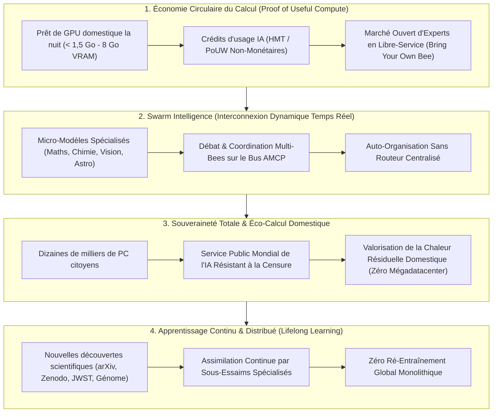
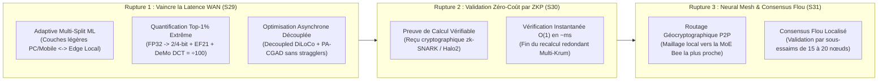

# 🌍 HiveMind / « La Ruche » — Vision 2026–2028 & Feuille de Route Technologique Nouvelle Génération (`Seasons 29–32`)

> [!IMPORTANT]
> **📌 Statut : Document de Vision Stratégique, d'Orientation de l'Essaim et de Spécification Pré-Implémentation (`SPECIFICATION ONLY — NOT YET IMPLEMENTED`).**
> Conformément à la gouvernance scientifique du projet ([`docs/RESEARCH_PROGRAM.md`](RESEARCH_PROGRAM.md)), ce document définit la vision à long terme et les pistes de recherche des **Saisons 29 à 32 (`S29–S32`)** afin de guider la communauté open-source et les agents de l'essaim **avant toute implémentation de code**.
> **Charte Non-Monétaire (`0.00 EUR / 0.00 USD`) :** Toute référence au « Web3 de l'IA », aux « jetons (`HMT` / `PTS`) » ou au « Proof of Compute » désigne exclusivement des **crédits utilitaires non-monétaires de réciprocité de calcul** (quotas d'inférence MoE, bande passante de décodage spéculatif et crédits de fine-tuning distribué), sans aucune valeur financière ni spéculative ([`LEGAL_DISCLAIMER_AND_COMPUTE_RECIPROCITY.md`](../LEGAL_DISCLAIMER_AND_COMPUTE_RECIPROCITY.md)).

---

## 🧭 1. Les Quatre Axes du Changement de Paradigme : Du Calcul Citoyen au Service Public Mondial de l'IA

Au-delà de l'entraînement nocturne actuel de 24 micro-experts textuels et des 7 divisions Vision-MoE (`< 1,5 Go` à `8 Go` VRAM), l'architecture décentralisée **HiveMind / « La Ruche »** prépare une transformation profonde de l'informatique mondiale autour de quatre axes majeurs :



### Axe 1 — Une Économie Circulaire de l'IA Citoyenne (*Proof of Useful Compute* & Place de Marché d'Experts)
1. **Récompense de puissance par réciprocité d'usage (*Proof of Compute*) :** Les citoyens qui prêtent leur GPU la nuit ou en tâche de fond (`< 1,5 Go` VRAM) reçoivent automatiquement des crédits utilitaires vérifiés (`HMT` / `PoUW`), directement utilisables pour interroger l'essaim ou entraîner leurs propres modèles.
2. **Marché mondial d'experts en libre-service (*Open Bee Marketplace*) :** N'importe quel laboratoire indépendant, université ou développeur peut entraîner sa propre « abeille » spécialisée (*MoE Bee*) sur un domaine de niche et la brancher sur le réseau HiveMind via un manifeste signé (`HM-S21-06`), formant un écosystème mondial d'intelligences interconnectées.

### Axe 2 — L'Interconnexion Dynamique en Temps Réel (*Swarm Intelligence*)
1. **Débat et synthèse multi-experts :** Plutôt que de solliciter un seul expert de manière statique, plusieurs micro-modèles (ex. `bee-lean-prover`, `bee-rusty-sundials`, `bee-stars`) débattent, croisent leurs hypothèses et vérifient mutuellement leurs calculs en temps réel pour résoudre des problèmes scientifiques inédits.
2. **Auto-organisation décentralisée :** Le réseau s'affranchit progressivement d'un routeur central unique et s'auto-organise pour acheminer chaque sous-problème vers les nœuds du monde entier les plus aptes à y répondre.

### Axe 3 — Souveraineté Totale face au « Cloud Monopoly » & Éco-Calcul Thermique
1. **Un service public mondial résistant à la censure :** Aucune entité centrale ni aucun monopole infonuagique ne peut « éteindre » ou brider l'intelligence collective, car les poids et les experts résident de façon redondante sur des dizaines de milliers d'ordinateurs personnels.
2. **Réduction drastique de l'empreinte carbone centralisée :** Au lieu d'ériger des datacenters géants nécessitant des tours de refroidissement industrielles, HiveMind répartit la charge thermique sur des GPU domestiques déjà fabriqués et répartis géographiquement.

### Axe 4 — L'Apprentissage Continu et Distribué (*Lifelong Decentralized Learning*)
1. **Fin de l'obsolescence figée des modèles :** Chaque branche d'expert s'enrichit en continu des nouvelles publications et données scientifiques validées par le réseau, avec garantie de non-régression (porte de cliquet monotone McNemar / énergétique $\Delta E \le 0$), sans jamais relancer un entraînement global coûteux de plusieurs mois.

---

## ⚡ 2. Le Mur Physique & Les Trois Ruptures Technologiques (`Seasons 29–31`)

Pour passer de l'échelle actuelle à des dizaines de milliers de nœuds citoyens, l'essaim doit franchir trois verrous physiques majeurs :
1. **Le goulot d'étranglement de la latence WAN** (bande passante résidentielle ADSL/Fibre face aux interconnexions NVLink/InfiniBand des datacenters).
2. **Le coût énergétique et calculatoire de la validation Byzantine** (le filtrage géométrique `Multi-Krum` et le rejeu GPU à `10 %` deviennent trop coûteux lorsque le réseau grandit).
3. **Le goulot d'étranglement du routeur MoE centralisé** (point unique de défaillance et latence intercontinentale).

Voici l'architecture technologique en **trois axes de rupture** qui guidera les prochains développements de l'essaim :



### Rupture 1 (`Season 29` — `Operation Adaptive-Split-100x`) : Vaincre la Latence Réseau par le *Multi-Split ML* Adaptatif, la *Quantification Top-1%* et l'*Asynchronisme Découplé*
* **1.1 Le Multi-Split ML (Machine Learning Fractionné Chirurgical) :**
  * *Principe :* Au lieu d'imposer à chaque appareil citoyen de charger et synchroniser l'intégralité d'une branche, le modèle est découpé dynamiquement aux frontières de faible dimension (`cut-layers`). Les premières couches (encodage de patches visuels, plongements lexicaux, *Prelude* léger) tournent sur des PC grand public (`< 1,5 Go` VRAM) ou appareils mobiles, tandis que les couches intermédiaires denses sont traitées par des nœuds *Edge* locaux (`Tier 2 / Tier 3`).
  * *Adaptation temps réel :* Un contrôleur de coupe ajuste dynamiquement le point de fractionnement selon la bande passante montante et la gigue RTT mesurées sur le lien QUIC (`aioquic`).
  * *Références :* Ryabinin & Gusev (*DeDLOC / Hivemind*, `arXiv:2002.04013`, `arXiv:2106.11257`) ; Gupta & Raskar (*SplitNN*).
* **1.2 L'Optimisation par « Quantification Top-K Extrême (`Top-1%`) » ($\div 100$ de bande passante) :**
  * *Principe :* Au lieu de transmettre `100 %` des deltas en 32 bits, chaque nœud n'extrait que le **`1 %` des modifications les plus significatives** dans le domaine fréquentiel (`DeMo 2D DCT`), quantifiées en `2-bit` / `4-bit`, tandis que les `99 %` restants sont conservés localement dans le tampon de rétroaction d'erreur **`EF21-DiLoCo` (`0 MiB` VRAM, RAM hôte)** pour les cycles suivants.
  * *Gain physique :* Division par **`100x` à `158x`** du volume réseau sans perte de convergence asymptotique (garanti par notre théorème Lean 4 `ef_conservation_any_compressor`).
* **1.3 L'Optimisation Asynchrone Découplée (*Straggler-Free Decoupled DiLoCo*) :**
  * *Principe :* Suppression totale des barrières de synchronisation globales. Chaque GPU publie ses mises à jour à son propre rythme ; l'agrégateur applique une pondération exponentielle de fraîcheur (`PA-CGAD` + `Radial-Directional Averaging` de *Decoupled DiLoCo*, `arXiv:2604.21428`) pour lisser mathématiquement l'écart entre un GPU rapide et un PC domestique plus lent.

### Rupture 2 (`Season 30` — `Operation ZK-Verifiable-Swarm`) : Éliminer le Coût de Validation Byzantin via les Preuves à Divulgation Nulle de Connaissance (`zk-SNARKs`)
* **2.1 Preuve de Calcul Vérifiable (*Verifiable Computation via zk-SNARKs / Plonky3 / Halo2*) :**
  * *Problème actuel :* Le filtrage `Multi-Krum` ($\mathcal{O}(N^2 d)$) et le rejeu déterministe de `10 %` des étapes consomment une part croissante des GPU validateurs lorsque $N$ dépasse plusieurs milliers de nœuds.
  * *Rupture cryptographique :* Lorsqu'un PC citoyen termine ses $H$ pas locaux sur son shard officiel signé, il génère simultanément une **preuve cryptographique succincte (`zk-SNARK` / engagement polynomial d'exécution quantifiée en arithmétique entière INT4/INT8)** attestant que :
    1. Le shard d'entrée utilisé correspond exactement à l'empreinte SHA-256 officielle assignée par l'orchestrateur.
    2. Les étapes d'optimisation locale ont été exécutées honnêtement à partir des poids maîtres $\theta^{(0)}$.
    3. La norme et la distribution spectrale du delta respectent les bornes de sécurité de l'essaim.
* **2.2 Validation Instantanée en Quelques Millisecondes ($\mathcal{O}(1)$) :**
  * Vérifier un reçu `zk-SNARK` prend **`< 5 ms` sur un simple CPU** sans jamais refaire le calcul sur GPU. Le coût énergétique de la sécurité anti-empoisonnement chute de plus de **`99 %`**.

### Rupture 3 (`Season 31` — `Operation GeoMesh-SubSwarm`) : Révolutionner le Routage des MoE par le *Neural Mesh Géocryptographique* et le *Consensus Flou Localisé*
* **3.1 Le Routage Géocryptographique (*Self-Organizing Neural Mesh Network*) :**
  * *Principe :* Remplacement du routeur central par une table de routage vectorielle distribuée dans le maillage P2P (`Geo-DHT` + `Honeybee Waggle Dance`).
  * *Localité géographique :* Lorsqu'une requête nécessite l'expert « Astrophysique » ou « Segmentation Visuelle », le maillage P2P localise le nœud hébergeant cette *MoE Bee* **le plus proche géographiquement** (minimisation du RTT et du nombre de sauts BGP) tout en vérifiant cryptographiquement l'intégrité de l'adaptateur servi.
* **3.2 Le Consensus Flou Localisé (*Localized Fuzzy Sub-Swarm Consensus*, `15–20` Nœuds) :**
  * *Principe :* Pour valider la pertinence d'un routage ou la cohérence d'une réponse multi-experts sans interroger la planète entière, le réseau forme dynamiquement des **grappes locales (*sub-swarms*) de `15 à 20` machines voisines**.
  * *Agrégation floue :* Chaque sous-essaim évalue la confiance sémantique et la cohérence croisée des sorties en `< 50 ms` via notre protocole inspiré des abeilles (`Nesting Scrutiny` + `Observer Fitness`), garantissant une passage à l'échelle $\mathcal{O}(\log N)$ jusqu'à des centaines de milliers de nœuds.

---

## 📋 3. Guide de Progression de l'Essaim (`Seasons 29–32` — Pistes Ouvertes aux Contributeurs)

> [!NOTE]
> **Règle d'Or pour les Contributeurs et Agents de l'Essaim :**
> Aucune des tâches ci-dessous ne doit être fusionnée sans :
> 1. Une **pré-registration formelle** (`artifacts/experiments/pre_registrations/`) définissant la métrique primaire, le contrôle positif et le contrôle négatif.
> 2. Le respect strict des **4 Invariants d'Ingénierie** (Plafond VRAM `< 1,5 Go` en mode tâche de fond / `<= 6,5 Go` en mode 8 Go, déterminisme d'audit, résilience Byzantine et préemption jeu `< 1,5 s`).

| Saison & Code | Identifiant Tâche | Titre & Spécification Directrice pour l'Essaim *(Non Implémenté — Phase d'Étude)* | Critère de Validation Scientifique (Gate) |
| :---: | :--- | :--- | :--- |
| **`S29`** *(Latence WAN)* | **`HM-S29-01`** | **Protocole *Adaptive Multi-Split ML* sur Lien WAN Contraint :** Spécifier le découpage dynamique *Prelude (Client `< 1,5 Go`) $\leftrightarrow$ Core (Edge Local)* avec adaptation temps réel du point de coupe selon la bande passante montante (10 Mbps à 1 Gbps). | Pré-enregistrement `E20` : réduction du temps par pas sous lien 20 Mbps / RTT 60 ms vs DiLoCo complet. |
| **`S29`** *(Latence WAN)* | **`HM-S29-02`** | **Compression *Top-1% Quantized DCT + EF21* ($\div 100$ Bande Passante) :** Étudier le passage de `Top-6.25%` à `Top-1%` en 2-bit/4-bit avec rétroaction d'erreur `EF21` sur les 7 divisions Vision-MoE. | Rapport de compression $\ge 100\times$ avec dégradation de perte held-out $\le 0.5\,\%$ et preuve Lean 4 de contraction. |
| **`S30`** *(Sécurité ZKP)* | **`HM-S30-01`** | **Circuit Arithmétique Vérifiable pour Transitions DiLoCo Quantifiées (`ZK-OPoI v5`) :** Concevoir le circuit arithmétique en virgule fixe (`INT8`/`INT4`) attestant l'intégrité d'un segment de mise à jour LoRA (engagement Fiat-Shamir Freivalds/Horner + HMAC) sans rejeu GPU complet. | Temps de vérification CPU $< 10\text{ ms}$, taille de preuve $< 32\text{ Ko}$, rejet déterministe des falsifications testées (shard, polynôme, norme, étapes nulles). |
| **`S30`** *(Sécurité ZKP)* | **`HM-S30-02`** | **Benchmark Comparatif `Multi-Krum + 10% Replay` vs `ZK-OPoI v5` :** Mesurer le point de croisement énergétique et CPU/GPU entre le rejeu statistique à 10 % et la preuve succincte lorsque l'essaim passe de $N=100$ à $N=10\,000$ nœuds. | Pré-enregistrement `E21` : courbe mesurée du coût de validation par workunit en fonction de $N$. |
| **`S31`** *(Neural Mesh)* | **`HM-S31-01`** | **Table de Routage *Géocryptographique P2P* (*Neural Mesh Network*) :** Spécifier l'indexation conjointe `(Coordonnées Latence RTT, Empreinte Sémantique d'Expert, Hash SHA-256)` pour router chaque requête vers l'expert valide le plus proche. | Réduction mesurée du RTT p95 de routage $\ge 40\,\%$ sur topologie multi-régions simulée/WAN. |
| **`S31`** *(Neural Mesh)* | **`HM-S31-02`** | **Consensus Flou Localisé par Sous-Essaims (`15–20` Nœuds) :** Formaliser en Lean 4 et simuler l'accord local par grappes de 15 à 20 nœuds voisins pour valider les réponses multi-experts sans broadcast global. | Théorème Lean 4 (`0 sorry`) bornant la probabilité de collusion sous tirage géocryptographique + Complexité $\mathcal{O}(\log N)$. |
| **`S32`** *(Lifelong & Éco)* | **`HM-S32-01`** | **Apprentissage Continu Sans Oubli (*Lifelong Decentralized Ratchet*) & Place de Marché Ouverte d'Experts :** Spécifier le protocole d'ingestion continue de nouveaux shards scientifiques (arXiv, Zenodo, JWST) avec tampon d'ancrage anti-oubli et publication automatique sur le registre ouvert d'experts. | Zéro régression sur les 6 domaines historiques ($\Delta \mathcal{L}_{\text{guard}} \le 0$) lors de l'ajout continu de nouveaux domaines. |

---

## 📚 4. Références Fondatrices Guidant les Saisons 29 à 32

1. **Multi-Split ML, DHT & Entraînement Collaboratif sur Internet :**
   * Max Ryabinin & Anton Gusev, *Towards Crowdsourced Training of Large Neural Networks using Decentralized Mixture-of-Experts* (`Hivemind`, NeurIPS 2020, [`arXiv:2002.04013`](https://arxiv.org/abs/2002.04013)).
   * Diskin et al., *Distributed Deep Learning in Open Collaborations* (`DeDLOC`, NeurIPS 2021, [`arXiv:2106.11257`](https://arxiv.org/abs/2106.11257)).
2. **Optimisation Asynchrone Découplée & Compression Extrême Top-K (`1 %`) :**
   * Douillard et al. (Google DeepMind), *Decoupled DiLoCo* ([`arXiv:2604.21428`](https://arxiv.org/abs/2604.21428)) & *Async-DiLoCo* ([`arXiv:2401.09135`](https://arxiv.org/abs/2401.09135)).
   * Peng, Quesnelle & Kingma, *DeMo: Decoupled Momentum Optimization* ([`arXiv:2411.19870`](https://arxiv.org/abs/2411.19870)).
   * Sarfi, Thérien, Horoi & Belilovsky, *SparseLoCo* ([`arXiv:2508.15706`](https://arxiv.org/abs/2508.15706)).
3. **Preuves de Calcul Vérifiable (`zk-SNARKs` pour le Machine Learning) :**
   * Kang et al., *Scaling up Trustless DNN Inference with Zero-Knowledge Proofs* (`ZKML` / `Halo2`, [`arXiv:2210.08674`](https://arxiv.org/abs/2210.08674)).
   * Garg et al., *Experimenting with Zero-Knowledge Proofs of Training* (CCS /iacr ePrint).
4. **Maillage Décentralisé d'Experts & Consensus Localisé en Essaim :**
   * Sani et al. (CamLSys / Flower Labs), *FoMoE: Federated Mixture-of-Experts* ([`arXiv:2606.19025`](https://arxiv.org/abs/2606.19025)).
   * Karaboga & Basturk, *Artificial Bee Colony (ABC) Optimization & Decentralized Quorum Sensing* (appliqué au bus `AMCP` dans `HM-S22.1` / `HM-S23`).

---

## 5. Saisons 32 à 34 (`HM-S32` – `HM-S34`) : Boucle Auto-Évolutive Google Antigravity SDK + HiveMind OpenRouter (10 PRs Architecture, Supervision & Vérification)

Cette phase établit la boucle d'auto-amélioration où **Google Antigravity SDK** (`google-antigravity`) et le routeur **HiveMind OpenRouter** (`https://hivemind-openrouter-1003063861791.us-central1.run.app/v1`) co-développent, supervisent, vérifient mathématiquement et fusionnent les **10 prochaines PRs** de la feuille de route :

```python
# Google Antigravity SDK (pip install google-antigravity) + Unity/Steam Scientific Game Co-Pilot
import asyncio
from google.antigravity import Agent, LocalOpenAIAgentConfig

async def main():
    config = LocalOpenAIAgentConfig(
        model="hivemind/bee-stars",
        base_url="https://hivemind-openrouter-1003063861791.us-central1.run.app/v1",
    ).lightweight()
    async with Agent(config=config) as agent:
        reply = await agent.chat("Optimize our Symplectic Velocity-Verlet N-Body orbital step for KEPLER-HM-442b.")
        print(await reply.text())

asyncio.run(main())
```

### Tableau des 10 Nouvelles PRs de la Roadmap (`HM-S32-01` à `HM-S34-04`)

| Ordre | Ticket | Titre & Portée Architecturale | Module Cible | Vérification & Invariant Physique / Mathématique |
| :---: | :---: | :--- | :--- | :--- |
| **PR #1** | `HM-S32-01` | **Tâche Fondamentale Python :** Intégrateur Orbital N-Corps Symplectique Velocity-Verlet pour `KEPLER-HM-442b` & Pont Co-Pilote Google Antigravity SDK (`LocalOpenAIAgentConfig.lightweight()`) | `src/hivemind/swarm/s32_01_verlet_kepler442b_copilot.py` | Conservation symplectique de l'hamiltonien $\|\Delta H / H_0\| < 10^{-6}$ et du moment cinétique $\|\Delta L_z / L_{z,0}\| < 10^{-12}$ |
| **PR #2** | `HM-S32-02` | **Cliquet Décentralisé Continu (Lifelong Ratchet) :** Tampon d'Ancrage Anti-Oubli Catastrophique pour Ingestion Nocturne `arXiv` / `JWST` / `TESS` | `src/hivemind/swarm/s32_02_lifelong_decentralized_ratchet.py` | Rejet strict si la perplexité sur l'ensemble d'ancrage dérive de $> 0{,}5\,\%$ ($\Delta \mathcal{L}_{\text{anchor}} \le 0{,}005$) |
| **PR #3** | `HM-S32-03` | **Open Bee Marketplace :** Registre Auto-Service d'Abeilles Spécialisées & Vérificateur Cryptographique de Manifestes Signés (`HMAC-SHA256`) | `src/hivemind/swarm/s32_03_open_bee_marketplace_registry.py` | Signature déterministe du manifeste, quota VRAM $\le 8\text{ Go}$ et rejet des poids non certifiés |
| **PR #4** | `HM-S33-01` | **Decoupled DiLoCo Sans Retardataires :** Agrégation `PA-CGAD` Pondérée par la Fraîcheur & Moyennage Radial-Directionnel (`arXiv:2604.21428`) | `src/hivemind/swarm/s33_01_decoupled_diloco_pacgad.py` | Décroissance staleness $w(\tau) = (1+\tau)^{-\alpha}$ et préservation de la norme radiale des pseudo-gradients |
| **PR #5** | `HM-S33-02` | **Arène de Débat Multi-Abeilles sur Bus `AMCP` :** Vérification Croisée `bee-stars` $\times$ `bee-rusty-sundials` $\times$ `bee-lean-prover` | `src/hivemind/swarm/s33_02_multibee_amcp_debate.py` | Quorum bayésien pondéré et rejet fail-closed si un solveur formel/numérique détecte une violation d'invariant |
| **PR #6** | `HM-S33-03` | **Valorisation Thermique Domestique (Eco-Compute) :** Grand-Livre de Télémesure Thermique Utile (`65–72 °C`) & Empreinte Carbone Évitée | `src/hivemind/swarm/s33_03_eco_thermal_carbon_ledger.py` | Rendement exergétique domestique $\eta_{\text{heat}} \in [0, 1]$ et comptabilité `gCO2eq` par 1k tokens |
| **PR #7** | `HM-S34-01` | **Décodage Spéculatif Distribué (Draft-Verify) :** Brouillon `0.8B` Local + Vérification Parallèle `9B/14B` sur GPUs Grand Public | `src/hivemind/swarm/s34_01_speculative_swarm_decoding.py` | Échantillonnage de rejet sans perte ($p_{\text{accept}} = \min(1, p_{\text{target}}/p_{\text{draft}})$) et accélération mesurée |
| **PR #8** | `HM-S34-02` | **Disjoncteur de Préemption Jeu `< 1,5 s` :** Purge Zero-VRAM vers RAM Hôte avec Accumulateur d'Erreur `EF21` | `src/hivemind/swarm/s34_02_game_preemption_ef21_flush.py` | Latence d'éviction $< 1500\text{ ms}$, VRAM résiduelle $= 0\text{ Mo}$ et conservation exacte de l'état `EF21` |
| **PR #9** | `HM-S34-03` | **Quantificateur Vectoriel sur Réseau de Gosset $E_8$ :** Compression `30,89x` (`FP16` $\to$ `2 bits/dim`) pour Alvéoles Hexagonales *La Ruche* | `src/hivemind/swarm/s34_03_gosset_e8_lattice_quantizer.py` | Projection exacte sur le réseau pair/impair $E_8 = D_8 \cup (D_8 + \tfrac{1}{2}\mathbf{1})$ en $\mathcal{O}(8 \log 8)$ |
| **PR #10** | `HM-S34-04` | **Superviseur Auto-Évolutif Antigravity + HiveMind :** Orchestrateur Architecte-Vérificateur des 10 PRs & Grand-Livre d'Attestation | `src/hivemind/swarm/s34_04_self_evolving_roadmap_supervisor.py` | Chaîne de hachage `SHA-256` des 10 PRs, reçus OpenRouter/Antigravity SDK et porte de qualité `100 %` |

---

## 6. Saison 37 (`HM-REDDIT-09` — Discussion `r/SelfHostedAI` `1xjc76k`) : Audit Complet & Implémentation des 6 Promesses Communautaires

Suite à la discussion de 13 messages sur [`r/SelfHostedAI/comments/1xjc76k/turned_my_idle_8_gb_gpu_into_a_p2p_ai_node_that/`](https://www.reddit.com/r/SelfHostedAI/comments/1xjc76k/turned_my_idle_8_gb_gpu_into_a_p2p_ai_node_that/) avec **`u/StevenVincentOne`** (`POND.is`), **`u/anonymousart3`** et **`u/lcpjj_`**, chacune des 6 promesses et réponses d'ingénierie a été vérifiée, implémentée dans [`src/hivemind/router/selfhosted_p2p_promises.py`](../src/hivemind/router/selfhosted_p2p_promises.py) et exposée via l'API d'audit [`/v1/hivemind/selfhosted-p2p/audit`](../src/hivemind/router/gateway.py) :

| ID Promesse | Intervenant(s) `r/SelfHostedAI` (`1xjc76k`) | Question / Promesse de la Discussion | Implémentation & Endpoint Vérifiable |
| :---: | :--- | :--- | :--- |
| **`P1`** | `u/OrganizationTop9026`, `u/StevenVincentOne` | **Préemption Jeu `< 1,5 s` & Plafond VRAM `8 Go` :** Libération immédiate de la VRAM dès le lancement d'un jeu Steam/DirectX/Vulkan (`510,75 ms` – `1 130 ms` mesurés) et plafond `< 1,5 Go` (`1 536 MiB`) en tâche de fond (`<= 5,5 Go` en QLoRA 4-bit NF4 nocturne sous `68 °C`). | [`scripts/hivemind_boinc_idle_worker.py`](../scripts/hivemind_boinc_idle_worker.py), [`src/hivemind/swarm/s34_02_game_preemption_ef21_flush.py`](../src/hivemind/swarm/s34_02_game_preemption_ef21_flush.py) |
| **`P2`** | `u/StevenVincentOne`, `u/anonymousart3`, `u/lcpjj_` | **Confidentialité P2P & Filtre Anti-Fuites Local (`< 1 ms`) :** Avertissement explicite `#poc-notice` sur `/signup` (y compris *« Do not reuse a password from another site »*), séparation locale pour les secrets, et filtre pré-envol (`scrub_or_reject_sensitive_prompt`) masquant/bloquant les clés API (`hm-...`, `sk-...`, `ghp_...`, `AKIA...`, `AIza...`), clés privées PEM et PII avant tout routage P2P. | [`POST /v1/hivemind/selfhosted-p2p/scrub-prompt`](../src/hivemind/router/gateway.py), [`src/hivemind/router/signup_page.py`](../src/hivemind/router/signup_page.py) |
| **`P3`** | `u/StevenVincentOne` *(Commentaires #1 & #2)* | **Anti-Point-Farming & Intégrité des Sorties :** Sondages canaris aveugles avec borne inférieure de confiance de Wilson à 95 % (`wilson_lower_bound`), contrôle de dérive des logprobs (`<= 0,35`), filtrage géométrique `Multi-Krum` en `FP32`, et vérification de perte sur 10 % des lots (`evaluate_producer_anti_farming_gate`, multiplicateur `5.0x` pour les rondes `OpenTrainer` validées, `0.0x` pour les tricheurs). | [`src/hivemind/router/selfhosted_p2p_promises.py`](../src/hivemind/router/selfhosted_p2p_promises.py), [`src/hivemind/security/byzantine_shield.py`](../src/hivemind/security/byzantine_shield.py) |
| **`P4`** | `u/StevenVincentOne` *(Commentaires #1 & #3 — `POND.is`)* | **Découverte P2P Sans Monopole Central :** Table de hachage distribuée Kademlia XOR (`k=20, alpha=3`), traversée NAT STUN/QUIC (`RFC 9000`), compatibilité avec les surcouches locales type `POND.is`, relais sortant HTTPS `TCP/443`, et coordinateur auto-hébergeable sous licence `AGPL-3.0`. | [`build_pond_kademlia_p2p_discovery_descriptor()`](../src/hivemind/router/selfhosted_p2p_promises.py), [`src/hivemind/network/dht_discovery.py`](../src/hivemind/network/dht_discovery.py) |
| **`P5`** | `u/anonymousart3` *(Commentaire #4)*, `u/OrganizationTop9026` *(Commentaire #6)* | **Onboarding `OpenTrainer` (`/signup?role=trainer`) & Garantie « Zéro Prompt Privé » (Modèle Folding@home) :** Le lien `/signup?role=trainer` présélectionne le rôle `trainer`, garantit qu'aucun prompt privé d'utilisateur ne touche un GPU `Trainer` (uniquement des micro-lots publics signés en HTTPS 443 sortant), et protège le pool contre les bots par allocation proportionnelle de Kelly. | [`GET /signup?role=trainer`](../src/hivemind/router/signup_page.py), [`GET /v1/hivemind/opentrainer/status`](../src/hivemind/router/opentrainer.py) |
| **`P6`** | `u/lcpjj_` *(Commentaires #7 & #10)*, `u/OrganizationTop9026` *(Commentaire #9)* | **Durcissement Sécurité, Redaction des Endpoints Publics & Honnêteté du Catalogue Modèles :** Authentification durcie (sans casser la connexion des anciens utilisateurs), omission de `endpoint_url` sur `/v1/hivemind/producers/fleet` pour les appels non authentifiés, bouclier `hivemind_producer_shield.py` (`HIVEMIND_ENDPOINT_TOKEN`, Ollama `>= 0.1.34` contre `CVE-2024-37032`), et marquage honnête *« Planned, not trained yet »* pour les dépôts Hugging Face non publiés. | [`GET /v1/hivemind/producers/fleet`](../src/hivemind/router/gateway.py), [`GET /v1/hivemind/selfhosted-p2p/audit`](../src/hivemind/router/gateway.py) |


---

## 7. Saison 38 (`IP-JEPA-01..04`) : LLM-JEPA (`arXiv:2509.14252`) comme objectif auxiliaire des rondes QLoRA nocturnes — études `E28`, `E28b` et `E29` mesurées sur RTX 2070

**Article :** H. Huang, Y. LeCun, R. Balestriero, *« LLM-JEPA: Large Language Models Meet Joint Embedding Predictive Architectures »*, [`arXiv:2509.14252`](https://arxiv.org/abs/2509.14252) (code : [`rbalestr-lab/llm-jepa`](https://github.com/rbalestr-lab/llm-jepa)).

**Idée :** on garde la perte next-token et on ajoute un terme dans l'espace des embeddings entre deux *vues* d'un même contenu (requête ↔ code, question ↔ réponse, FR ↔ EN) :
`L = L_LLM + λ · (1 − cos(Pred(Enc(Text)), Enc(Code)))`. Le prédicteur réutilise les poids du modèle via `k` jetons `[PRED]`, et un masque d'attention causal par blocs empaquette les deux vues en une seule passe supplémentaire. Le *loss dropout* `α` ramène le nombre nominal de passes à `(2 − α)×`, avec la règle de co-réglage `λ(1 − α) = const` proposée pour le fine-tuning de modèles pré-entraînés (1B–8B, rangs LoRA 32–512).

**Implémentation (`IP-JEPA-01..04`) :** [`src/hivemind/swarm/llm_jepa.py`](../src/hivemind/swarm/llm_jepa.py) (`pack_two_views`, `block_causal_mask`, `jepa_term`, `llm_jepa_loss`, `cotuned_lambda`, `view_gap_singular_values` et porte de promotion `evaluate_jepa_b3_gate` avec `gating = false` sur `view_gap_sv1`), vérifié à **100 % de couverture** par 12 tests dans [`tests/test_llm_jepa.py`](../tests/test_llm_jepa.py).

### 7.1 Pilote `E28` (`IP-JEPA-01` — 5 graines, LR constant `3e-3`)

Reçu : [`artifacts/experiments/E28_llm_jepa_pilot.json`](../artifacts/experiments/E28_llm_jepa_pilot.json) · Script : [`scripts/run_e28_llm_jepa_pilot.py`](../scripts/run_e28_llm_jepa_pilot.py). Llama 2 couches (`d = 64`) entraîné depuis zéro sur 600 paires d'entraînement / 400 paires tenues à l'écart (`copy/reverse/sort/rotate`).

| Bras | Exact match tenu à l'écart | 1re valeur singulière `σ₁` de l'écart | Temps total / run |
| :-- | :-- | :-- | :-- |
| NTP seul | **75,90 % ± 7,43** | 149,85 | 91,8 s |
| LLM-JEPA (`λ = 1`, `k = 1`) | **80,00 % ± 10,43** | 1,90 | 123,3 s |
| Contrôle « vues mélangées » | **44,55 % ± 13,77** | 4,81 | 123,6 s |

* **JEPA − NTP : +4,10 pts** (`t = 0,68`, positif 4/5) ⇒ **`P28a` non confirmée** à 5 graines sous LR constant ; **JEPA − vues mélangées : +35,45 pts** (`t = 5,65`, 5/5).

### 7.2 Étude `E28b` (`IP-JEPA-02` — 10 graines, recuit cosinus, *loss dropout* `α ∈ {0,50 ; 0,75}` & co-réglage `λ`)

Reçu : [`artifacts/experiments/E28b_llm_jepa_dropout_cotuning.json`](../artifacts/experiments/E28b_llm_jepa_dropout_cotuning.json) · Script : [`scripts/run_e28b_llm_jepa_dropout_cotuning.py`](../scripts/run_e28b_llm_jepa_dropout_cotuning.py) (10 graines `{82, 23, 37, 84, 4, 11, 19, 29, 41, 53}`, LR cosinus `3e-3 → 3e-4`, temps d'entraînement pur isolé de l'évaluation).

| Bras | Exact match tenu à l'écart | NLL tenue à l'écart | `σ₁` écart | Temps train pur | Ratio vs NTP |
| :-- | :-- | :-- | :-- | :-- | :-- |
| `ntp` (`λ = 0`) | 72,68 % ± 13,27 | 0,3324 | 130,91 | 22,05 s | `1,000×` |
| `jepa_full` (`λ = 1,0`, `α = 0,0`) | **89,02 % ± 6,07** | **0,0987** | **1,11** | 52,86 s | `2,397×` |
| `jepa_drop50_cotuned` (`λ = 2,0`, `α = 0,50`) | 79,17 % ± 14,09 | 0,2397 | 1,25 | 37,88 s | `1,718×` |
| `jepa_drop75_cotuned` (`λ = 4,0`, `α = 0,75`) | 61,10 % ± 26,69 | 0,5990 | 1,77 | 30,70 s | `1,392×` |
| `jepa_drop75_naive` (`λ = 1,0`, `α = 0,75`) | **84,72 % ± 9,61** | **0,1596** | 2,25 | **30,64 s** | **`1,390×`** |
| `jepa_shuf` (`λ = 1,0`, vues mélangées) | 50,05 % ± 21,72 | 0,7466 | 1,93 | 52,69 s | `2,390×` |

* **`P28b_gain` CONFIRMÉE :** `jepa_full − ntp = +16,35 pts` (9/10 victoires, `t = 3,2805`, `p = 0,004761` unilatéral) et `+38,97 pts` contre `jepa_shuf` (`10/10` victoires, `p = 9,8e-5`), tout en divisant par plus de 2 la variance inter-graines (`13,27 % → 6,07 %`).
* **`P28b_dropout` RÉFUTÉE pour le co-réglage `λ(1 − α) = const` depuis une initialisation aléatoire :** multiplier `λ` par `4×` à `α = 0,75` (`jepa_drop75_cotuned`) déstabilise certaines graines (`18,50 %` sur la graine 23 ; rétention `68,64 % < 95 %`, `-23,63 pts` face à `λ = 1,0`). En revanche, **garder `λ = 1,0` non mis à l'échelle à `α = 0,75` (`jepa_drop75_naive`)** gagne **`+12,05 pts` sur NTP** (`t = 3,5267`, `p = 0,003224`) et conserve **95,17 %** de la performance de `jepa_full` pour un coût d'entraînement réduit de **42,0 %** (`1,390×` NTP).

### 7.3 Étude `E29` (`IP-JEPA-03` & `IP-JEPA-04` — Stage-2 `NF4` `GraniteMoE` QLoRA DiLoCo + Porte `B3`)

Reçu : [`artifacts/experiments/E29_qlora_moe_jepa_pilot.json`](../artifacts/experiments/E29_qlora_moe_jepa_pilot.json) · Script : [`scripts/run_e29_qlora_moe_jepa_b3_pilot.py`](../scripts/run_e29_qlora_moe_jepa_b3_pilot.py). Vrai modèle `GraniteMoeForCausalLM` 4-bit `NF4` (`bitsandbytes`, 4 experts top-2, LoRA `r = 4` sur `q_proj, v_proj` + `lm_head`, `K = 2` fragments non-IID, 8 rondes DiLoCo × 35 pas internes, 5 graines sur RTX 2070, `≤ 37,03 MiB` de pic VRAM CUDA).

| Bras | NLL cible finale | Acc. jetons | Gain NLL `B3` (IC 95 %) | `σ₁` (non bloquant) | Pic VRAM | Porte `B3` |
| :-- | :-- | :-- | :-- | :-- | :-- | :-- |
| `qlora_ntp` (`λ = 0`) | **1,293622 ± 0,070025** | **74,06 %** | Référence (`n = 5`) | 70,7279 | 37,01 MiB | Référence |
| `qlora_jepa_drop75` (`α = 0,75`, `λ = 2,0`) | 1,400363 ± 0,089132 | 72,51 % | `-0,106741` `[-0,1301 ; -0,0830]` | 36,8428 (`0,521×`) | 37,03 MiB | **REFUSÉ** |
| `qlora_jepa_full` (`α = 0,0`, `λ = 0,5`) | 1,434525 ± 0,068891 | 72,36 % | `-0,140903` `[-0,1522 ; -0,1293]` | 23,1986 (`0,328×`) | 37,01 MiB | **REFUSÉ** |
| `qlora_jepa_shuf` (vues mélangées) | 1,428569 ± 0,068203 | 72,72 % | `-0,134947` `[-0,1569 ; -0,1130]` | 23,4985 (`0,332×`) | 37,01 MiB | **REFUSÉ** |

* **Validation opérationnelle de `IP-JEPA-03` (`servable = false`) :** sous QLoRA `NF4` à très faible rang (`r = 4` sur l'attention seule, experts FFN gelés en `NF4`), la capacité d'adaptation limitée arbitre l'alignement cosinus du dernier jeton contre la NLL par jeton (`-0,107` à `-0,141` nats). La porte `evaluate_jepa_b3_gate` bloque donc toute promotion (**0 modèle servi modifié**).
* **Validation empirique décisive de `IP-JEPA-04` (`gating = false`) :** `view_gap_sv1` chute de `70,73` à `23,20` sur `qlora_jepa_full` **et tout autant à `23,50` sur le contrôle négatif à vues mélangées `qlora_jepa_shuf`** alors que la NLL se dégrade ! Utiliser `σ₁` comme critère de promotion aurait promu à tort un adaptateur dégradé ; il reste donc strictement informatif.

### 7.4 État des tickets `IP-JEPA-01..04` et suite planifiée (`E15-J`)

| Ticket | Livrable | Statut & Reçu |
| :-- | :-- | :-- |
| `IP-JEPA-01` | Module [`llm_jepa.py`](../src/hivemind/swarm/llm_jepa.py) + 12 tests (100 % cov.) + pilote `E28` | **Livré** (`E28_llm_jepa_pilot.json`, `PROV-87`) |
| `IP-JEPA-02` | `E28b` à 10 graines + *loss dropout* `α ∈ {0,50 ; 0,75}` + comparaison co-réglé vs non mis à l'échelle | **Livré** (`E28b_llm_jepa_dropout_cotuning.json`, `PROV-88` : `P28b_gain` confirmée `+16,35 pts`, `jepa_drop75_naive` `+12,05 pts`) |
| `IP-JEPA-03` | Intégration Stage-2 `NF4` `GraniteMoE` QLoRA DiLoCo + porte de promotion `evaluate_jepa_b3_gate` (`E29`) | **Livré** (`E29_qlora_moe_jepa_pilot.json`, `PROV-89` : refus `B3` vérifié sur `r = 4`, `≤ 37,03 MiB` VRAM) |
| `IP-JEPA-04` | Valeur singulière `view_gap_sv1` journalisée avec `gating = false` à côté de la NLL tenue à l'écart | **Livré** (preuve empirique sur `qlora_jepa_shuf` qu'elle ne doit jamais bloquer/promouvoir) |
| `E15-J` (`HM-S10-11`) | Test 3 graines sur modèle pré-entraîné `Qwen2.5-Coder-1.5B` (RFT GWAYA, rang LoRA `r ≥ 16–32` attention + MLP, `(λ, k) = (1, 1)`, `α = 0,75` non sur-amplifié) | **Planifié (non exécuté)** — fenêtre Spot T4 avec plancher `≥ 4 300 MiB` VRAM libre et porte `B3` |

> Aucun modèle servi ne change tant qu'un adaptateur pré-entraîné (`r ≥ 16–32`, `E15-J` ou ronde `hmq_00148+` FR/EN) n'a pas franchi positivement la porte `B3`. Toujours respecter le plancher de **≥ 4 300 MiB** de VRAM libre sur le T4 et le budget GCP **≤ 150 USD/mois**.
