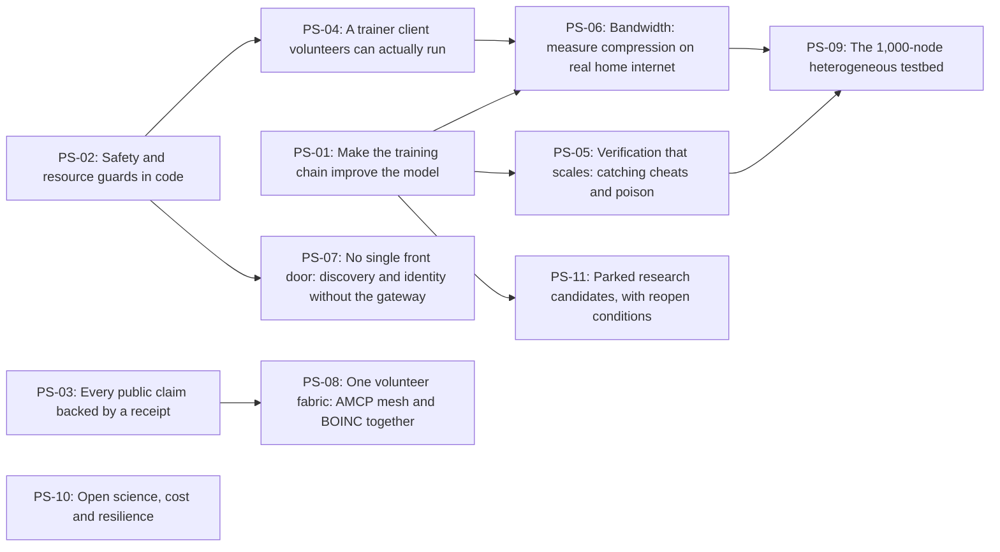

<!-- Generated by scripts/render_planetary_plan.py from docs/roadmap/planetary_streams.json; edit the JSON, not this file. -->

# HiveMind planetary-scale plan

Derived from the foundation paper *Project HiveMind: A System Design for Decentralized Sparse Mixture-of-Experts Training with DiLoCo-Style Outer Optimization on 8 GB Consumer GPUs*, version 4.3.0 ([doi:10.5281/zenodo.24043016](https://doi.org/10.5281/zenodo.24043016)), on 2026-11-07.

## 1. Where we are going

**Planetary scale:** At least 10,000 volunteer nodes active in a 30-day window, in at least 10 languages and 6 regions, training and serving HiveMind-built experts that are measured to improve on their base models, with every node discoverable and verifiable without the project's gateway, and the project's own cloud spend still within the 150 USD/month budget.

*Source:* Wave 5 of the five-wave table (sec:regional_super_peers_and_5wave_roadmap) and Phases 1-4 of the 18-month roadmap (sec:roadmap_exec_summary). The paper's wave numbers are forecasts from a queueing model, not measurements; here each wave is entered only on receipts.

*Measured by:*

- accounts and node-telemetry receipt (stream PS-03): active nodes in a 30-day window, by region and language
- chain status receipt (PS-01): experts that improve held-out loss against their base
- discovery receipt (PS-07): share of nodes reachable without the gateway
- cost receipt (PS-10): monthly GCP spend

## 2. Where we are (baseline, from receipts)

| Fact | Receipt |
|---|---|
| Training chain: 187 BOINC QLoRA-MoE rounds; median per-domain held-out change +0.1266 nats over rounds 171 onward, 99% of domain changes worse; the first diagnostic round was also worse on all 6 evaluated domains. | `artifacts/experiments/CHAIN_STATUS_2026-11-07.json` |
| Served models: no HiveMind-trained adapter is served to users; 1 of 13 serving tags is HiveMind-built (hivemind-bee-stars). | `artifacts/experiments/CATALOG_SERVED_2026-11-07.json` |
| GPUs doing the work: one Tesla T4 (GCP Spot) and one RTX 2070. | not re-verified (operator statement) |
| Accounts: 55 active accounts claimed in public on 30 October 2026. | none yet; producing one is PS-03 |
| VRAM floor: one probe arm left 3,557 MiB free against the 4,300 MiB floor; the probe queue does not enforce the floor. | `artifacts/experiments/NIGHT_INTENSE_1_probe_results_2026-10-28.json` |
| Volunteer cost: about 0.05 EUR of electricity per RTX 2070 hour at the EU average, 0.39 EUR per 8-hour night. | `artifacts/experiments/CONSUMER_GPU_ECONOMICS_2026-11-07.json` |
| Older paper claims (47-node live WAN, 24 trained experts, zk-SNARK soundness, a 100x bandwidth cut) are not re-verified against receipts in v4.3 and are not used as a baseline here. | not re-verified |

## 3. Rules every stream follows

1. A wave is entered only when every entry criterion is met by a committed receipt; forecasts never count.
2. Every experiment is pre-registered (hypothesis, metric, controls, decision rule) before it runs; a refuted prediction is reported as refuted.
3. Every number in the paper enters through the provenance lock (paper/autoevolve_peer_review_pipeline.py).
4. AGENTS.md applies to every stream: keep at least 4,300 MiB free on the T4, never touch /opt/hivemind/t4 outside the installer, keep GCP within 150 USD/month (Spot VMs, scale-to-zero services), Lean theorems with zero sorry, uv run pytest green before a PR.
5. A producer sees every prompt it serves until a private path is measured end to end; every public page says so.

## 4. Waves: entered on receipts, never on forecasts

| Wave | Name | Node target | Status | Entry criteria (all required) |
|---|---|---:|---|---|
| W0 | Pioneers (today) | 0 | current | Baseline facts above, each with its receipt or marked not re-verified. |
| W1 | First 150 volunteers (EU and North America East) | 150 | not entered | PS-01 done: chain non-regressing over a pre-registered window. PS-02 done: VRAM floor and consent/pause enforced in code with tests. PS-03 done: every public claim backed by a receipt; accounts receipt published. PS-04 done: trainer client measured on at least 3 real volunteer GPUs of different classes. Accounts receipt shows at least 150 nodes active in 30 days. |
| W2 | Global launch, 265 nodes, 6 regions | 265 | not entered | W1 entered. PS-05 done: verification false-accept and false-reject rates measured with planted poisoners. PS-08 done: BOINC and mesh share one volunteer identity and one event stream. Measured p50 gateway latency within the pre-registered bound at the W2 node count. |
| W3 | 500 nodes, trans-Pacific and LATAM | 500 | not entered | W2 entered. PS-06 done: outer-gradient compression measured on real residential links. PS-07 done: nodes discover each other without the gateway in a pre-registered experiment. |
| W4 | 2,000 nodes, 10 languages | 2,000 | not entered | W3 entered. PS-09 done: 1,000-node heterogeneous simulation passes its pre-registered gates. Verification cost per work unit measured at the W3 node count, with the crossover point against replay known. |
| W5 | Planetary scale, 10,000 nodes | 10,000 | not entered | W4 entered. End-state definition met, every item from a receipt. PS-10 done for the release that reports it: Zenodo version with verified checksums and an external review on record. |

## 5. Streams at a glance

Ordered by dependency. A stream with no dependency can start today.

| Stream | Title | Depends on | Pre-reg | Labels |
|---|---|---|---|---|
| [PS-01](#ps-01--make-the-training-chain-improve-the-model) | Make the training chain improve the model | — | yes | research, needs-prereg, help wanted |
| [PS-02](#ps-02--safety-and-resource-guards-in-code) | Safety and resource guards in code | — | no | help wanted, agent-ready |
| [PS-03](#ps-03--every-public-claim-backed-by-a-receipt) | Every public claim backed by a receipt | — | no | help wanted, good first issue, documentation |
| [PS-04](#ps-04--a-trainer-client-volunteers-can-actually-run) | A trainer client volunteers can actually run | PS-02 | no | help wanted, agent-ready |
| [PS-05](#ps-05--verification-that-scales-catching-cheats-and-poison) | Verification that scales: catching cheats and poison | PS-01 | yes | research, needs-prereg, help wanted |
| [PS-06](#ps-06--bandwidth-measure-compression-on-real-home-internet) | Bandwidth: measure compression on real home internet | PS-01, PS-04 | yes | research, needs-prereg, help wanted |
| [PS-07](#ps-07--no-single-front-door-discovery-and-identity-without-the-gateway) | No single front door: discovery and identity without the gateway | PS-02 | yes | research, needs-prereg, help wanted |
| [PS-08](#ps-08--one-volunteer-fabric-amcp-mesh-and-boinc-together) | One volunteer fabric: AMCP mesh and BOINC together | PS-03 | yes | help wanted, java |
| [PS-09](#ps-09--the-1000-node-heterogeneous-testbed) | The 1,000-node heterogeneous testbed | PS-05, PS-06 | yes | research, needs-prereg, help wanted |
| [PS-10](#ps-10--open-science-cost-and-resilience) | Open science, cost and resilience | — | no | help wanted, documentation |
| [PS-11](#ps-11--parked-research-candidates-with-reopen-conditions) | Parked research candidates, with reopen conditions | PS-01 | no | research |

## 6. How to contribute

1. Pick a stream whose dependencies are done (or which has none). Comment on its tracking issue to say what you take, so two people do not take the same item.
2. If the stream needs pre-registration, open a PR with the pre-registration file first; nothing runs before it is merged.
3. Each definition-of-done item is closed by its validation entry: run the command, commit the receipt, quote the pass condition in the PR.
4. Run `uv run pytest` on what you touched; every PR passes the security scanner and the core checks.
5. Never claim more than the receipt shows. A refuted result is a result.

## 7. Streams in detail

### PS-01 — Make the training chain improve the model

**Objective.** Find and fix why the BOINC QLoRA-MoE chain has made held-out loss worse since round hmq_00171, and show a pre-registered window of rounds that improves or holds it.

**Why it matters.** The chain is the only place HiveMind trains anything. Since round 171, almost every round has made the model worse on the held-out test sets, and a first diagnostic round (no stratified mixing, half the learning rate) was worse too. Nothing else on this roadmap matters while the core training loop degrades the model it trains.

**Depends on:** nothing; can start now  
**Pre-registration required:** yes, before any run  
**Paper sections:** `sec:directions`, `sec:limitations`  
**Roadmap ids:** `HM-S33-06`  
**Skills:** PyTorch, PEFT/QLoRA, experiment design  

**Directions**

1. Read the ledger receipt (artifacts/experiments/CHAIN_STATUS_2026-11-07.json) and the per-round eval_by_domain fields in the assimilated ledger.
2. Write the E24 pre-registration: three candidate causes (the ratchet's acceptance rule, single-domain work units, stratified mixing), one arm each plus a control arm that replays the round-170 adapter unchanged.
3. Check the evaluation itself first: same held-out shards, same seed, same base weights before and after each round (an evaluation drift would look exactly like this).
4. Align the outer loop with Decoupled DiLoCo's learner/synchroniser split (arXiv:2604.21428) only after the cause is known.

**Definition of done**

- [ ] `PS-01-D1` E24 pre-registration committed before any run, with arms, metric (median per-domain held-out change) and decision rule.
- [ ] `PS-01-D2` Cause attributed, or each candidate refuted, in a committed E24 report.
- [ ] `PS-01-D3` A pre-registered window of at least 20 consecutive rounds has median per-domain held-out change <= 0 and share of domain changes worse <= 50%.
- [ ] `PS-01-D4` The paper's chain paragraph is updated through the provenance lock.

**Validation tests**

| DoD | Command | Receipt | Passes when | Tool exists |
|---|---|---|---|---|
| `PS-01-D1` | `test -f artifacts/experiments/E24_chain_regression_prereg.json && git log --diff-filter=A --format=%cI -- artifacts/experiments/E24_chain_regression_prereg.json` | `artifacts/experiments/E24_chain_regression_prereg.json` | file exists and its first commit predates the first E24 round in the ledger | to be written |
| `PS-01-D2` | `python3 -c "import json;r=json.load(open('artifacts/experiments/E24_chain_regression_report.json'));assert r['decision'] in ('CAUSE_ATTRIBUTED','ALL_REFUTED')"` | `artifacts/experiments/E24_chain_regression_report.json` | decision field present and one of the two registered outcomes | to be written |
| `PS-01-D3` | `python3 scripts/chain_status_receipt.py --out artifacts/experiments/CHAIN_STATUS_<date>.json` | `artifacts/experiments/CHAIN_STATUS_<date>.json` | for the registered window: median_change_nats <= 0 and share_worse <= 0.50 | yes |
| `PS-01-D4` | `python3 paper/autoevolve_peer_review_pipeline.py` | `paper/PEER_REVIEW_REPORT.json` | all provenance checks pass, including PROV-86 rebuilt on the new receipt | yes |

**Constraints:** T4 VRAM floor 4,300 MiB; T4 runs as Spot within the training window.

**Owner decisions needed:** Whether the chain keeps running during E24 or pauses (HOLD) until the report.

### PS-02 — Safety and resource guards in code

**Objective.** Turn the project's safety promises into enforced code with tests: the VRAM floor, consent and pause, no lateral movement between volunteers, and a per-node egress budget.

**Why it matters.** Volunteers lend their machines on trust. A probe already breached the T4's 4,300 MiB floor because nothing enforced it, and a recent red-team study showed small models can learn to spread across cheap devices. HiveMind must be provably different: it only runs where the owner installed it, stops when told, never reaches another volunteer's machine, and moves only the data it declares.

**Depends on:** nothing; can start now  
**Pre-registration required:** no  
**Paper sections:** `sec:limitations`  
**Roadmap ids:** `HM-S33-10`, `HM-S33-11`, `HM-S33-12`, `HM-S33-15`  
**Skills:** Python, Lean 4, networking tests  

**Directions**

1. Night probe queue: cap = free VRAM - 4,300 MiB; refuse the arm when the cap is below the estimate (scripts/night_probe_queue.py).
2. Apply the same floor check in every trainer entry point (BOINC client, OpenTrainer worker).
3. Lean: state 'no node starts without a stored owner enrolment' and 'pause implies no new work within one heartbeat' in lean4/HiveMindSpec.lean, zero sorry.
4. Add a repository test that fails if the producer agent, shield or BOINC client gains an outbound connection to anything other than the gateway, the bucket or loopback.
5. Measure egress per node type and publish the budget.

**Definition of done**

- [ ] `PS-02-D1` Probe queue and trainers refuse to start below the VRAM floor, with unit tests.
- [ ] `PS-02-D2` Consent and pause invariants compiled in Lean with zero sorry, and an integration test showing a paused producer serves nothing within one heartbeat.
- [ ] `PS-02-D3` No-lateral-movement test in CI.
- [ ] `PS-02-D4` Egress receipt per node type, with the budget documented on the join page.

**Validation tests**

| DoD | Command | Receipt | Passes when | Tool exists |
|---|---|---|---|---|
| `PS-02-D1` | `uv run pytest tests/test_vram_floor_guard.py` | `pytest output` | all pass; a simulated 4,000 MiB-free GPU is refused | to be written |
| `PS-02-D2` | `cd lean4 && lake env lean HiveMindSpec.lean && grep -c sorry HiveMindSpec.lean` | `Lean build log` | build succeeds and the sorry count is 0 | yes |
| `PS-02-D3` | `uv run pytest tests/test_no_lateral_movement.py` | `pytest output` | all pass, and the test fails when a planted outbound connection is added | to be written |
| `PS-02-D4` | `python3 scripts/node_egress_receipt.py` | `artifacts/experiments/NODE_EGRESS_<date>.json` | every node type has a measured egress per hour and a declared budget | to be written |

**Constraints:** Never modify /opt/hivemind/t4 outside the installer; Lean zero sorry.

**Owner decisions needed:** Approve the floor fix as a blocker on further night runs.

### PS-03 — Every public claim backed by a receipt

**Objective.** Make the portal, README and paper say only what receipts show: who is enrolled, what is served, what is trained, and that producers see prompts.

**Why it matters.** Reviewers on Reddit found catalog entries claiming training that never happened, and the project agreed in public. Trust is the scarce resource for a volunteer project. Every number a visitor sees should link to a file that produced it, and the counter for trained rounds should never appear without the held-out trend beside it.

**Depends on:** nothing; can start now  
**Pre-registration required:** no  
**Paper sections:** `sec:limitations`  
**Roadmap ids:** `HM-S33-14`, `HM-S33-16`, `HM-S33-17`, `HM-S33-18`, `HM-S33-19`  
**Skills:** Python, FastAPI templates, technical writing  

**Directions**

1. Accounts receipt: count accounts by kind (user/test/probe) and role (producer/trainer/consumer) and nodes active in 30 days, from the accounts store, without personal data.
2. Publish the chain-status and catalog receipts on the portal's benchmarks page with the paper's wording.
3. State the producer-sees-prompts rule on every page that offers the chat API.
4. README: a 10-line TL;DR at the top, session history moved to its own file.

**Definition of done**

- [ ] `PS-03-D1` Accounts and active-node receipt generated by a script and committed without personal data.
- [ ] `PS-03-D2` Catalog exposes no trained status on an off-the-shelf tier (done in PR #717 once merged).
- [ ] `PS-03-D3` Portal pages show the producer-sees-prompts notice and link each number to its receipt.
- [ ] `PS-03-D4` README starts with a TL;DR of at most 10 lines.

**Validation tests**

| DoD | Command | Receipt | Passes when | Tool exists |
|---|---|---|---|---|
| `PS-03-D1` | `python3 scripts/accounts_receipt.py --out artifacts/experiments/ACCOUNTS_<date>.json` | `artifacts/experiments/ACCOUNTS_<date>.json` | counts by kind and role present; no email, IP or key in the file | to be written |
| `PS-03-D2` | `uv run pytest tests/test_router_catalog.py` | `pytest output` | test_no_trained_moe_status_on_an_off_the_shelf_tier passes | yes |
| `PS-03-D3` | `uv run pytest tests/test_public_claims_have_receipts.py` | `pytest output` | every page with the chat API contains the notice; every number on the benchmarks page cites a receipt path | to be written |
| `PS-03-D4` | `python3 -c "t=open('README.md').read().split('\n## ')[0];assert len([l for l in t.splitlines() if l.strip()])<=14"` | `README.md` | the section before the first heading has at most 10 content lines plus title and badges | yes |

**Constraints:** No personal data in public receipts.

**Owner decisions needed:** Which personal fields may never appear in a receipt (default: none).

### PS-04 — A trainer client volunteers can actually run

**Objective.** Ship the OpenTrainer worker so a volunteer with an 8-16 GB GPU can train work units overnight with outbound-only networking, and measure it on real volunteer hardware.

**Why it matters.** Today two GPUs do all the training. Planetary scale means thousands of strangers' GPUs. The client must install in minutes, never open a port, stay under its VRAM ceiling, pause instantly for games, and report honest telemetry, including the real idle hours and power draw that the economics model currently assumes.

**Depends on:** PS-02  
**Pre-registration required:** no  
**Paper sections:** `sec:rtx`  
**Roadmap ids:** `HM-S33-17`, `HM-S33-20`, `HM-S33-22`  
**Skills:** Python packaging, CUDA/ROCm, Windows and Linux testing  

**Directions**

1. Start from scripts/hivemind_opentrainer_worker.py and the volunteer preflight tool (PR #255).
2. Measure on at least three GPU classes (for example RTX 20xx, 30xx/40xx, and an AMD card on Linux); record VRAM peak, step time, pause latency.
3. Replace the economics model's 18 h/day idle and 175 W assumptions with telemetry from enrolled trainers.
4. Answer the open community questions: AMD integrated GPUs on Linux, Windows WDDM headroom.

**Definition of done**

- [ ] `PS-04-D1` Install-to-first-work-unit in under 15 minutes on a clean machine, documented step by step.
- [ ] `PS-04-D2` Measured on at least 3 GPU classes, with VRAM peak below the declared ceiling and pause latency below 1.5 s.
- [ ] `PS-04-D3` Idle-hours and power telemetry from at least 10 enrolled trainers feeds the economics receipt.

**Validation tests**

| DoD | Command | Receipt | Passes when | Tool exists |
|---|---|---|---|---|
| `PS-04-D1` | `bash scripts/volunteer_install_smoke.sh` | `artifacts/experiments/TRAINER_INSTALL_<date>.json` | elapsed_s < 900 and first work unit accepted | to be written |
| `PS-04-D2` | `python3 scripts/trainer_hardware_receipt.py` | `artifacts/experiments/TRAINER_HARDWARE_<date>.json` | at least 3 distinct GPU classes; every row vram_peak_mib < ceiling_mib and pause_ms < 1500 | to be written |
| `PS-04-D3` | `python3 scripts/consumer_gpu_economics.py` | `artifacts/experiments/CONSUMER_GPU_ECONOMICS_<date>.json` | idle_hours_per_day and board power sourced from telemetry with n >= 10 | yes |

**Constraints:** Outbound-only networking; No code download or execution on the volunteer machine beyond the signed client.

### PS-05 — Verification that scales: catching cheats and poison

**Objective.** Measure how well the project detects bad work (junk inference answers, poisoned or lazy training deltas) and how the cost grows with the number of nodes.

**Why it matters.** Strangers will try to farm points or poison the model. The paper proposes Multi-Krum plus replay today and zero-knowledge proofs later, but neither has been measured with planted cheaters at scale. Before recruiting thousands of nodes we need the false-accept and false-reject rates, and the node count where replay becomes too expensive.

**Depends on:** PS-01  
**Pre-registration required:** yes, before any run  
**Paper sections:** `sec:byz_replay_note`, `sec:e12`, `sec:roadmap_phase1`  
**Roadmap ids:** `HM-S30-02`, `HM-S33-15`  
**Skills:** Byzantine-robust aggregation, statistics, security testing  

**Directions**

1. Inference: implement blinded canary prompts with a Wilson lower-bound score per node; plant junk-answering nodes and measure detection.
2. Training: plant label-flipping, noise and ALIE-style poisoners at 10-30% and measure Multi-Krum plus replay (E21 crossover).
3. Keep validators execution-class matched (the paper's E12 result: cross-architecture replay fails the tolerance).
4. Treat zk proofs of training as research; do not claim them until a prototype is measured.

**Definition of done**

- [ ] `PS-05-D1` Canary probe implemented, with measured detection rate and false-positive rate on planted nodes.
- [ ] `PS-05-D2` E21 report: verification cost per work unit versus node count, with the crossover against replay.
- [ ] `PS-05-D3` Poisoner detection at 10%, 20% and 30% planted fractions reported with confidence intervals.

**Validation tests**

| DoD | Command | Receipt | Passes when | Tool exists |
|---|---|---|---|---|
| `PS-05-D1` | `uv run pytest tests/test_canary_probe.py` | `artifacts/experiments/CANARY_PROBE_<date>.json` | detection >= pre-registered threshold and honest-node false positives <= pre-registered threshold | to be written |
| `PS-05-D2` | `python3 scripts/run_experiment_E21.py` | `artifacts/experiments/E21_verification_cost_report.json` | report contains cost per work unit at N in {100, 1000, 10000} and the crossover N | to be written |
| `PS-05-D3` | `python3 scripts/run_experiment_E21.py --poison 0.1,0.2,0.3` | `artifacts/experiments/E21_verification_cost_report.json` | detection rate with 95% interval for each planted fraction | to be written |

**Owner decisions needed:** Thresholds for the canary probe before it runs.

### PS-06 — Bandwidth: measure compression on real home internet

**Objective.** Measure outer-gradient and adapter compression (Top-1% DCT with EF21, the paper's Pillar 1) on real residential links, including its effect on held-out loss.

**Why it matters.** Home connections are slow and asymmetric. The paper claims a 100x bandwidth cut from Top-1% compression with error feedback, measured in simulation. At scale, what matters is bytes per round on real links and whether the compressed rounds still improve the model.

**Depends on:** PS-01, PS-04  
**Pre-registration required:** yes, before any run  
**Paper sections:** `sec:roadmap_phase1`, `sec:e20_live_experiment`  
**Roadmap ids:** `HM-S29-02`  
**Skills:** Distributed optimisation, networking measurement  

**Directions**

1. Use the existing compressor (compress_top1pct_dct_ef21) inside the PS-01-fixed chain, not in a toy.
2. Measure on at least 5 volunteer links with recorded up/down bandwidth and RTT.
3. Report bytes per round and the held-out loss change against an uncompressed control arm.

**Definition of done**

- [ ] `PS-06-D1` Pre-registered experiment comparing compressed and uncompressed rounds on the same chain.
- [ ] `PS-06-D2` Measured bytes per round and loss change on at least 5 real residential links.

**Validation tests**

| DoD | Command | Receipt | Passes when | Tool exists |
|---|---|---|---|---|
| `PS-06-D1` | `test -f artifacts/experiments/E26_residential_compression_prereg.json` | `artifacts/experiments/E26_residential_compression_prereg.json` | committed before the first E26 round | to be written |
| `PS-06-D2` | `python3 -c "import json;r=json.load(open('artifacts/experiments/E26_residential_compression_report.json'));assert len(r['links'])>=5"` | `artifacts/experiments/E26_residential_compression_report.json` | at least 5 links; compressed arm not worse than control beyond the registered margin | to be written |

### PS-07 — No single front door: discovery and identity without the gateway

**Objective.** Let nodes find and verify each other without the project's Cloud Run gateway, and interoperate with KwaaiNet/Petals-style swarms (owner decision of 2026-11-07).

**Why it matters.** A shared pool with one front door still has one company in the middle, as a Reddit reviewer put it. The repository has a Kademlia DHT and STUN/QUIC code but no measurement of nodes finding each other without the gateway. KwaaiNet already ships keypair identity, verifiable credentials and a Petals-compatible swarm; reusing their conventions is cheaper than inventing ours.

**Depends on:** PS-02  
**Pre-registration required:** yes, before any run  
**Paper sections:** `sec:roadmap_phase2`, `sec:live_wan_deployment`  
**Roadmap ids:** `HM-S2-01`, `HM-S2-02`, `HM-S31-01`, `HM-S33-07`  
**Skills:** libp2p/Kademlia, cryptographic identity, Rust or Python  

**Directions**

1. Identity bridge: a producer presents an Ed25519 key and a W3C Verifiable Credential in addition to its HMT key.
2. E22: advertise one bee on a Kademlia DHT using KwaaiNet's conventions; measure discovery time and false peers with the gateway switched off.
3. Run a weekly scripted liveness check of the public Petals swarm and record it as a receipt.
4. Keep the producer-sees-prompts notice in every joint document.

**Definition of done**

- [ ] `PS-07-D1` Identity bridge verified against shared test vectors.
- [ ] `PS-07-D2` E22 report: discovery without the gateway, measured against registered thresholds.
- [ ] `PS-07-D3` Petals liveness receipt produced weekly for 4 weeks.

**Validation tests**

| DoD | Command | Receipt | Passes when | Tool exists |
|---|---|---|---|---|
| `PS-07-D1` | `uv run pytest tests/test_identity_bridge.py` | `pytest output` | all shared Ed25519/VC test vectors verify; tampered vectors are rejected | to be written |
| `PS-07-D2` | `python3 scripts/run_experiment_E22.py` | `artifacts/experiments/E22_discovery_report.json` | discovery time and false-peer rate within the registered thresholds with the gateway off | to be written |
| `PS-07-D3` | `python3 scripts/petals_liveness_receipt.py` | `artifacts/experiments/PETALS_LIVENESS_<date>.json` | 4 weekly receipts committed | to be written |

**Constraints:** No paid static external IPs for internal nodes.

**Owner decisions needed:** Which bee is advertised in E22 (its prompts are visible to any peer).

### PS-08 — One volunteer fabric: AMCP mesh and BOINC together

**Objective.** Connect the two volunteer channels: BOINC work-unit events on the AMCP mesh, one identity per volunteer across both, and measured AMCP mobility before it is used.

**Why it matters.** HiveMind runs BOINC for training and an AMCP/Kafka mesh for serving, and they do not talk to each other. A volunteer who trains and serves has two identities and two ledgers. The AMCP whitepaper claims mobility and linear scaling but publishes no measurements, so ours are the evidence.

**Depends on:** PS-03  
**Pre-registration required:** yes, before any run  
**Paper sections:** `sec:layer1_waggle_dance`, `sec:bee_mesh_foundations`  
**Roadmap ids:** `HM-S2-03`, `HM-S2-04`, `HM-S2-05`, `HM-S2-06`  
**Skills:** Kafka, Java 21, BOINC server, Python  

**Directions**

1. Publish 'assimilated' and 'validated' events from the BOINC validator onto AMCP topics, read-only on the ledger.
2. Reconcile BOINC credit and HMT per volunteer; resolve the known order-of-magnitude credit mismatch first.
3. E23: measure AMCP migrate/replicate at 100 and 1,000 simulated bees on the Kafka transport (Spot voters, stopped when idle).

**Definition of done**

- [ ] `PS-08-D1` Hosts see the newest validated adapter pointer from the mesh, equal to the ledger's.
- [ ] `PS-08-D2` Per-volunteer reconciliation receipt between BOINC credit and HMT.
- [ ] `PS-08-D3` E23 report on migration time, state loss and duplicate delivery.

**Validation tests**

| DoD | Command | Receipt | Passes when | Tool exists |
|---|---|---|---|---|
| `PS-08-D1` | `uv run pytest tests/test_boinc_mesh_events.py` | `pytest output` | the adapter pointer seen on the mesh equals the ledger's in a paired test; no event changes credit | to be written |
| `PS-08-D2` | `python3 scripts/credit_reconciliation_receipt.py` | `artifacts/experiments/CREDIT_RECONCILIATION_<date>.json` | every volunteer row reconciles within the registered tolerance | to be written |
| `PS-08-D3` | `python3 scripts/run_experiment_E23.py` | `artifacts/experiments/E23_amcp_mobility_report.json` | results at 100 and 1,000 bees against registered thresholds | to be written |

**Constraints:** Kafka voters are Spot and stopped when idle.

**Owner decisions needed:** Resolution of the BOINC credit versus verified_credit mismatch.

### PS-09 — The 1,000-node heterogeneous testbed

**Objective.** Build the paper's Phase 3 simulator: 1,000 emulated nodes with CUDA, ROCm and Metal profiles on real residential network traces, with planted Byzantine nodes, and run its pre-registered gates.

**Why it matters.** Scaling bugs appear at scale. The paper's Phase 3 plans a 1,000-node simulation with real network traces and 10-30% malicious nodes before any live rollout. The earlier MESH-SCALE-1 result reached 1,000 simulated bees on one VM, one run per size, with a thin latency margin; this extends it to training traffic and adversaries.

**Depends on:** PS-05, PS-06  
**Pre-registration required:** yes, before any run  
**Paper sections:** `sec:roadmap_phase3`, `sec:literature_queueing_model`  
**Roadmap ids:** `HM-S31-02`  
**Skills:** Distributed systems simulation, network emulation  

**Directions**

1. Start from the MESH-SCALE-1 harness and its report.
2. Feed real link traces from PS-06 and hardware profiles from PS-04.
3. Run on Spot or CPU-only infrastructure within the 150 USD/month budget; real scale comes from volunteers, not from the cloud.

**Definition of done**

- [ ] `PS-09-D1` Pre-registration with time-to-convergence, bandwidth per epoch, prover or replay overhead and routing latency thresholds.
- [ ] `PS-09-D2` Report with at least 3 runs per node count (100, 300, 1,000).

**Validation tests**

| DoD | Command | Receipt | Passes when | Tool exists |
|---|---|---|---|---|
| `PS-09-D1` | `test -f artifacts/experiments/E27_testbed_1000_prereg.json` | `artifacts/experiments/E27_testbed_1000_prereg.json` | committed before the first E27 run | to be written |
| `PS-09-D2` | `python3 -c "import json;r=json.load(open('artifacts/experiments/E27_testbed_1000_report.json'));assert all(len(r['runs'][str(n)])>=3 for n in (100,300,1000))"` | `artifacts/experiments/E27_testbed_1000_report.json` | 3 runs per size; gates decided as registered | to be written |

**Constraints:** Spot VMs only, deleted after the run; GCP within 150 USD/month.

**Owner decisions needed:** Budget ceiling for the simulation runs within the 150 USD/month cap.

### PS-10 — Open science, cost and resilience

**Objective.** Keep every release reproducible and every claim locked, keep cloud spend within budget, and protect the project against an AI-capex downturn (mirrored base weights, prosumer cards).

**Why it matters.** A volunteer project survives on credibility and on not depending on anyone's goodwill. Each paper version goes to Zenodo with verified checksums and every number through the provenance lock. The project owns no GPUs and caps cloud spend at 150 USD/month, so a market downturn mostly threatens the supply of open base weights and the distribution channels, which this stream mirrors.

**Depends on:** nothing; can start now  
**Pre-registration required:** no  
**Paper sections:** `sec:roadmap_phase4`, `sec:limitations`  
**Roadmap ids:** `HM-S33-21`, `HM-S33-22`  
**Skills:** Reproducibility, release engineering, licensing  

**Directions**

1. Release checklist: lock passes on the compiled PDF, Zenodo upload verified, receipt committed, GitHub release tagged.
2. Monthly cost receipt from scripts/d1_cost_estimate.py.
3. Mirror the base weights the chain depends on (Granite, Qwen, Gemma) under their licences.
4. Seek one external review of record (gate G4).

**Definition of done**

- [ ] `PS-10-D1` Each paper release has a verified Zenodo receipt and a lock pass on the compiled PDF.
- [ ] `PS-10-D2` Monthly cost receipt at or below 150 USD.
- [ ] `PS-10-D3` Base weights used by the chain mirrored with licence files and checksums.
- [ ] `PS-10-D4` One external review recorded in paper/review/ with a point-by-point response.

**Validation tests**

| DoD | Command | Receipt | Passes when | Tool exists |
|---|---|---|---|---|
| `PS-10-D1` | `python3 -c "import json;r=json.load(open('paper/ZENODO_DEPOSIT_RECEIPT.json'));assert r['verified'] and not r['checksum_mismatches']"` | `paper/ZENODO_DEPOSIT_RECEIPT.json` | verified true and no mismatches | yes |
| `PS-10-D2` | `python3 scripts/d1_cost_estimate.py` | `cost estimate output` | monthly total <= 150 USD | yes |
| `PS-10-D3` | `python3 scripts/base_weights_mirror_receipt.py` | `artifacts/experiments/BASE_WEIGHTS_MIRROR_<date>.json` | every chain base model has a mirror path, licence and sha256 | to be written |
| `PS-10-D4` | `ls paper/review/` | `paper/review/` | a new external review file and its response file | yes |

**Constraints:** GCP within 150 USD/month; Zenodo publication only with the owner's explicit go.

**Owner decisions needed:** Who is asked for the external review.

### PS-11 — Parked research candidates, with reopen conditions

**Objective.** Keep a short, honest list of ideas that were assessed and parked, each with the measured reason and the condition that would reopen it, so contributors do not redo work.

**Why it matters.** Good ideas arrive often. Some were already measured: the paper's HN1 assessment parked H-Net chunk-level routing because H-Net's boundary bytes were 1.54x larger than a BPE split (failing a 2x reduction threshold) and both validity controls of HN1 failed. A parked list with reopen conditions saves contributors from re-running settled questions.

**Depends on:** PS-01  
**Pre-registration required:** no  
**Paper sections:** `sec:hn1_hnet`, `sec:decoupled`  
**Roadmap ids:** `HM-S10-12`, `HM-S33-09`, `HM-S33-23`, `HM-S33-24`, `HM-S33-25`  
**Skills:** Literature review  

**Directions**

1. H-Net dynamic chunking: parked (PARK_CHUNK_LEVEL_ROUTING, paper sec:hn1_hnet). Reopen only if a chunker reaches at least 2x fewer boundary bytes than a BPE split on our domains, or a distillation path fits a 16 GB node.
2. Decoupled DiLoCo alignment note: write it after PS-01 explains the regression.
3. zk-SNARK proofs of training: research only until a prototype is measured (PS-05).

**Definition of done**

- [ ] `PS-11-D1` Each parked idea has its measured reason, its receipt and a reopen condition in docs/roadmap/PARKED.md.

**Validation tests**

| DoD | Command | Receipt | Passes when | Tool exists |
|---|---|---|---|---|
| `PS-11-D1` | `uv run pytest tests/test_planetary_streams.py -k parked` | `pytest output` | every parked entry names a receipt that exists and a reopen condition | yes |

## 8. Parked ideas

See [PARKED.md](PARKED.md): assessed ideas with the measured reason and the condition that would reopen them.

